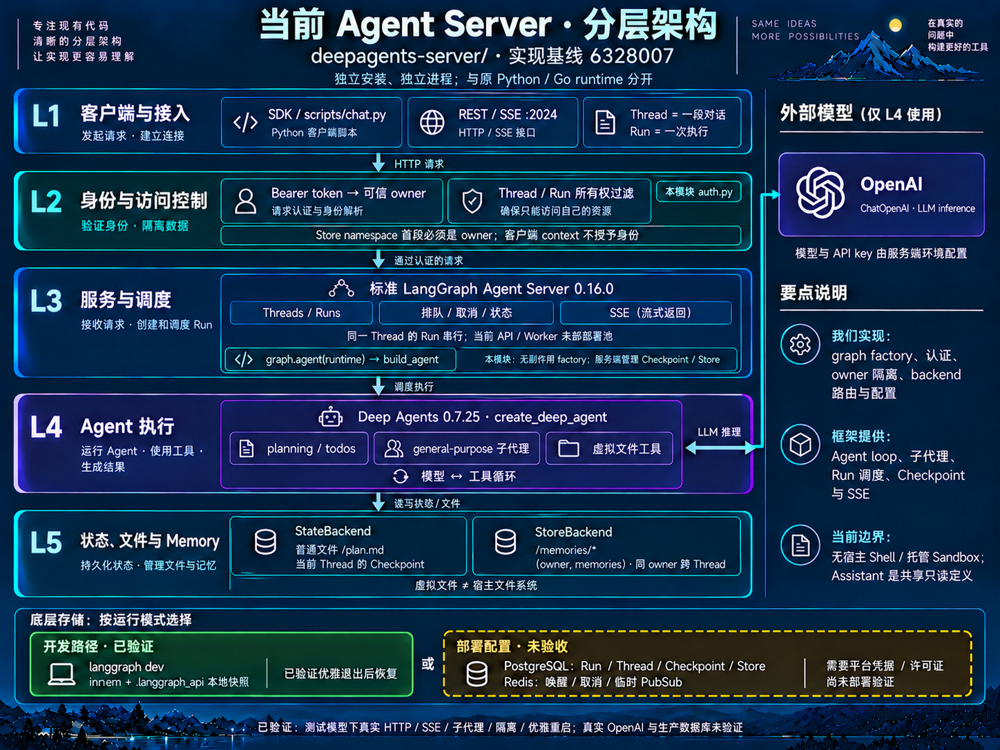

# Agent Server 分层架构

当前分层以实现 `6328007`、架构图 `9ba2a49` 为起点，加入异步长任务客户端与
API/Worker 分离部署。标准 Agent Server 管理 Run 调度与持久状态，Deep Agents 执行
模型和工具循环，本模块负责 graph、认证、用户隔离、存储绑定与长任务客户端。
这是 [README canonical architecture](../README.md#architecture) 独立模块泳道的展开，
原 Python/Go runtime 保持各自入口与语义。

本文展开标准 LangGraph 入口；独立 Temporal Task HTTP 入口见
[Task Server](TASK_SERVER.md) 与 [本轮独立分层图](../docs/audits/task-server-single-runtime-2026-10-17.png)。
两条入口各有自己的调度权威，不能把这里的 PostgreSQL/Redis 或 Store 直接视作 Task HTTP 的底座。

当前模块保留单一 `runtime.py:TaskWorkflow`，删除早期未生产使用的 v1；部署角色保持。
Task API 的 HTTP 层、任务编排、Temporal 后端以 `protocol.py` 为共同合同；
生产 Workflow 的确定性适配位于
`temporal_support/`，不依赖历史原型。构建与故障验收属于仓库 `tooling/`，原脚本保留
兼容入口。具体目录与扩展位置见 [项目结构](docs/PROJECT_STRUCTURE.md)。

Temporal 中的当前 Workflow type 仍为 `TaskWorkflowV2`，在安全的父 model 边界分段
Continue-As-New；这是持久协议标识，Worker 只注册一份当前实现。迁移载体是
保存在 Temporal History 中的完整 public saver 写日志，包括 DeltaChannel 祖先、
待执行路由、摘要私有状态及虚拟文件；不在下表 L5 增加第二套 SQL checkpointer。
API 的任务身份跨 Run 稳定，状态/结果/取消跟随经校验的执行链，事件保留每个 Run
独立序号并支持导航。单任务仍受原始 24 小时期限、512 个父 model 边界及 checkpoint
大小预算约束。详细协议与尚未验收项见 [Task Server](TASK_SERVER.md)。

`401e4d5` 已交付 Temporal Worker CLI 的进程生命周期边界：SIGTERM/SIGINT 调用 SDK
shutdown，宽限内排空已领取工作，宽限后交回可重试 Activity；硬期限和第二次信号
保证 CLI 有界退出。library `serve` 保持宿主进程所有权。Worker 停机不发送 Task
cancel；交接仍消耗原 Activity 尝试预算。此边界不改变下述标准 Agent Server 的
180 秒 graceful/210 秒容器配置，也不证明多机 HA 或旧 graph 自动升级。

`06a93d4` 增加 API/Worker 共用的 Temporal Client 连接配置层。CLI 从明确的环境变量
加载 TLS、CA、mTLS 证书对、服务名与 API key；library 的 Temporal 连接默认明文并忽略对应环境变量，
可由可信调用方显式传入设置。连接层是两个进程内部共用的代码，并非新的代理服务。
错误配置/握手失败拒绝启动且不降级；证书校验不能关闭，轮换需要重新创建 Client。
Task HTTP 的 Bearer→owner 校验与 Temporal 自身的认证/namespace ACL 独立。
本地 mTLS 隧道只用于故障验证，不替代原生 Temporal TLS、Cloud ACL 或生产 HA 验收。

`08b4333` 已交付独立 Task 镜像和 `launch api|worker`，同进程进入实际 CLI，分别读取 API
与 Worker 的 Secret 文件；固定的 Python 基础镜像和锁文件依赖构建经过源码核对的
发行 wheel。Compose 只读 root、非 root 身份、20 秒 stop grace，连接外部 Temporal。
`GET /readyz` 以 1 秒 singleflight RPC/缓存读取并核对 namespace 的 REGISTERED 状态；
`/healthz` 仍仅是进程 liveness。就绪不证明 Start 权限、Worker 槽或模型可用；
Compose 不因 unhealthy 自动重启。容器内 API 需要已有 ingress，镜像 pinning 不等于
Workflow 版本路由。真实容器验收发现并修复 Linux 空闲 selector 在 SIGTERM 后未
唤醒的问题：立即置位停止事件，再调用 thread-safe 唤醒，保留既有启动/硬退出语义。
最终同镜像两 API/两 fixture Worker 强杀替换后，两 Task 各 10 工具/1 CAN 完成；
默认生产 Worker 空队列正常停机，provider 未调用。命令与证据边界见
[Task 部署](TASK_DEPLOYMENT.md)。

## 从上往下读

| 层 | 回答的问题 | 当前实现 |
| --- | --- | --- |
| L1 客户端与接入 | 长任务怎样提交与观察？ | `scripts/jobs.py` / `AsyncJobsClient` 提交后返回可保存的 Thread/Run handle；状态查询、轮询等待、取消、显式续跑；SDK/HTTP/SSE 仍可使用 |
| L2 身份与访问控制 | 这个用户能访问什么？ | Bearer token → 可信 owner；Thread/Run 按 owner 过滤；Store namespace 首段必须匹配 owner |
| L3 API 与后台 Worker | 接入服务重启会不会带走执行？ | Compose 的 API 只接入、不执行；独立 Worker 默认两个槽，原生认领排队 Run；HTTP/SSE 连接不拥有任务生命周期 |
| L4 Agent 执行 | 怎样完成并保存任务进度？ | `create_deep_agent` 执行 planning、general-purpose 子代理、模型/虚拟工具循环；长任务客户端请求 sync Checkpoint durability |
| L5 持久状态与协调 | 哪些数据能够用于恢复？ | PostgreSQL 保存 Run/Checkpoint/Store；Redis 只负责临时唤醒、取消与事件；线程 StateBackend 文件和 owner StoreBackend memory 保持原作用域 |

Thread 是一段对话，Run 是其中一次执行。客户端每次提交默认新 Thread，独立 Thread
可并发；显式复用 Thread 则 enqueue 串行。Compose 将 API 与 Worker 拆为不同容器，
两者使用同一不可变 image、graph 注册和数据库。五层是职责，只有 API/Worker/PG/Redis
是此部署中独立的服务；本地 `langgraph dev` 仍是组合式开发进程。

## 一条长任务的路径

1. 客户端带 token 创建 Thread，再以 `durability="sync"` 提交后台 Run。认证验证 owner，模型输入和客户端 context 不能授予身份。
2. Agent Server 记录 Run 后返回 handle；任务并不等待 HTTP 客户端持续连接。PostgreSQL 是排队任务的持久来源，Redis 通知 Worker。
3. Worker 认领可执行 Run。不同 Thread 可占用不同槽，同一 Thread 的 Run 串行；无副作用 `graph.agent(runtime)` 构建 graph，不在 factory 创建业务资源。
4. Deep Agents 执行模型/工具步骤，Server 保存 Checkpoint 与执行状态。线程虚拟文件进入 Checkpoint，长期 memory 进入 owner Store。
5. 客户端可凭 handle 在另一进程查询或等待。等待超时或断线不会取消任务；显式 cancel 请求 checkpoint-preserving interruption。SSE 是实时观察，不是恢复所需的持久 token 日志。

`state` 返回 Thread 当前状态，可能已包含该 handle 之后的新 Run；判断单个任务结果应
读取 `status`。创建请求响应丢失会产生 uncertain submission，先按已知标识核对；
`request_id` 不是服务端原子去重键，也没有自动重新提交输入。

## 故障、重启与部署的边界

| 事件 | 恢复路径 | 限制 |
| --- | --- | --- |
| 客户端退出、网络断线、等待超时 | 保存 handle，重新连接并查询同一 Run | Run 生命周期不属于等待连接 |
| API 容器重启 | Worker 独立执行，API 恢复后继续读取 PostgreSQL 状态 | API 与 Worker 必须共享注册和数据底座 |
| Worker 优雅停止 | 180 秒退出窗口；Compose 210 秒后才强制终止；由原生调度处理剩余执行 | 不等于等待任意长任务全部跑完 |
| Worker 崩溃或部署终止 | 生产运行时依据持久 Run/Checkpoint 认领符合条件的未完成任务 | 真实 PostgreSQL/Redis 故障恢复尚待带许可证验收；本地快照证据不能替代 |
| Run 进入 error/timeout/interrupted | 操作者检查最新 Run 和未完成 Checkpoint，再以空 input 新建 continuation Run | 不把原消息重复加入对话；graph interrupt 需明确人工答案，通用 resume 会拒绝 |

默认 attempt 时间上限 24 小时，原生 attempt 总数上限 3。进程故障与终态模型/graph
错误不能统称为自动重试；耗尽后需检查错误并决定是否续跑。客户端 resume 的预检查
不能代替跨操作者原子锁；部署升级必须保持 graph/Checkpoint schema 和工具兼容，
以及稳定的 token→owner 映射与持久卷。不可兼容升级须迁移或先排空任务。

同步 Checkpoint 允许从已保存边界继续，未完成步骤可能重放。调用外部 API、支付或
发信等副作用不因此 exactly-once；增加工具前需要业务幂等和执行隔离。Worker 的
isolated loops 不等于 Sandbox。生产部署许可、数据库备份和容量验收仍由运营方负责。

## 两种文件作用域

假设 Alice 有 Thread A、B，Bob 有 C。

- A 的 `/plan.md` 属于 A 的虚拟状态，B/C 不会自动读取。
- A 的 `/memories/preference.txt` 进入 `(alice, memories)`，B 可读、C 不可读；namespace 来自 verified server user。
- `/memories/AGENTS.md` 可作为用户知识进入上下文，仍是不可信数据，不能改变身份或工具权限。不同 Thread 同时修改同一 memory 文件没有 CAS/事务合并保证。

当前都是 graph state/store 虚拟文件，没有宿主文件 backend 或 shell executor；即使
工具 schema 中出现 `execute`，backend 仍返回 execution unavailable。共享 Assistant
是只读定义，Thread/Run/memory 才是用户私有数据。Cron 拒绝访问；没有 Context Hub、
OAuth、Channels 或托管 Sandbox。

## 验证与制图证据

- [异步客户端](src/mini_loop_deepagents/jobs.py)、[任务 CLI](scripts/jobs.py)、[交互 SSE 示例](scripts/chat.py)。
- [授权](src/mini_loop_deepagents/auth.py)、[graph/model/backend 绑定](src/mini_loop_deepagents/graph.py)、[服务注册](langgraph.json)、[API/Worker Compose](compose.yaml)。
- [长任务运行约束及恢复验证](LONG_TASKS.md)；[交付记录](DELIVERY.md) 区分单元检查、真实开发 HTTP 与生产栈验收。
- `langgraph dev` 是 inmem runtime + 本地快照；生产 PostgreSQL/Redis 崩溃与部署恢复尚未验收。真实 OpenAI 推理也须在有 provider key 的环境另验。
- Built-in imagegen 维护 [模块架构图](docs/agent-server-layered-architecture.png)；精确 prompt 随交付证据保存。仓库 canonical Mermaid、Archify JSON 和生成 HTML 同步表达 API/Worker 分离，图不能用作生产恢复测试证据。
