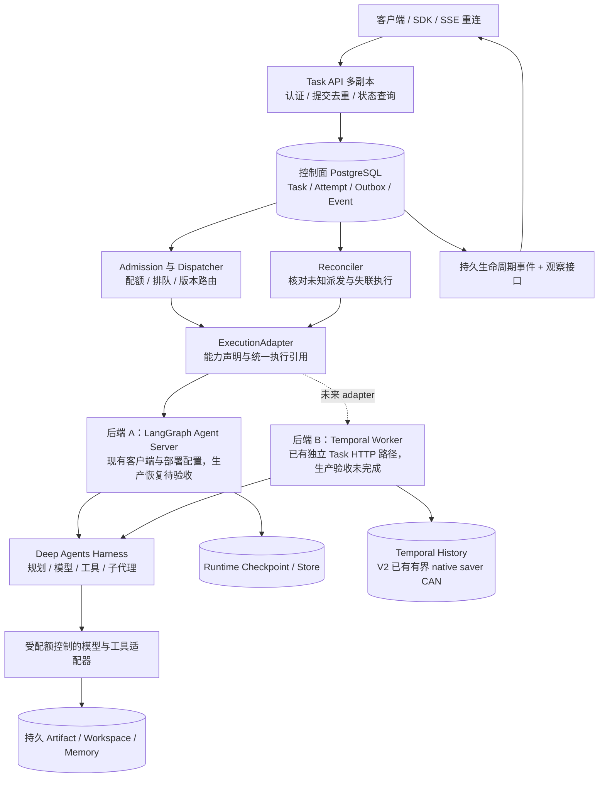
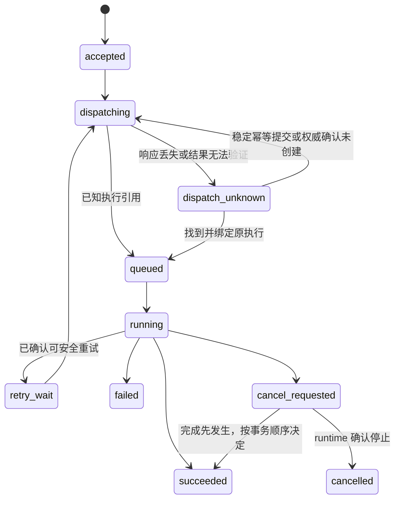

# Agent Server 多任务并发与故障恢复设计

## 结论先行

mini-loop 已新增独立、显式启用的 **Temporal Task HTTP 服务**：API 在远端 Start 确认后返回任务，Worker 运行真实 Deep Agents，状态与事件直接来自保留的 Workflow History。此阶段以 Temporal 为单一执行权威，复用已批准的 SDK 1.34.0；没有再建立业务 SQL 台账、Outbox 或第二套任务重试器。稳定 owner/key 在 History 保留范围内去重，模型 I/O 经 Activity，可脱离客户端和 API 进程执行。最终故障验收见 [Task Server 记录](../deepagents-server/TASK_SERVER.md)，源码存在本身不证明高可用。

`98de8d2` 已交付 TaskWorkflowV2 的有界 Continue-As-New：每 8 个安全父 model 边界携带完整 public saver 写日志进入下一 Run；原始 24 小时期限不重置，最多 512 个父 model 边界。原生摘要、子图与迁移 journal 的边界见下文，不能将它理解成无限长任务或所有模型调用的统一上限。

`401e4d5` 已交付 Worker CLI 的信号与停机入口：SIGTERM/SIGINT
触发 SDK shutdown，默认 2 秒宽限处理已领取工作，15 秒硬期限或第二次信号退出
专用进程；library `serve` 保持宿主所有权。Workflow 和 Activity 策略不变，交接
消耗原重试预算，不产生业务 Task cancel。固定 12 Task / 3 Worker 的本地
滚动机制验收已通过；这组结果不能推导生产容量或 HA。

本轮以 `401e4d5` 为审查基线，增加 API/Worker 共享 Temporal Client 连接层：
CLI 显式加载验证 TLS/mTLS、CA、服务名与 API-key metadata；library 默认明文且
不读环境安全变量，配置或连接失败不降级。它不改变 Workflow/CAN 或新增依赖。
Task HTTP owner 校验和 Temporal 原生认证/namespace ACL 分开；证书启动时加载，
轮换需要重建 Client。测试 mTLS 隧道只验证 SDK 到隧道的传输边界，不能等同于
Temporal 服务原生 TLS、Cloud ACL、跨主机 HA 或容量验收。

更完整的业务 Task 控制面仍是目标：永久接受台账、跨实例配额、业务状态投影、版本路由、外部副作用 fencing 和生产 HA/容量尚未完成。标准 LangGraph Agent Server 的 PostgreSQL/Redis 恢复验收也保持未完成。本文保留这些长期要求，同时区分已实现的直接 Temporal 路径与未来按业务需求引入的数据库层，避免把全部目标组件强制叠加成两个竞争的调度系统。

审查日期：2026-10-16。本文是目标架构与实施决策依据；“建议”和图中的目标组件均不表示已实现。Agent Server 与原 Python/Go 模块在业务、依赖安装和运行时上独立；既有模块仅提供设计参考，不共享会话管理或调度权威。它补充 [Managed Deep Agents / Agent Server 参考设计](MANAGED_DEEP_AGENTS_AGENT_SERVER_DESIGN.md)，当前模块使用方式以 [模块 README](../deepagents-server/README.md) 为准。

## 1. 证据基线与当前状态

本文区分四种结论：**事实**表示当前源码或官方资料直接支持；**推断**表示由证据推导、尚未复现的风险；**建议**表示拟采用的设计；**未验收**表示尚无覆盖相应部署环境的运行证据。

| 对象 | 固定基线或查阅范围 | 证据边界 |
| --- | --- | --- |
| 当前 mini-loop 模块 | `deepagents==0.7.25`、`langgraph-api==0.16.0`、`langgraph-cli[inmem]==0.4.35`、`langgraph-sdk==0.4.7`；来源为模块 `pyproject.toml` | 当前工作树包含本轮修改；类型和配置存在不等于生产能力已验证 |
| LangSmith Agent Server | 2026-10-16 查阅官方 Agent Server、data plane 与环境变量文档 [S1], [S2][S3] | 在线文档会变化，不能将新文档中的全部能力倒推为本地 0.16.0 已支持 |
| Temporal Python SDK | `1.34.0`，tag 指向 `a4c2bb38c3bad43498dfa6bd849e8d85bb684e94` [S4] | 已按批准安装为可选 extra；独立故障原型的结果见专门交付记录；Deep Agents 集成仍为 experimental |
| DBOS Python | `3.3.0`，tag 指向 `61426cb95bcd749dd18137b4eb483d02b9975d7d` [S11] | 固定版本候选；队列与恢复行为参考当天官方文档，未进行集成验收 |
| PostgreSQL | 16 系列的 SELECT 与 HA 官方文档 [S15], [S16] | 仅用来论证数据库原语与部署责任，与现有 Compose 的 PostgreSQL 16 对齐 |

### 1.1 已有实现与不能据此作出的承诺

| 当前文件或配置 | 当前事实 | 不能据此宣称 |
| --- | --- | --- |
| [jobs.py](../deepagents-server/src/mini_loop_deepagents/jobs.py) | `AsyncJobsClient` 提交原生后台 Run，返回可保存的 handle；等待超时不取消执行；默认新 Thread，不同任务可并发，共享 Thread 使用原生排队 | 业务 Task 已有持久台账、提交已经原子去重、任意失败都会自动恢复 |
| 同一客户端的 `_create_run` / `_write` | 提交指定 `durability="sync"`；写请求不自动重试；结果不明确时抛出 `SubmissionUncertain`；`request_id` 放在 metadata 中 | metadata 是服务端强制的幂等键；查询不到 Run 就证明创建未发生 |
| 同一客户端的 `resume` | 检查最新 Run 与未完成 Checkpoint，以 `input=None` 创建 continuation Run；拒绝需要人工答案的 graph interrupt | 检查与创建是跨客户端原子操作；重复 resume 一定只产生一个 continuation |
| [task_contracts.py](../deepagents-server/src/mini_loop_deepagents/task_contracts.py) | 纯数据类型、状态迁移校验、能力声明、fencing 谓词、事件游标和 `ExecutionAdapter` Protocol | 已有 Task HTTP API、数据库事务、租约服务、运行适配器或真正 fencing |
| [task_server/](../deepagents-server/src/mini_loop_deepagents/task_server/) | 新独立 Bearer Task HTTP 服务；Temporal 原生 Start/Describe/Result/Cancel/History；同 owner/key 的相同请求复用、不同请求 409；远端接受确认后 202 | 永久幂等台账、跨副本全局配额、跨后端统一 adapter 或生产 HA 已完成 |
| 同目录的 `runtime.py` / `worker.py` | v1/V2 Workflow 代码保持不变，Worker 同时注册两版；模型 Activity 经 Worker 环境解析为 ChatOpenAI | 真实 provider 已验收、自动版本路由或任意 graph 升级兼容 |
| `worker.run_process` / `lifecycle.py` | CLI 首信号显式 SDK shutdown；默认 2 秒 grace、15 秒 hard deadline，第二信号或超期退出 70；library `serve` 不接管进程信号/强退 | 退出 70 即证明任务已恢复、无限重试、信号后绝无 buffered Start、任意宿主进程可安全强退 |
| 同目录的 `runtime_v2.py` / `checkpoint.py` / `summarization.py` | V2 每 8 个安全父 model 边界 CAN；完整 public saver 日志保留 DeltaChannel 祖先、路由和摘要私有状态；累计 512 父边界、原始 24 小时及传输大小预算 | 无限任务、512 是所有模型调用上限、所有子图都被父 invocation 128 步限制、默认 Memory 或通用 graph 迁移 |
| [compose.yaml](../deepagents-server/compose.yaml) | 描述同一不可变镜像的 API-only 与 Worker 分离，连接 PostgreSQL/Redis，并限制小规模验证资源 | 已通过多副本部署、数据库故障切换或高并发容量验收 |
| [fault_smoke.py](../deepagents-server/scripts/fault_smoke.py) | 脚本覆盖独立客户端提交、两个并发 Run、排队、取消/续跑、owner 隔离，以及开发快照写出后的 SIGKILL 与进程替换 | 提交确认后立即崩溃的数据安全、生产 PostgreSQL 恢复、Docker 滚动部署或高吞吐能力已得到证明 |

开发故障脚本特意等待周期性 inmem 快照写出再强杀，并设置 `production_acceptance=False`。这是受限故障场景；本报告没有重新执行该脚本，也不将脚本存在当作通过记录。

`e67e174` 之后新增的 [Temporal 故障原型](../deepagents-server/TEMPORAL_PROTOTYPE.md)
与上述标准 Agent Server 路径分开：真实 Deep Agents 在 Workflow 中运行，模型与
Memory 分别进入 Activities，本地 SQLite 保存 History 与应用操作回执。固定版本、
真实故障结果、首次失败原因和资源证据由该记录维护；这不会把第 3 节的 Task 控制面
或第 9 节的生产 HA 设计变成已实现能力。

`1fd010d` 之后的 Task HTTP 路径直接使用 Temporal 作为任务接受和恢复权威，
不引入业务 SQLite，也不继承旧原型的 Memory ledger。`9af554a` 之后新增 V2：
在安全父 model 边界用完整 public saver 日志 CAN，协议与旧原型 snapshot 分开。
它保留 native channels、pending writes、task_path、DeltaChannel 祖先、路由和私有
摘要状态；迁移只从受信任 History 读取。原生摘要以 40 messages 或 16000 tokens
触发、保留 12 messages，时钟和 ID 由 Workflow 固定；原生 patch-tool slot 同时
保留父图与 GP 子图修复。旧 v1 代码仍注册，旧 key 按原版本摘要复用。专用故障
脚本与最终收据单独维护，旧原型或 v1 的通过结果不能自动覆盖 V2。

## 2. 从 LangSmith 借鉴的职责分离

**事实：**官方资料将 Agent Server 的 API、后台 Worker、持久数据和临时通信分开。Run 信息与核心资源保存在 PostgreSQL；Redis 用于唤醒、取消和流式通信。Worker 读取持久 Run，执行 graph 并写 Checkpoint；同 Thread 同时最多执行一个 Run。部署控制面与监听 desired state 的 data plane listener 也是不同职责。[S1], [S2]

**建议：**保留这个分层，同时区分两个控制面：LangSmith 的部署控制面负责“发布哪个应用版本”，本文的 Task 控制面负责“某个用户任务是否已接受、由哪个执行承载、何时可恢复”。两者可以协作，但不能互相替代。

增加 Worker 数量与每个 Worker 的执行槽能够扩大执行容量，但仍受模型配额、工具资源、数据库连接和内存限制。官方对 isolated loops 的说明也指出：隔离 serving event loop 不会消除阻塞代码本身的问题。[S3] 因此进程分离、事件循环隔离与工具 Sandbox 应分别设计和验证。

## 3. 目标分层与所有权

下图是**更完整的跨后端目标设计**，不是当前部署拓扑。当前已实现的 Task API 直接
调用 Temporal，并以其原生接受、调度和 History 为权威；下图中的业务 PostgreSQL
台账、Outbox、dispatcher、reconciler、全局 admission 和独立事件投影尚未实现。
是否需要这些额外业务组件应由永久保留、配额和跨后端需求决定，不能与 Temporal
重复争夺同一个执行的重试权。当前拓扑见 [Task Server](../deepagents-server/TASK_SERVER.md)。

| 层 | 负责 | 权威状态与边界 |
| --- | --- | --- |
| Task API | 验证身份、接受任务、提交幂等、查询、取消请求、审批输入 | 只有持久接受事务成功后才能返回已接受；不在 API 进程中维持任务存活 |
| Task 台账 | 业务任务、尝试、输入摘要、版本、状态与恢复决策 | 业务生命周期权威；不能仅根据 HTTP 超时推断 runtime 终态 |
| Admission / Dispatcher / Reconciler | 容量控制、可靠派发、核对和安全恢复 | 控制调度，不成为第二个 graph/checkpoint 写入者 |
| ExecutionAdapter | 将 task/attempt 映射到 runtime ID，提交、读取、取消、恢复与核对 | 显式声明不能保证的能力；不能用统一接口掩盖语义差异 |
| Runtime | 独占执行、checkpoint、执行版本兼容与恢复 | LangGraph profile 由 runtime 管 Checkpoint；Temporal profile 由 workflow history 管重放 |
| Harness 与工具 | Deep Agents 推理循环、规划、子代理、工具业务 | 不承担跨实例队列；外部副作用须有独立幂等与权限协议 |
| 数据底座 | Task/Event、runtime 状态、Artifact/Memory、备份恢复 | 可用独立 schema 或数据库隔离；不能直接修改托管 runtime 的内部表来补事务 |

同一任务只能选择一种 checkpoint 权威。不能让 Task 控制面与 Agent Server 同时认领并写同一个 graph；也不能在 Temporal Workflow 内直接使用进行数据库 I/O 的 LangGraph saver 来叠加第二套恢复机制。

## 4. 任务、尝试与身份

### 4.1 业务身份与执行身份分开

| 标识 | 生命周期 | 建议用途 |
| --- | --- | --- |
| `task_id` | 一次用户业务任务始终稳定 | API 返回值、状态与事件查询、业务取消 |
| `attempt_id` | 每次执行尝试不同 | 诊断、资源计费、重试与执行隔离 |
| `execution_id` | 具体 runtime 执行的原生身份 | Agent Server Run ID 或 Temporal Workflow 执行引用；同时保存 backend 和 scope |
| `logical_operation_id` | 某个业务操作在重试和恢复间稳定 | 副作用的幂等身份基础，不能每次改成新 attempt ID |
| `epoch` / `worker_id` | 当前尝试的写入权威 | 拒绝过期 worker 更新受保护状态 |
| `request_id` | 当前调用链的核对标识 | 日志与 runtime metadata 关联；不自动获得去重能力 |

现有合同明确分开 task、attempt 与 logical operation。未来一个 Task 内有多个外部动作时，还应派生稳定的子操作标识，例如 `(logical_operation_id, operation_name, operation_ordinal)`，避免把整项任务的一个 key 误用于不同外部动作。

**建议：**认证层从可信 token/身份服务得到 `tenant_id` 与 `user_id`，规范化为不可歧义的 owner scope，写入持久任务及适配器授权上下文。当前代码仅有 `owner: str` 和 token→owner 映射；并不存在已实现的 tenant 配额或租户管理服务。模型输入、用户提供的 metadata/context、memory 和 handle 都不能授予身份。

所有查询、取消、审批、事件回放和 Artifact URL 都必须检查相同 owner scope。密钥保留在执行 worker 的受控环境或凭据服务，不进入 Task 输入、Workflow 参数、日志或事件。长任务恢复后也要重新校验当前权限；已有任务并不意味着权限永不过期。

### 4.2 持久接受与提交幂等

建议一个数据库事务完成：

1. 在 `UNIQUE(owner_scope, idempotency_key)` 下确定唯一 Task；key 的保留期必须覆盖声明的客户端重试期。
2. 对规范化输入、graph/model/tool 配置与版本引用计算 `payload_sha256`。同 key 同摘要返回原 Task；同 key 不同摘要返回冲突。
3. 同事务写 `accepted` 状态、待派发 Outbox 和持久生命周期事件。
4. 事务确认成功后才返回 Task handle。API 副本重启不丢任务，也不依赖客户端持续在线。

当前 `admission_decision` 只给出 `create/reuse/conflict` 判断；先查询再插入不能串行化竞争，唯一约束与事务必须由未来存储实现提供。重复 Task 提交去重，也不等于外部工具副作用去重。

**当前 Temporal 路径的不同选择：**TaskID 是 owner 与 Idempotency-Key 的稳定摘要，
也是 Workflow ID；原生 `REJECT_DUPLICATE` / conflict `FAIL` 负责接受竞争，API 再核对
owner、请求摘要、版本与队列。新任务默认 V2；同 key 重试旧 v1 时，用旧版本摘要
确认同内容并复用，不能悄然创建新 V2。已确认 Start 或核对到同内容执行才返回 202。这里没有
业务数据库与远端 Start 的双写事务，因此不需要另一个本地 Outbox；代价是关闭执行
的去重、结果读取和事件读取受 namespace retention 约束。若以后要求保留期之外的
永久幂等，须显式设计长期台账与一致性协议，不能直接宣称当前方案已提供。

## 5. 派发不确定性、恢复与终态

### 5.1 `dispatch_unknown` 是必要业务状态

数据库 Outbox 与远程 runtime 创建操作之间没有共享事务。如果远端已经接受 Run，dispatcher 却在收到响应前崩溃，控制面不能知道创建是否发生。Outbox 提供可靠重试机会，不会自动使远端调用幂等。

这是目标状态机的主路径；超时、审批等待及运维终止还需在实现时补齐协议。现有合同中已有部分状态与迁移校验，并未实现上图服务。

当前 `LANGGRAPH_AGENT_SERVER_PROFILE` 保守声明 `idempotent_submit=False`、`authoritative_absence=False`、`checkpoint_owner="runtime"` 和 `checkpoint_durability="architecture_available_unverified"`。这是当前客户端可证明的能力边界，并非断言所有 Agent Server 版本都不可能提供额外能力。

`request_id` metadata 可以帮助找到正向匹配；一次列表查询没有结果、分页尚未扫完、查询被权限过滤或短暂不可见，都不足以证明远端未创建。adapter 只能返回 `found/absent/unknown` 中有证据支持的结果。无原子幂等或权威 absence 证明时保留 unknown 并等待核对，不自动再次发送原输入。

当前 Task HTTP 路径没有实现上面的独立 `dispatch_unknown` 业务台账：Start 结果未知
时返回 503 `submission_unknown`、稳定 TaskID 和 `outcome=unknown`；客户端可
核对该 TaskID，或在保留期内以相同 key/正文重试。未知不被伪装成接受成功或创建失败，
也不派生另一 Workflow ID。该能力与标准 Agent Server 的 metadata 核对语义不同。

### 5.2 恢复、失败与取消是不同事件

- **进程失联：**先核对 runtime 是否仍在执行，不能把控制面 lease 到期直接当作远端已经停止。若 runtime 自身支持崩溃认领，应让它恢复同一原生执行。
- **原生执行失败：**Run 的 error 不自动等同于业务 Task 的最终失败。根据错误分类、剩余预算和 checkpoint 决定进入 `retry_wait` 还是结束 Task；模型拒绝、无效输入、权限失败、程序错误与短暂网络错误不能统一无限重试。
- **显式续跑：**尚未终结的 Task 可以产生新 runtime Run 和新 Attempt；保留之前的错误和执行引用，不重复追加原始用户消息。Task 一旦进入终态不可复活；之后人工重试应创建有 `retry_of` 关联的新 Task，并明确副作用 key 的复用规则。该关联字段尚未加入当前纯合同。
- **取消：**先持久记录请求，再请求 runtime 中断。只有确认后才能声明停止；取消与成功竞争用数据库条件更新决定终态，过期 attempt 不得复活 Task。
- **人工审批：**持久保存等待内容、决策身份、版本和决策幂等键；等待时不占用昂贵执行槽。当前通用 `resume` 主动拒绝 graph interrupt，不是完整审批实现。

## 6. Lease 与 fencing 的真实边界

**建议：**控制面 claim 时在短事务中生成新的 `epoch`、`worker_id` 和 `lease_expires_at`，以数据库时间判定到期；续约与受保护写入须原子检查当前 ownership。不能在整个数小时任务期间持有数据库事务或行锁。

写 Task 状态、Attempt 结果、事件及受保护 Artifact 指针时，条件必须包含 task、attempt、epoch、worker 与未过期 lease，并与实际更新处于同一事务。比较失败表示执行已经失去写权限，应停止继续提交结果。当前 `fence_allows_write` 只是纯谓词；调用前后各检查一次仍有竞争窗口。

**事实：**DBOS 官方的 ownership token 设计也将 checkpoint 写入与 token 检查放在同一事务，过期 executor 在下一次 checkpoint 停止。[S14] **推断：**这提供了可借鉴的本地存储保护思路，却不能隔空撤销已经发出的 HTTP 请求。

必须分别证明三种保护：

| 保护对象 | 必须由谁落实 |
| --- | --- |
| Task 台账 / Outbox / 持久事件 | 控制面数据库条件写入 |
| graph Checkpoint / runtime 排他执行 | runtime 自身的 lease、锁和写入协议；控制面的 epoch 不会自动传入并生效 |
| 外部副作用、文件系统和工具服务 | 对方支持的幂等键、条件版本写、fencing token 或可验证结果核对 |

因此不得在旧 runtime 执行可能仍活着时，仅凭 Task lease 到期新建第二个执行。若无法证明停止或安全幂等，进入 unknown；不要以“自动恢复”掩盖双写风险。外部动作失败后如不能判断是否成功，应记录操作级 unknown/回执待核对，而不是只重跑整项任务。

## 7. 事件、文件和 Memory

建议区分持久生命周期事件与短期实时流：

- `TaskEvent(task_id, ordinal)` 作为可回放游标，状态变化与事件在同事务写入；客户端在重连时从已确认 ordinal 继续，消费方按游标去重。
- token/chunk 采用独立 `StreamSequence`、保留时间和 attempt 标识。中断时明确告知缺口；最终结果和关键业务事件不依赖 token 流完整。
- 不宣称逐 token exactly-once。慢消费者、网络重连和重试可能造成重复或缺失，应将实时观察与审计日志分开。
- 大型 Artifact 保存到可跨 worker 访问的持久存储，台账保存 owner、内容摘要、版本与引用。进程本地目录只能是可重建缓存；若未来引入 Sandbox，恢复协议还要包含 workspace 身份和挂载策略。
- 线程文件、跨线程 Memory、输入快照和工具版本是不同生命周期。恢复 graph 不意味着本地文件自动重建，也不意味着 Memory 已原子更新。

当前 `EventCursor` 与 `StreamSequence` 的类型区分只是一项合同，未接入事件数据库或 SSE 回放服务。现有 `/plan.md` 等线程虚拟文件由原生 Checkpoint 保存，`/memories/` 经 owner Store 路由；换 runtime 时须显式迁移其语义。

Task HTTP 服务提供保留 History 的单 Run 倒序分页，返回 event_id、事件类型和时间。
签名 cursor 绑定 namespace、owner、TaskID、RunID 与事件边界；API 副本共享固定
secret，重启后可续页。V2 支持可选 `run_id` 与经过 chain/owner/memo 核对的
first/previous/next 导航，每个 Run 的 event_id 独立。相邻 Run 因 retention 消失时
显式 `history_navigation_incomplete=true`，不能把不完整链拼成连续任务事件。
没有新增事件数据库或逐 token/SSE 重放。V2 的 native saver public 写日志通过 CAN
携带完整路由和私有状态；owner Memory 仍未启用。旧原型证据不自动覆盖这条路径。

## 8. 高并发：准入、背压与容量

高并发包括可接受的积压任务、同时运行任务和 API/SSE 连接三种容量，不能用一个 worker 槽数替代。建议按下面维度分别建立预算：

| 预算 | 目标行为 |
| --- | --- |
| API 请求和连接 | 限制提交速率与 SSE 连接，查询不被执行流量拖垮；提交拒绝时保持可重试语义 |
| 全局及 owner 运行数 | 跨副本计数与认领原子化；某个 owner 的积压不会独占全部执行槽 |
| Thread 并发 | 共享线程默认单写；独立任务使用不同 Thread；扩容不突破线程一致性 |
| 模型 provider / credential / model | 统一请求数、token 速率与预算；主 agent、子代理和重试共用额度 |
| 工具 / Sandbox / 数据库 | 分别限制 I/O、CPU、内存、连接数和外部服务速率；隔离阻塞任务 |
| 重试 | 指数退避、抖动、尊重上游退避信号；限制最大尝试、总时长与总成本 |
| 队列与事件 | 积压上限、最老任务年龄、事件保留期；超限时返回明确背压，不无限占内存 |

Worker 数量扩大后，全局预算不能随进程数等比例扩大。不要同时开启 SDK、工具、runtime、控制面多层独立无限重试；每一层的重试范围和总预算必须可观察。Temporal 官方同样要求 Activity 按可能重复执行设计，而不是把最终完成记录当作副作用只发生一次。[S7]

建议以 pending 的最老年龄、可执行 backlog、执行槽利用率、provider 429、数据库池等待、checkpoint 写延迟和 worker RSS 决定扩容；单看 CPU 容易漏掉 I/O 等待。容量结论必须附任务分布、上下文大小、子代理数量、provider 配额和持续测试时间；目前没有测得可以承诺的并发量或吞吐 SLO。

## 9. 发布版本、RPO/RTO 与运维责任

### 9.1 长任务必须保存可恢复的版本

Task/Attempt 应记录不可变应用镜像或构建摘要、graph ID、状态 schema 版本、工具协议版本、模型配置引用和执行后端版本。密钥引用可以轮换，密钥值不进入快照。

兼容升级可以恢复旧 checkpoint；不兼容升级应让旧 worker 池排空、保留旧版本，或执行显式迁移。API 与 Worker 使用同一镜像只解决同批部署的一致性，不证明所有旧任务都与新 graph 兼容。不能在旧任务尚未完成时删除它唯一可用的执行版本。

当前 V2 通过新 Workflow type 与不变 v1 同时注册保留旧任务；旧 key 仍核对旧版本。
这只处理此次显式协议分叉，不是通用 Worker Versioning、镜像路由或任意版本迁移。

**事实：**Temporal Worker Versioning 提供版本路由与 Workflow pinning，需要符合版本要求，并采用支持旧版本并存的发布方式；长生命周期任务还需要适当的 Continue-as-New 或兼容策略。[S8] DBOS 也区分 patching 与应用版本，恢复时匹配版本并建议保留旧进程排空。[S13] **建议：**不要将这两种产品能力预先写成 mini-loop 的部署功能。

本轮明确补上进程停机边界。固定 SDK 的 `graceful_shutdown_timeout` 只有在真正
调用 shutdown 后才进入排空过程，不能因为配置了 2 秒就宣称 SIGTERM 会优雅交接。
SDK 停止新轮询、处理已领取/缓冲工作，宽限到期后取消未完成 Activity。[S17]
本地 1.34.0 Core 将 WorkerShutdown cancellation 转成 retryable failure；重试仍
消耗原 Activity 最多 3 次尝试，耗尽可能让任务失败。吞 cancellation 的 Activity
可使 SDK 等待，因此 CLI 用独立硬期限退出 70，再由原生 timeout/heartbeat 恢复。

`run_process` 只拥有专用 Worker 的信号和硬退；异步库 `serve` 仅接收 stop event。
替换 Worker 必须兼容同一队列上的历史执行；先启动兼容替代进程，再停止旧进程。
这提供兼容代码的进程替换入口，不提供自动 graph 迁移或版本路由。正常排空、
宽限后交接、硬退后恢复与多任务背压需要各自的运行证据。

### 9.2 持久执行不等于数据库已经高可用

| 指标或责任 | 本设计要求 |
| --- | --- |
| 接受任务的持久性 | 明确“已接受”对应的数据库提交及复制条件；故障后核对已返回 handle 的任务 |
| RPO | 分别定义已接受 Task、checkpoint、Memory、Artifact 与事件可能丢失的窗口；不能用 checkpoint 模式替代数据库复制策略 |
| RTO | 拆为故障检测、接管、排队等待、版本加载及恢复点重放时间，并通过故障注入测量 |
| 数据库 HA | 主备复制、自动切换、连接重建、旧主 fencing、备份与恢复演练；异步复制可能丢失最近提交 |
| Redis | 声明哪些唤醒和流可能丢失；从持久状态重建任务，不将 Redis PubSub 当唯一真相 |
| 集群和区域 | API/Worker 副本分散故障域；跨区域恢复与单机进程重启是不同级别的验收 |

PostgreSQL 的 HA 文档说明了复制与故障切换的多种选择。[S16] 本文不假定选型已经完成，也不捏造“零丢失”、恢复秒数或可用性百分比；目标值需要结合部署成本、复制方式与实际测量确定。

## 10. 四种执行方案的选择

| 方案 | 已有官方能力或原语 | 需要承担的工作 | 本次建议 |
| --- | --- | --- | --- |
| LangGraph Agent Server + PostgreSQL/Redis | 原生 Run、后台 queue、Checkpoint/Store、取消、线程单写 [S1], [S2] | 适用许可、生产故障验收、Task 接受去重、未知派发核对、跨实例配额、版本兼容 | 保留为现有适配目标；不以开发 inmem 结果替代生产持久性 |
| Temporal + Deep Agents | 持久 Workflow/Activity、worker 拉取与重试、版本路由；官方 Deep Agents 插件 [S5], [S7][S8], [S9] | 独立服务运维；实验插件兼容、完整状态迁移、版本路由、业务权限与全局配额 | 已批准并实现隔离原型与 opt-in Task HTTP 路径；不替换标准 runtime，生产 HA/容量仍待验收 |
| DBOS + PostgreSQL | Workflow/step、持久队列、全局与单 worker 并发/起始速率、应用版本 [S11], [S12][S13] | 无 Conductor 的分布式部署需管理 executor ID 与恢复；仍需工具幂等、权限、配额和数据库 HA | 较轻的备选；不能概括为“只加 PostgreSQL 就自动分布式 HA” |
| 自建 PostgreSQL 任务队列 + LangGraph | `SKIP LOCKED` 可降低多个消费者在队列表上的锁竞争 [S15] | 自己实现 lease、fencing、扫描恢复、取消、事件、配额、公平性、版本与运维 | 仅在约束明确、成熟方案不适用时选择，不把取锁原语包装成完整恢复保证 |

Temporal 也需要持久服务与数据库；官方将服务拆为可独立扩展的 Frontend、History、Matching 等职责。[S10] 因此它可以减少自建工作流协议，却不会免除运维。DBOS 的恢复检测同样是需要明确归属的控制面职责。[S12]

### 10.1 Temporal experimental 集成的三个迁移风险

以下核对的是 SDK `1.34.0` 固定提交，不是对所有未来版本的判断。

1. **Checkpoint 权威不同。**插件让 agent 控制循环运行于 Workflow，真实 I/O 通过 Activities。源码对进行数据库/磁盘 I/O 的 checkpointer 发出警告：这种 I/O 不应直接发生在重放中的 Workflow。不能原样注入现有 PostgreSQL LangGraph saver；需在该 profile 中明确以 Temporal history 负责重放，另定义线程状态读取接口。[S5], [S6]
2. **Continue-as-New 没有自动保存整个 AgentState。**固定 `run_deep_agent` 用 pending todos 判断是否继续，但创建的 snapshot 主要包含 `messages`；没有自动复制所有 files、todos、自定义状态或 saver 内部数据。不能仅按 README 的宽泛描述宣称 `/plan.md` 与 Memory 已完整迁移。需定义完整序列化/恢复协议，并测量历史和 payload 增长。[S6]
3. **Backend 对象注册是进程内状态。**固定 `TemporalBackend` 把 backend ref 放进当前进程字典；backend Activity 查不到 ref 时返回不可重试错误。**推断风险：**多 worker 共用队列时，Activity 若落到没有该 ref 的进程，可能无法执行；尚未在本项目复现，不能称为已确认缺陷。必须验证跨进程派发与原 worker 消失，或使用以 owner/workspace ID 重新定位持久资源的自定义 Activity，不能把进程字典当作可迁移存储。[S6a], [S6b]

此外仍要核对当前模型实例、owner Store、认证上下文、子代理和 streaming 的适配；Temporal 的 Workflow ID 去重不能替代 provider 对外部副作用的幂等。技术验证成功前不发布通用兼容或生产 HA 承诺。

## 11. 分阶段实施与完成判据

### 阶段 A：固定业务合同和架构边界

当前 `task_contracts.py` 是这一阶段的基础。继续明确 owner scope、payload 规范化、Task 状态、能力标记、unknown、事件与 stream 的分离。单元测试可以证明纯判断符合合同，但不能证明持久性、并发互斥或跨进程恢复。

完成判据：每个 adapter 能力都附证据等级；文档与 API 命名不将 metadata 当幂等键；未知派发和失联执行没有不安全的自动重投路径。这个阶段不需要新增依赖。

### 阶段 B：隔离 Temporal 技术验证

2026-10-16 用户已批准固定 `temporalio==1.34.0` 与本地临时 Temporal 服务的独立故障原型。
目前已实现独立 Worker、完整状态 Continue-as-New 协议与本地故障脚本；
[原型记录](../deepagents-server/TEMPORAL_PROTOTYPE.md) 区分运行结果和未覆盖项。
批准覆盖该技术验证，不等于生产后端已经完成选型或验收。DBOS 或其他新增依赖仍需另行批准。
验证后端与现有生产 profile 分开，固定版本，不改变现有默认路径。

验证任务至少覆盖真实 Deep Agents 控制循环、两个独立任务、多进程 Worker、模型与工具 Activity、owner 隔离、进程强杀、版本并存、Continue-as-New 与完整虚拟文件/Memory 恢复。模型可以先用可计数的确定性假服务建立故障证据；真实 provider 的速率和成本行为另验。

完成判据：第 10.1 节三项风险有当前版本的明确结论和可复现日志；无进程对象依赖；副作用重试符合幂等协议；不能仅凭 hello world 或同进程重启通过就晋升为默认后端。

### 阶段 C：实现持久 Task 控制面

**已实现的切片：**独立 Task HTTP API + v1/V2 Workflow Worker，直接以 Temporal
作为保留期内的接受与执行权威。同 owner/key 竞争依赖原生 Workflow ID 约束；请求
摘要不匹配为 409，确认远端 Start 或核对到同请求才返回 202。状态、结果、取消与
签名事件分页都经过 owner 校验；没有新增业务数据库依赖或本地 Outbox。

已提交 `9af554a` 的 v1 历史基线：2026-10-16 专用故障运行
`792fc91351654e1ba8ff5f3b7fa35c32` 的 **8 组通过**：
覆盖双 API 同 key 竞争、独立提交进程退出、两个真实 Deep Agents 任务、多 Worker、
全部 API 替换、同 SQLite Temporal 重启及 Worker 冷重放、owner 隔离、事件续页和
取消隔离。另以真实循环任务触发 128 步上限：43 个模型 Activity 完成后 Workflow
进入不可重试的 `task_step_limit` 失败，HTTP 返回 `failed/ready=true`，没有
WorkflowTaskFailed 重试循环。完整收据、源码摘要与测试范围见
[Task Server](../deepagents-server/TASK_SERVER.md)。该结果只证明这组本地机制场景。

已交付 `98de8d2` 的 V2 在源码层补充了安全父 model 边界 CAN、native saver public 写日志迁移、
原生摘要确定性及跨 Run 状态/结果/取消/事件观察。迁移分别限制 16 MiB raw journal、
384 KiB compressed checkpoint 和 512 KiB continuation envelope，超限进入明确失败。
原始 24 小时总期限不重置，512 只计父 model 边界；原生 GP 子图仍为 9999 步，
父图每次 invocation 为 128 步。CAN journal 累积写日志，并非恒定状态大小。新的
`task_can_fault_smoke.py` 运行 `caffa4578ab348a3bc7198eb430bcbfb` 已通过 4 组：
4 次 CAN / 5 个 Run、37 个父工具步骤、2 个真实 GP 子代理与 2 次原生摘要。
子 Activity、CAN 前后及第三次 CAN 后注入 Worker/API/Temporal 强杀，恢复后的
完整语义状态与模型请求摘要一致；5 Run 都为 0 WorkflowTaskFailed。旧 Run cursor、
chain 导航、同 key 复用、owner 边界与第二项 continued Task 的取消隔离已覆盖。
耗时 45.86 秒、峰值 797.3 MiB、最低可用内存 37%，19 个所属进程全部退出。
模型仍为确定性 fixture，持久服务仍是本地 SQLite；这是机制验收而不是生产 HA。

同一 V2 历史基线另通过 HTTP 8 组回归 `d252d1bc60c9470b84747c5dcbda28bc`，包括原生 Start
创建 v1 后的 HTTP 复用/409/404 与原 128 步失败终态。完整范围、资源证据和门禁
见 [Task Server](../deepagents-server/TASK_SERVER.md) 及其交付记录。

`401e4d5` 在相同 v1/V2 Workflow 上补进程停机：`worker.run_process` / `lifecycle.py`
显式接入 SIGTERM/SIGINT、SDK drain 和有硬期限的专用进程退出。真实运行
`7058dd0bb0f84158bb1d8a76155b59e4` 已通过 4 组：12 Task / 3 owner / 3 个单
Activity 槽 Worker / 2 API，初始 3 Activity 执行、9 项原生排队；替换 Worker 承接
原 9 项，全部任务成功、各 10 个真实工具步骤与 1 次 CAN。

三次 SIGTERM 分别覆盖宽限内完成（退出 0）、配合 cancellation 后交接（退出 0）、
吞 cancellation 后硬退出（退出 70）。试验用 grace 1 秒/hard 5 秒，默认仍是
2/15 秒；硬退出实测 5.087 秒。两项重试都保留 Activity/Run/request SHA，attempt
1→2，未耗尽原 3 次预算。134 个模型执行区间为 132 完成、1 配合取消、1 进程退出，
最大同时执行 3。API admission 真正返回 429 后原生 Workflow NOT_FOUND，同 key
重试可接受；owner 隔离与跨副本重试均有验证。源码中的 buffered Start 可能性保留，
没有以“signal 后零开始”代替真实 slot/交接观察。

此运行耗时 20.95 秒、峰值 1059.5 MiB、最低可用内存 47%，45 个所属进程全部退出。
它是固定规模、离线模型、单机 SQLite 的机制验收，不是 provider 429、吞吐 SLO、
全局租户配额、生产 HA 或跨版本升级验收。详细证据见
[Task Server](../deepagents-server/TASK_SERVER.md)。

本轮新增共享连接配置，按固定 SDK `TLSConfig` 和 `Client.connect` 接口实现。
`MINILOOP_TASK_TEMPORAL_TLS` 缺省 false，安全字段必须显式配合 true；支持自定义
CA、成对客户端证书/私钥、`domain` 服务名与 API key。`domain` 同时影响 SNI、
HTTP/2 authority 与默认证书校验名，没有关闭验证的开关。[S18] 只有两生产 CLI
读取环境，库调用要求显式 settings，连接工厂以 10 秒预算 eager connect；文件受
普通文件/大小约束，固定错误码不带原始异常。一次连接不证明全部 RPC 权限。

Temporal 服务端 frontend TLS、internode TLS 和认证/授权插件有各自配置，[S19]
本轮客户端配置不代替这些部署工作。证书读取一次，轮换必须重建 Client/滚动替换；
HTTP Bearer owner、Temporal namespace ACL 与 History 静态加密分别是独立边界。[S20]
本地 stdlib mTLS 隧道接 loopback dev Temporal 仅是故障设施，不进入生产组件图。
实际故障运行 `cfdf11707eb142be9c8af50e11cb5dae` 的 3 组通过：错 CA、错服务名、
缺客户端身份和不受信任身份被真实 SDK 拒绝，每项前后都有 fresh RPC 成功控制；
强杀并同端口恢复隧道后，HTTP 短暂返回 503，6.133 秒后两个原 API、两个原 Worker
及 observer 重连。业务进程 PID 保留，门控点完整 native 状态与 Task/Run/Activity
身份和请求摘要一致。两项 V2 Task 最终各 10 个真实工具步骤和 1 次 CAN，四个 Run
为 0 WorkflowTaskFailed；22 个原生模型 Activity 产生 24 个尝试记录。离线后检确认
两个门控 Activity 由原两个 Worker 互换承接，attempt 1→2，保留相同原生身份、
step 与 request SHA；不是全程同 attempt，也不是外部模型 exactly-once 保证。

耗时 13.8 秒，采样峰值 822.0 MiB、最低可用内存 43%，23 个所属进程全部退出。
四份 Run History 和 23 份进程日志的测试凭据扫描匹配为零；这只覆盖所用测试凭据。
本轮证明 SDK 到测试隧道的传输和中断恢复；合成 API key 只覆盖 metadata 配置，
没有验证原生 Temporal 服务 TLS、真实 Cloud ACL、跨机 HA、生产轮换或容量。
完整回执与局限见 [Task Server](../deepagents-server/TASK_SERVER.md)。

**阶段 C 仍未全部完成：**永久业务台账、全局 admission/owner 配额、跨后端 adapter、
自动版本路由与外部工具副作用协议仍无实现。未来引入业务 SQL 时，必须先确定其
权威范围与 Temporal 的衔接，不能用新 dispatcher 重复执行同一个 graph。

完成判据：声明保留期内的已接受任务经实际持久存储竞争和故障测试不消失；未知创建
不能重复执行；跨用户数据不可访问。永久重试期、配额、公平性、旧版本排空和业务
副作用保护分别验收，不能从当前局部通过推定整阶段或生产 HA 已完成。

### 阶段 D：生产 HA 与容量验收

在真实许可证/运行时、持久数据库、至少两个执行进程和目标部署方式上进行故障注入；记录版本、命令、故障时间线、Task/Run/attempt 标识、恢复点、外部操作回执、资源峰值和未覆盖项。

完成判据：通过下面与目标 backend 相关的全部场景；RPO/RTO、吞吐和配额表现有测量，滚动升级/排空策略可重复执行。测试本身需遵守仓库 CPU/内存预算，重负载串行进行，不能在 16 GB 开发机上无界扩容。

## 12. 故障验收矩阵

这是未来实现必须证明的目标，除特别说明外均未在生产栈验收。

| 场景与注入点 | 必须观察的结果 | 当前证据边界 |
| --- | --- | --- |
| 两个 API 副本同时提交同 owner/key | 同 payload 只有一个 Task；不同 payload 冲突；事件和 Outbox 不重复创建 | Task HTTP 本地双副本竞争已验收同请求复用/不同请求 409；无独立 Outbox，去重受 Temporal retention 约束 |
| 数据库提交前 API 崩溃 | 不返回已接受；重试可安全创建 | Task API 只确认远端 Start；该精确崩溃点尚未故障注入 |
| 提交后、派发前 API 崩溃 | 已返回 handle 的任务仍存在，Outbox 可继续派发 | 本地测试全部 API 替换后 handle 保留；直接 Temporal 路径无本地派发/Outbox 间隙 |
| 远端 Run 已创建、响应丢失 | `dispatch_unknown`；核对/绑定原执行或有证据的幂等重投；不能盲目重复输入 | Task API 未知结果 503 与稳定 TaskID 已实现；精确断响应故障仍待注入；标准客户端保留 `SubmissionUncertain` |
| 完成 checkpoint 后 worker SIGKILL | runtime 在另一个执行进程恢复；Task 仍绑定正确执行；已完成步骤符合恢复协议 | Task HTTP 本地 Temporal/Worker 强杀与冷重放已通过；不证明生产 PostgreSQL 或多机 HA |
| 未 checkpoint 的外部动作成功后 worker 崩溃 | 重试复用稳定逻辑操作 key，或核对回执；不会无依据宣称只调用一次 | 当前没有此类外部工具验收 |
| lease 过期后旧 worker 恢复 | 旧 epoch 的受保护数据库/Artifact 写入被拒绝；外部动作另行保证 | 只有纯 fencing 谓词，未接存储与 runtime |
| 两个 worker 随机接收 backend Activity | 任一进程可重新定位 owner 的持久 backend；原进程消失不破坏任务 | 旧原型使用显式 Memory Activity + 持久绑定规避进程 ref；不证明原生 backend ref 可跨进程；Task HTTP 未启用 Memory |
| Continue-as-New 或 agent 版本迁移 | messages、todos、files、Memory、审批状态按声明协议保存，旧任务可继续 | Task V2 本地 4 次 CAN / 5 Run、真实子图/摘要与跨故障状态保持已通过；Memory、任意版本迁移和审批状态仍未覆盖 |
| 取消与完成、重复取消、重复 resume 竞争 | 持久终态一致；重复决策不创建多条 continuation；失效尝试不能复活任务 | Task HTTP 取消一项任务不影响另一项已实测；全部竞争组合及恢复决策尚未验收 |
| SSE 中断、慢消费者和事件服务重启 | 执行继续；生命周期事件按游标回放；token 流缺口有明确语义 | Task HTTP 签名 History 游标跨 API 重启/副本以及 V2 旧 Run 续页与 chain 导航已实测；无 SSE/token 持久流或独立事件索引 |
| Redis 丢失或重启 | 持久任务可重新发现；取消与实时流中断可观察；不依赖丢失的 PubSub 恢复历史 | 生产 PostgreSQL/Redis 路径待验收 |
| Temporal Client TLS/mTLS 与认证失败 | 错误 CA/名称/客户端证书不能启动；连接恢复不破坏已接受任务 | 真实 SDK→本地 mTLS 隧道的四种拒绝控制、断隧道 503/重连和两 Task 各一次 CAN 已验收；原生服务 TLS/Cloud ACL 仍未验收 |
| PostgreSQL 重启、主备切换、旧主复活 | 已接受任务符合声明 RPO；连接恢复；旧主不继续接受权威写入 | 未建立数据库 HA 环境与测量 |
| 部署新版本并终止旧容器 | 兼容 checkpoint 可恢复；不兼容任务路由旧版本或显式迁移；无孤儿任务 | 本地相同 Workflow 版本的正常 drain、grace 后交接与硬退恢复三例通过；没有容器编排/不兼容版本路由验收 |
| 多 owner 与子代理突发、provider 429 | 全局与 owner 配额有效；有界排队、退避和公平性；扩容不放大上游超额 | `401e4d5` 的 12 Task / 3 owner / 3 Worker / 2 API 及真实 API 429 机制实验通过；未实现跨实例 admission，不能替代 provider 429 或容量压测 |
| 持久审批等待跨重启 | 决策内容、权限与版本保留，重复批准只生效一次，等待释放执行资源 | 当前通用 resume 拒绝 graph interrupt |
| 相同 task/handle 被另一 owner 使用 | 状态、取消、事件、memory、artifact 均拒绝越权 | Task HTTP 状态/结果/取消/事件跨 owner 404 已实测；Memory/Artifact 新接口未实现，Temporal RPC 仍是受信任边界 |
| 图步骤预算耗尽 | 业务任务进入可观察失败终态，不形成无限 Workflow Task 重试 | v1 本地真实循环达到 128 步后已进入 `task_step_limit`；V2 分别限制父 invocation、总父 model 边界和 checkpoint 大小，新故障证据单列；不是全部模型调用配额 |

## 13. 来源与固定版本

下列外部来源均为官方文档或官方源码；动态文档查阅日期为 2026-10-16。固定源码链接优先于 README 的概括性表述，未执行上游测试不等于已验证其运行保证。

- [S1] [LangSmith Agent Server](https://docs.langchain.com/langsmith/agent-server)：API、Runtime、queue 与 Checkpoint 的职责、Thread 单写及部署模式。
- [S2] [LangSmith data plane](https://docs.langchain.com/langsmith/data-plane)：PostgreSQL、Redis、listener 与 desired-state reconciliation。
- [S3] [Agent Server environment variables](https://docs.langchain.com/langsmith/env-var-cloud)：isolated loops、连接池、后台执行与等待连接的不同限制；该页面向 Cloud，具体 self-hosted 变量须核对对应版本。
- [S4] [Temporal Python SDK 1.34.0 release](https://github.com/temporalio/sdk-python/releases/tag/1.34.0)：固定 tag/commit，Deep Agents 0.7 版本范围与集成修复。
- [S5] [Temporal Deep Agents README，固定提交](https://github.com/temporalio/sdk-python/blob/a4c2bb38c3bad43498dfa6bd849e8d85bb684e94/temporalio/contrib/deepagents/README.md)：experimental 状态、Workflow/Activity 分工。
- [S6] [Temporal Deep Agents workflow.py，固定提交](https://github.com/temporalio/sdk-python/blob/a4c2bb38c3bad43498dfa6bd849e8d85bb684e94/temporalio/contrib/deepagents/workflow.py)：`warn_durable_checkpointer` 与 `run_deep_agent` 的实际状态携带。
- [S6a] [Temporal Deep Agents _tools.py，固定提交](https://github.com/temporalio/sdk-python/blob/a4c2bb38c3bad43498dfa6bd849e8d85bb684e94/temporalio/contrib/deepagents/_tools.py)：进程内 backend registry 与 `TemporalBackend` ref。
- [S6b] [Temporal Deep Agents _activity.py，固定提交](https://github.com/temporalio/sdk-python/blob/a4c2bb38c3bad43498dfa6bd849e8d85bb684e94/temporalio/contrib/deepagents/_activity.py)：Activity 查找 backend 与不存在时的错误；模型 SDK 重试与 runtime 重试分工。
- [S7] [Temporal Activity Definition](https://docs.temporal.io/activity-definition)：Activity 可能重复执行，外部副作用需要调用方与服务方的幂等协议。
- [S8] [Temporal Worker Versioning](https://docs.temporal.io/production-deployment/worker-deployments/worker-versioning)：版本路由、pinning、旧版本并存和兼容约束。
- [S9] [Temporal Task Queues](https://docs.temporal.io/task-queue)：worker 拉取、持久队列与分发限流。
- [S10] [Temporal Server](https://docs.temporal.io/temporal-service/temporal-server)：Frontend、History、Matching 等可独立扩展职责。
- [S11] [DBOS Python 3.3.0 release](https://github.com/dbos-inc/dbos-transact-py/releases/tag/3.3.0) 与 [Queues & Concurrency](https://docs.dbos.dev/python/tutorials/queue-tutorial)：候选版本及队列能力。
- [S12] [DBOS Workflow Recovery](https://docs.dbos.dev/production/workflow-recovery)：单机、无 Conductor 分布式与 Conductor 恢复责任的区别。
- [S13] [DBOS Upgrading Workflow Code](https://docs.dbos.dev/python/tutorials/upgrading-workflows)：应用版本、patching 和排空。
- [S14] [DBOS Concurrent Executions](https://docs.dbos.dev/explanations/concurrent-executions)：ownership token 与 checkpoint 事务检查；不能据此声称外部副作用 exactly-once。
- [S15] [PostgreSQL 16 SELECT](https://www.postgresql.org/docs/16/sql-select.html)：`FOR UPDATE SKIP LOCKED` 的队列场景和不一致视图限制。
- [S16] [PostgreSQL 16 High Availability](https://www.postgresql.org/docs/16/high-availability.html) 与 [Log-Shipping Standby Servers](https://www.postgresql.org/docs/16/warm-standby.html)：复制、故障切换与持久性选择。
- [S17] [Temporal Python Worker API](https://python.temporal.io/temporalio.worker.Worker.html) 与 [固定 1.34.0 Worker 源码](https://github.com/temporalio/sdk-python/blob/a4c2bb38c3bad43498dfa6bd849e8d85bb684e94/temporalio/worker/_worker.py)：显式 shutdown、Activity grace 与等待完成语义；另核本地 wheel 中 `bridge/sdk-core/crates/sdk-core/src/worker/activities.rs` 的 WorkerShutdown retryable 转换。
- [S18] [Temporal Python Client 官方指南](https://docs.temporal.io/develop/python/client/temporal-client)、[固定 1.34.0 Client](https://github.com/temporalio/sdk-python/blob/a4c2bb38c3bad43498dfa6bd849e8d85bb684e94/temporalio/client/_client.py) 与 [TLSConfig 源码](https://github.com/temporalio/sdk-python/blob/a4c2bb38c3bad43498dfa6bd849e8d85bb684e94/temporalio/service.py)：显式 TLS/API key、客户端连接与 domain 语义。本地接口以固定源码为准，不自动采用动态指南的 envconfig profile。
- [S19] [Temporal Service 配置](https://docs.temporal.io/references/service-configuration)：frontend/internode TLS、mTLS 与服务端 authorization 的独立设置。
- [S20] [Self-hosted Temporal 运维指南](https://docs.temporal.io/self-hosted-guide)：安全、监控、备份、静态数据加密与多集群各自需要部署和验收。

[S1]: https://docs.langchain.com/langsmith/agent-server
[S2]: https://docs.langchain.com/langsmith/data-plane
[S3]: https://docs.langchain.com/langsmith/env-var-cloud
[S4]: https://github.com/temporalio/sdk-python/releases/tag/1.34.0
[S5]: https://github.com/temporalio/sdk-python/blob/a4c2bb38c3bad43498dfa6bd849e8d85bb684e94/temporalio/contrib/deepagents/README.md
[S6]: https://github.com/temporalio/sdk-python/blob/a4c2bb38c3bad43498dfa6bd849e8d85bb684e94/temporalio/contrib/deepagents/workflow.py
[S6a]: https://github.com/temporalio/sdk-python/blob/a4c2bb38c3bad43498dfa6bd849e8d85bb684e94/temporalio/contrib/deepagents/_tools.py
[S6b]: https://github.com/temporalio/sdk-python/blob/a4c2bb38c3bad43498dfa6bd849e8d85bb684e94/temporalio/contrib/deepagents/_activity.py
[S7]: https://docs.temporal.io/activity-definition
[S8]: https://docs.temporal.io/production-deployment/worker-deployments/worker-versioning
[S9]: https://docs.temporal.io/task-queue
[S10]: https://docs.temporal.io/temporal-service/temporal-server
[S11]: https://github.com/dbos-inc/dbos-transact-py/releases/tag/3.3.0
[S12]: https://docs.dbos.dev/production/workflow-recovery
[S13]: https://docs.dbos.dev/python/tutorials/upgrading-workflows
[S14]: https://docs.dbos.dev/explanations/concurrent-executions
[S15]: https://www.postgresql.org/docs/16/sql-select.html
[S16]: https://www.postgresql.org/docs/16/high-availability.html

[S17]: https://python.temporal.io/temporalio.worker.Worker.html
[S18]: https://docs.temporal.io/develop/python/client/temporal-client
[S19]: https://docs.temporal.io/references/service-configuration
[S20]: https://docs.temporal.io/self-hosted-guide
