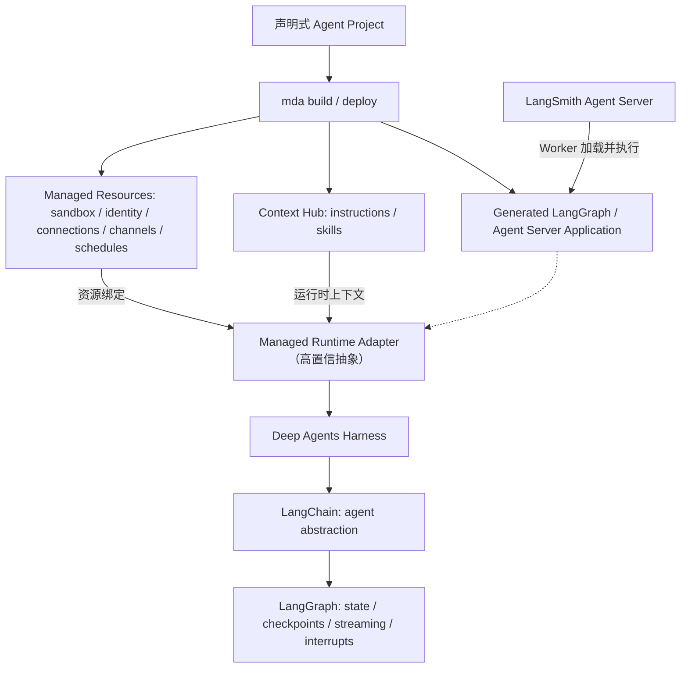
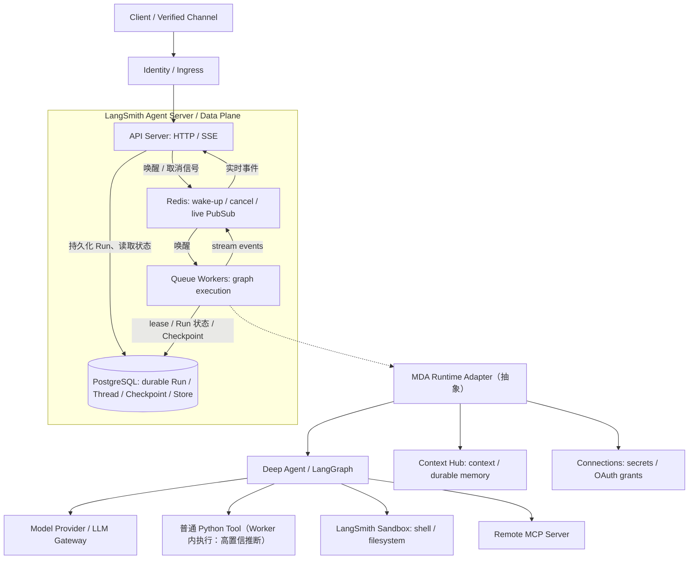
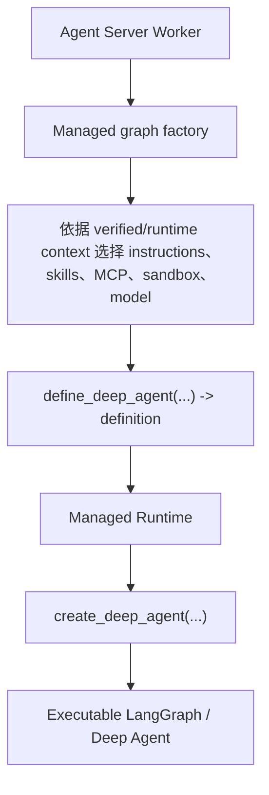
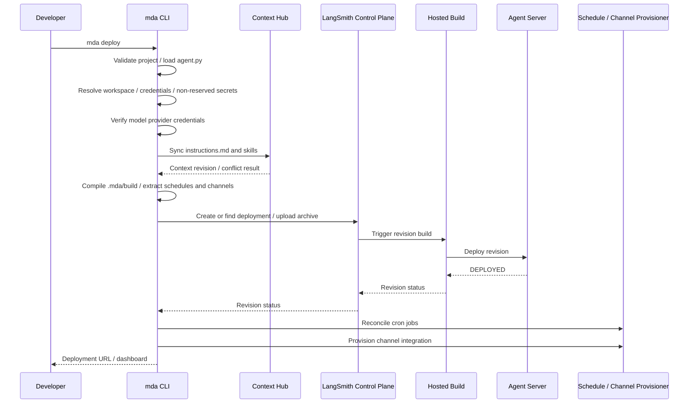
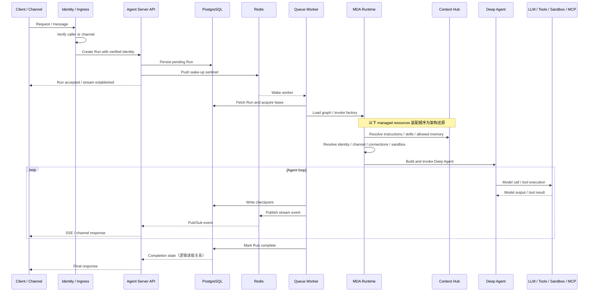
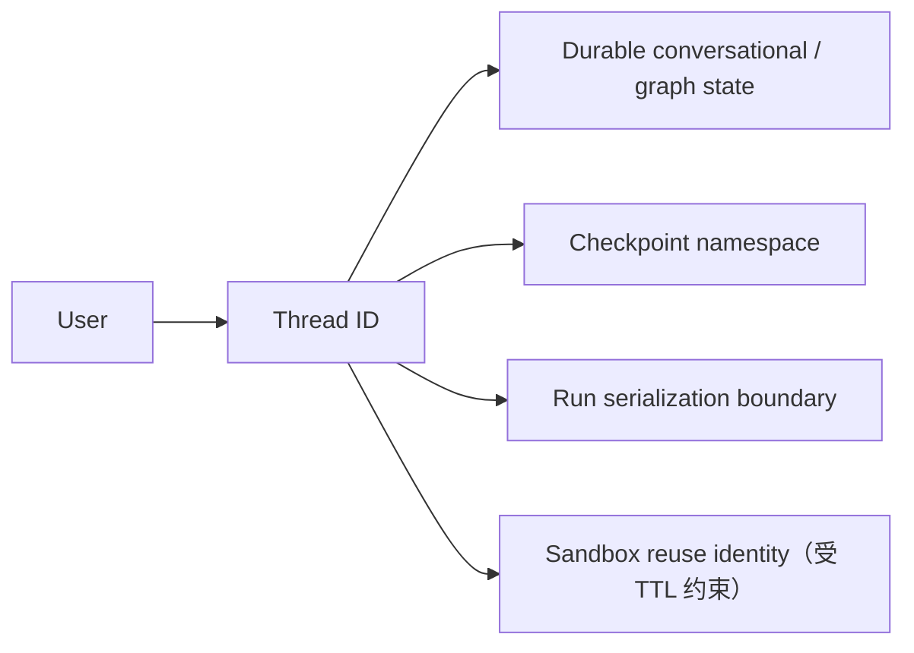
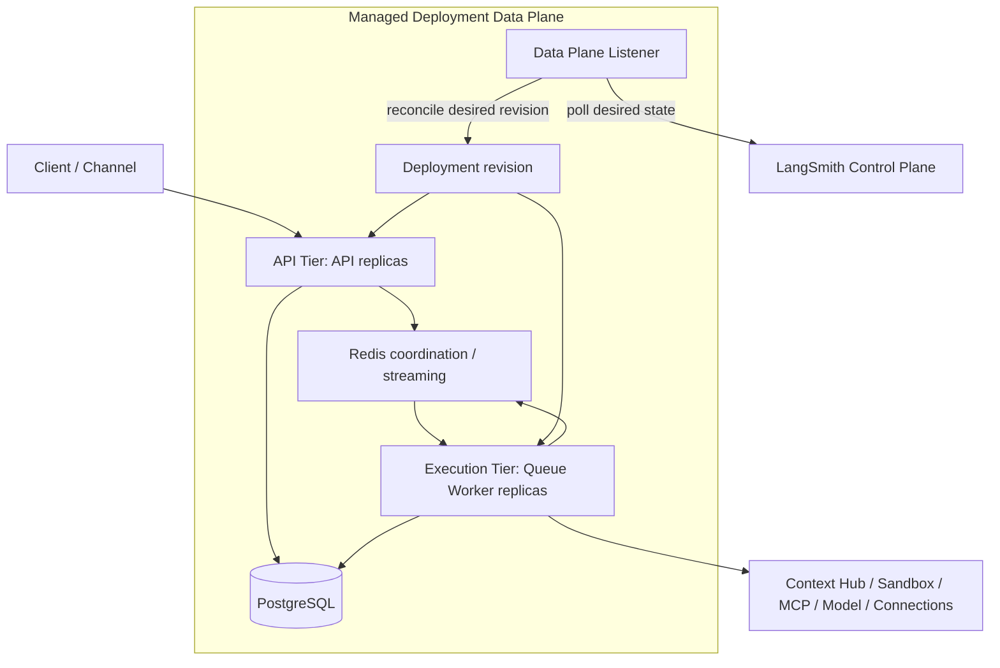
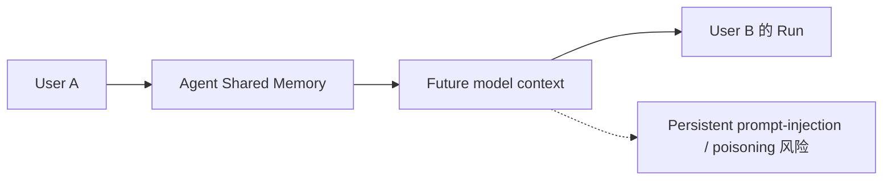
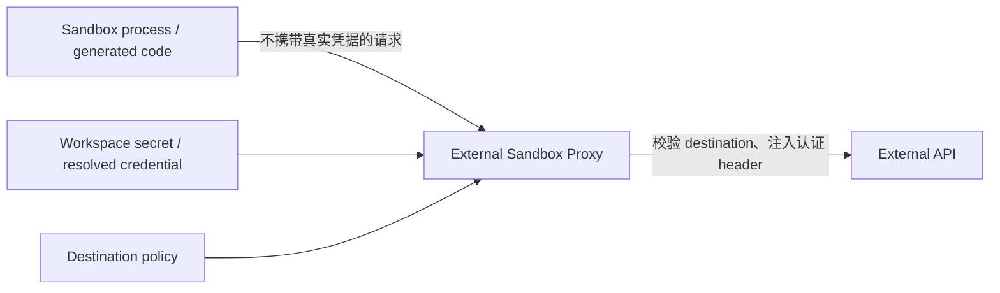

# LangChain Managed Deep Agents 的 Agent Server 架构设计

## 摘要

Managed Deep Agents（MDA）在原报告中的核心架构不是另一套独立 Agent Server，而是将声明式 Agent Project 编译为 LangGraph Application，再由 Managed Runtime 装配 Deep Agents harness 与托管资源，部署到标准 LangSmith Agent Server。Agent Server 负责 Run 调度、持久化、Checkpoint、Streaming 与 Worker 执行；MDA 增加 Context Hub、Identity、Memory、Connections、Channels、Schedules、Sandbox 及其生命周期管理。本文将该研究整理为可评审的参考设计，不代表 mini-loop 已实现或已决定采用这些能力。

| 项目 | 内容 |
| --- | --- |
| 状态 | Reference design，待评审；非 mini-loop 实现契约 |
| 原文 | 《LangChain Managed Deep Agents 的 Agent Server 架构：Technical Design Spec》PDF，共 38 页 |
| 原报告资料截止日 | 2026-10-15 |
| 转换范围 | 保留原文的分层、组件、流程、数据生命周期、安全边界、取舍、限制与证据等级；重排为 Markdown 并重绘关系图 |
| 事实边界 | 文中“确认”沿用原报告的证据判断；本次转换没有独立重新核验外部资料 |
| 仓库边界 | 本文只新增参考设计；不改变 Python/Go runtime、默认配置、现有架构图或已接受的设计决策 |
| 原 PDF SHA-256 | `8b2b9ac513752afef64410bd9b1d59e903fa64b679514b119d9ff06cfb18f886` |

> 版本提示：区域支持、SDK 开源状态、默认并发、TTL、重试次数及 API 限制均是原报告的时间快照，不是对阅读时最新版本的承诺。示例代码用于说明原文接口，不是本仓库新增的可运行集成。
>
> 图示提示：原 PDF 第 5、17 页的图存在节点文字缺失；本文根据相邻正文及原文其他流程重绘。图中的 `Managed Runtime Adapter` / generated wrapper 是原报告的架构抽象，不是已公开的内部类名或微服务名称。

mini-loop 的现状和规范仍以 [README](../README.md)、[架构决策](DECISIONS.md) 及相关实现契约为准。尤其不能把本文的 Context Hub memory 与仓库现有的 [user-scoped skills and memory](USER_SCOPED_SKILLS_MEMORY_DESIGN.md) 直接等同。

## 1. 目标、范围与证据边界

### 1.1 设计问题

本设计说明回答原报告的三个问题：

1. **MDA 最终运行在哪里？** 每个 deployment 运行在 LangSmith Agent Server 上，获得 Agent Server API、Threads、Runs、Streaming 和 MCP Endpoint。[S01]
2. **Agent Server 如何执行一个 Run？** API 持久化 pending Run，Redis 唤醒 Worker，Worker 获取 lease、执行 graph、写 Checkpoint、发布事件，API 通过 SSE 转发并提供状态查询。[S13] [S14]
3. **MDA 在其上增加什么？** Project compiler、managed runtime、Context Hub、Sandbox、Identity、Connections、MCP、Channels 与 Schedules 的资源装配及生命周期。[S01] [S02] [S04] [S06]

本次不设计 mini-loop 的数据库 schema、API 迁移、AG-UI 断线重放协议或生产部署方案；原 PDF 没有给出这些本项目实现契约。也不将 LangChain 未公开的内部调用次序、服务拆分、资源隔离实现补写为事实。

### 1.2 证据等级

| 标记 | 原报告中的含义 | 本文使用方式 |
| --- | --- | --- |
| 确认 | 官方文档或源码直接说明 | 保留为原报告的直接证据结论 |
| 高置信推断 | 两个以上官方事实可直接组合推出 | 明确标注推断链，不包装为源码实现 |
| 中置信推断 | 可由接口或生命周期推断，私有实现未公开 | 不依此承诺具体内部行为 |
| 未知 | 没有足够公开资料 | 保留问题，不猜测 |
| 工程建议 | 原报告基于上述架构提出的设计建议 | 与平台已提供的能力分开描述 |

原报告指出 `langchain-ai/managed-deepagents` 在 beta 期间主要是公开入口和 Issue Tracker，SDK 实现不开源。因此无法检查生成 wrapper 的具体类名、私有 service call 顺序及 Hosted Cloud sandbox 的确切底层技术。[S18]

**资料冲突保留。** 原报告发现仓库 README 仍写 public beta 位于 US，而更具体的 Deployment 文档列出 GCP US、EU、APAC 支持及 AWS US 暂不支持，故报告采用后者。不能把这一处理写成所有资料一直一致。[S05] [S18]

**不可反推。** 即使 self-hosted LangSmith Sandboxes 的公开架构采用 Firecracker，也不能据此断言 Hosted MDA Cloud 必然采用相同实现；原报告未找到直接结论。

## 2. 核心架构判断

### 2.1 分层与职责

原报告将 MDA 概括为：

```text
MDA = Deep Agents Harness
    + Generated Agent Server Application
    + Managed Context Plane
    + Managed Execution Resources
    + LangSmith Deployment Control Plane
```

其中 `Opinionated Compiler + Runtime Adapter + Managed Resource Provisioner` 是**高置信架构抽象**。依据是 CLI 的 compilation、managed resource lifecycle 以及生成应用部署到 Agent Server 的行为，而不是一套官方公开的内部模块命名。[S01] [S06]



图表达职责关系，而不是 Python 导入顺序，也不是嵌套容器拓扑。Deep Agents 提供 opinionated harness，LangChain 提供 agent abstraction，LangGraph 提供状态运行时；Agent Server 承载应用的服务端执行。[S16]

### 2.2 两种构造路径

| API | 返回值 | 基础设施责任 |
| --- | --- | --- |
| `create_deep_agent(...)` | 已编译的 Agent | 使用者负责 backend、store、checkpointer、server |
| `define_deep_agent(...)` | Agent definition，而非最终可执行 graph | Managed Runtime 提供 managed components，并调用 `create_deep_agent(...)` 构造 Agent |

这是理解“使用 Deep Agents 库”和“使用 MDA 产品”不能混为一谈的关键。[S01] [S03]

### 2.3 总体组件关系



Agent Server 排队与持久化关系属于原报告的确认结论；Runtime Adapter 及普通工具的进程位置保留推断标记。图中的 Context Hub、Sandbox、Connections 不意味着它们一定与 Worker 在同一个容器、数据库或内部服务中。[S04] [S09] [S11] [S13] [S14]

## 3. 系统架构与关键组件

### 3.1 Agent Project / Compiler Layer

MDA 的输入是带约定的项目目录。原报告中唯一必须存在的根文件为 `agent.py`，其余特定路径被识别为 managed declarations。[S02]

```text
my-agent/
├── agent.py
├── instructions.md
├── skills/
│   └── research/
│       └── SKILL.md
├── tools/
│   ├── search.py
│   └── mcp.py
├── middleware/
├── channels/
│   └── slack.py
├── schedules/
│   └── daily.py
├── sandbox/
│   └── __init__.py
├── identity.py
├── memory.py
├── pyproject.toml
├── .env
└── evals/
```

这些约定构成 declarative resource model，不只是目录风格。[S02] [S05]

| 项目内容 | 编译、部署后的归属 |
| --- | --- |
| `agent.py` | Agent Server graph / factory |
| 普通 `tools/*.py` | 随 deployment image 运行的 application code |
| `middleware/` | Deep Agents / LangChain middleware |
| `instructions.md` | Context Hub |
| `skills/**` | Context Hub |
| `memory.py` | Managed memory configuration |
| `identity.py` | Managed ingress / identity configuration |
| `tools/mcp.py` | Managed MCP connector configuration |
| `sandbox/` | Managed sandbox configuration |
| `channels/*` | Managed channel lifecycle |
| `schedules/*` | LangSmith managed cron / schedule |
| `.env` | 非 reserved 值转为 deployment secrets；文件本身不上传 |

原文最小 definition 示例：

```python
from managed_deepagents import define_deep_agent

agent = define_deep_agent(
    name="research-assistant",
    model="openai:gpt-5.5",
)
```

`define_deep_agent()` 只返回 definition。模型名称保留原文示例，不表示 mini-loop 新增了该模型配置或本次验证了其可用性。[S03]

原报告对 compiler 的**高置信还原**为：

```text
Managed Project
  -> Parse declarations
     (agent / identity / memory / MCP / sandbox / channels / schedules)
  -> Generate Managed LangGraph App
     (runtime adapter / deep-agent factory / Agent Server config)
  -> .mda/build
```

直接证据是 `mda deploy` 执行 compile project into `.mda/build`，部署文档称结果为 managed LangGraph app；具体生成代码结构没有公开。[S05] [S06]

### 3.2 Agent Server Layer

一个 deployment 至少包含 graph、persistence/database 和 task queue。Agent Server 管理四类主要对象。[S13]

| 对象 | 语义 |
| --- | --- |
| Assistant | Graph + configuration |
| Thread | 对话状态、Checkpoint 及其持久身份 |
| Run | 在 Thread 上的一次执行 |
| Cron | 定时创建的 Run |

在 split deployment 中，API Server 处理请求、状态查询和 Streaming；真正的 graph code 在 Queue Worker 中执行。其系统形态可概括为：

```text
Front-end API Tier
+ Durable Job Queue
+ Worker Pool
+ Durable State Store
+ Ephemeral Pub/Sub Bus
```

这里的 durable job queue 不等于“Redis 保存完整持久任务载荷”；其持久事实来源是 PostgreSQL，详见第 4 节。[S13] [S14]

### 3.3 Managed Runtime Adapter

原报告列出的公开 runtime 类型包括 `ManagedServerRuntime`、`ManagedToolRuntime`、`ManagedRuntime`，它们扩展 Agent Server / LangGraph runtime，注入 managed information。[S04]

```text
runtime
├── context
├── store
├── user
├── server_info
│   ├── principal
│   ├── subject
│   └── source
├── channel
└── backend
```

| 字段 | 来源与用途 | 信任边界 |
| --- | --- | --- |
| `context` | 客户端传入的 application data | 不能作为授权依据 |
| `server_info` | Verified identity | 授权所用的可信输入 |
| `channel` | 经 managed channel ingress 验证的来源信息 | 不能靠普通 Run context 伪造 |
| `backend` | 当前 Thread 的 managed sandbox / filesystem backend | 指向执行资源，不等于客户端指定的任意路径 |

MDA 还会移除客户端通过 `configurable` 注入的 identity fields。业务上下文、可信身份、Channel 来源和执行 backend 被分为不同 trust domains。[S04]

### 3.4 Static Graph 与 Graph Factory

Agent Server 支持两种加载方式：已编译 graph 在容器启动时加载一次；graph factory 在需要 graph 时调用，以提供 per-run customization。[S13]

MDA 的静态形式为 `agent = define_deep_agent(...)`。动态形式由 factory 按 runtime 返回 definition：

```python
# 接口示意：省略模型、instructions、skills 等具体配置。
def agent(runtime: ManagedServerRuntime):
    return define_deep_agent(
        name="open-swe",
        model=...,
        instructions=...,
        skills=...,
        mcp=...,
        sandbox=...,
    )
```

原报告引用的生命周期是：factory 在每个 Run 开始时调用，resume / retry 时再次调用，也可能因 schema / state inspection 被调用。因此 factory 必须无副作用。[S03]



Factory 的生命周期有直接文档依据；wrapper class 名称及内部调用实现仍未知。上图不增加额外的公开 API 保证。[S03]

### 3.5 Deep Agents Harness

真正的 Agent loop 来自开源 Deep Agents。LangGraph 提供 state、checkpoints、streaming、interrupts、pause/resume；Deep Agents 增加 planning、filesystem abstraction、skills、subagents、context management 和 middleware defaults。[S16] [S17]

因此原报告将“执行 graph”与“理解 planning、skills、subagents”分层：前者属于 Agent Server 承载的运行机制，后者属于 MDA / Deep Agents 的高层语义。不能把所有 harness 功能都归因于 Server 的调度层。

### 3.6 数据平面与生命周期

| 平面 | 主要数据 | 原报告描述的后端 / 生命周期 |
| --- | --- | --- |
| Agent Server State Plane | Threads、Runs、Assistants、Cron | PostgreSQL |
| Checkpoint Plane | LangGraph execution snapshots | PostgreSQL 默认；标准 Agent Server 可选 MongoDB/custom |
| Agent Server Store | Generic long-term store | PostgreSQL 默认 |
| MDA Context Plane | Instructions、skills | Context Hub |
| MDA Durable Memory Plane | Agent / user memory files | Context Hub |
| Sandbox Workspace Plane | 临时工作文件、代码 | LangSmith Sandbox；有独立 TTL |
| Event Plane | Wake-up、cancel、live streaming | Redis，ephemeral |

Agent Server 的 PostgreSQL 保存核心资源，默认也保存 Checkpoints 和 Store；Redis 不保存用户或 Run 的 durable data。MDA 的 instructions、skills、durable memory 则归 Context Hub。[S07] [S08] [S13] [S14]

```text
Thread checkpoint  != Context Hub memory
Context Hub memory != Sandbox filesystem
Sandbox filesystem != Agent Server Store
```

原报告中的 Sandbox 约定为一个 durable Thread 对应一个 Sandbox；默认 idle TTL 为 600 秒，超时后 Sandbox 及内容删除且不可恢复。Thread 可持久存在，不代表其工作目录永久存在。[S09]

### 3.7 组件职责与接口

| 组件 | 职责 | 主要接口 | 证据 |
| --- | --- | --- | --- |
| `mda CLI` | 编译、Context sync、部署、schedule/channel provisioning | `mda build/dev/deploy/logs` | 确认，[S06] |
| Agent Server API | Threads、Runs、Assistants、Streaming、Cron、MCP | HTTP / SDK / SSE | 确认，[S13] |
| API Server | 创建 Run、读取状态、转发 stream | REST / SSE | 确认，[S13] |
| Queue Worker | 执行 graph、写 Checkpoint、发布 stream | Internal queue / Redis / PostgreSQL | 确认，[S13] |
| PostgreSQL | Durable core state | Internal persistence | 确认，[S13] |
| Redis | Wake-up、cancel、Pub/Sub | List / string / Pub/Sub | 确认，[S14] |
| MDA Runtime | 为 Deep Agent 注入 managed resources | `Managed*Runtime` | 类型确认，部分内部实现未知，[S04] |
| Context Hub | Instructions、skills、memory | Managed repository / mounted files | 确认，[S07] |
| Deep Agents | Agent loop、tools、skills、subagents | LangGraph graph | 确认，[S16] |
| Sandbox | Thread-scoped shell / filesystem | `runtime.backend` | 确认，[S09] |
| Connections | Secrets / OAuth grants | Runtime credential resolution | 确认，[S11] |
| Remote MCP | 外部 tool provider | Streamable HTTP / SSE | 原报告确认，未单列额外引文 |
| Model Provider / Gateway | LLM inference | LangChain ChatModel / Gateway | 确认，[S03] |
| LangSmith Tracing | Run / model / tool tracing | Platform instrumentation | 确认，[S15] |

### 3.8 Custom Tool 在哪里执行

“普通 Python custom tool 通常在 Worker execution process 中执行”是**高置信推断**，而不是原报告找到的逐字官方保证。推断链如下：[S02] [S13]

```text
tools/*.py -> application modules -> imported into graph
           -> Queue Worker executes graph code
```

只有当工具自己把工作交给 Sandbox、MCP 或外部 API 时，工作才跨越相应边界：

```text
Custom Python Tool : Agent Worker -> Python function
Sandbox shell tool : Agent Worker -> backend -> Managed Sandbox
Remote MCP         : Agent Worker -> MCP client -> External MCP Server
```

不能把“Agent 有 Sandbox”解释成所有普通 Python 函数自动运行在 Sandbox 内。

## 4. 数据流、控制流与接口

### 4.1 部署阶段

原报告依据 CLI 文档重构的 deploy pipeline 包含以下步骤。[S06]

| 顺序 | 动作 |
| --- | --- |
| 1 | 校验项目，加载 Agent entry |
| 2 | 解析 LangSmith credentials / workspace |
| 3 | 收集 `.env` 中非 reserved secrets |
| 4 | 验证模型 provider credentials |
| 5 | 同步 instructions / skills 到 Context Hub |
| 6 | 编译到 `.mda/build`，提取 schedule / channel declarations |
| 7 | 创建或定位 hosted deployment |
| 8 | 上传 build archive，启动 remote build |
| 9 | 等待 revision 进入 `DEPLOYED` |
| 10 | Reconcile managed cron |
| 11 | Provision Slack channel |



该图依据原 PDF 第 12—13 页重排。它描述的是部署行为，不声称公开了每一个私有服务之间的真实 RPC 路径。

MDA 并不把所有资源塞进一个 deployment artifact，而是“多目标编译”。[S02] [S05]

```text
instructions / skills -> Context Hub
project source        -> Agent Server build
.env secrets          -> Hosted Secrets
schedules             -> LangSmith Cron
channels              -> Managed Channel provisioning
```

因此原报告把它理解为 Infrastructure Compiler / Application Platform，而不只是一个 Agent SDK。

### 4.2 Run 请求与执行流程

Agent Server 排队、lease、Checkpoint 和事件转发属于直接证据；MDA context / sandbox mount 的相对次序是原报告的**高置信还原**，不应依赖它构造强时序契约。[S04] [S07] [S09] [S13] [S14]



图中 LLM / Tools 合并展示以控制宽度；它们不是同一种执行环境。普通工具、Sandbox backend 与 Remote MCP 的分支见第 3.8 节。Checkpoint 与 Streaming 同处执行循环不表示二者对所有事件存在原子提交关系；原报告没有给出这样的保证。

### 4.3 PostgreSQL 与 Redis 的分工

原报告引用的 Data Plane 细节为：[S14]

- 新 Run 在 Redis list 中写入的是唤醒 Worker 的 **sentinel**，而不是完整的持久 task payload。
- Worker 随后从 PostgreSQL 读取真正的 Run 信息。
- Cancellation 使用 Redis string + Pub/Sub。
- Live streaming 使用 Redis Pub/Sub，event 不保存在 Redis。

```text
PostgreSQL = source of durable truth
Redis      = real-time coordination plane
```

Redis 的临时消息丢失不等于 PostgreSQL 中的 Run metadata 消失。但这也**不推出**“已丢失的 SSE token 可逐条重放”或“原连接会自动恢复”。原报告没有定义持久事件日志、replay cursor 或浏览器断线恢复协议；这些需要独立设计，不能由 Checkpoint 持久化直接替代。

### 4.4 Thread serialization

Agent Server queue 保证同一 Thread 任意时刻至多一个 Run 正在执行。结合 MDA 的一个 durable Thread 对应一个 Sandbox，原报告给出以下**高置信组合模型**。[S09] [S13]



这不是“Thread 永久拥有一个永不销毁的容器”，也不定义不同 Thread 之间共享 memory 的并发策略。

## 5. 部署、扩展、容错与运维

### 5.1 生产拓扑

Agent Server 支持 Single Host、Split API/Queue 以及更进一步的 Distributed Runtime。Hosted Deployment 可以把 API 与 Queue Worker 作为独立扩缩容池。[S13] [S14]



根据原 PDF 第 17—18 页正文重绘。图不指定副本数、网络设备、数据库 HA 拓扑或内部服务拆分。

Control Plane 不主动连接 Data Plane；Data Plane Listener 持续轮询 desired state 并 reconciliation。原报告用 Kubernetes Operator 风格的 desired-state model 类比，而不是断言某个具体 Operator 实现。[S15]

```text
Control Plane: desired revision = R42
Data Plane Listener: poll -> observe current revision R41 -> reconcile -> R42
```

### 5.2 扩展模型

| 容量维度 | 主要工作 | 原报告描述的扩容信号 |
| --- | --- | --- |
| API capacity | Create Run、read Thread / state、stream response | CPU / memory |
| Execution capacity | Model / tool execution、graph transitions、Checkpoints | Run backlog / pending Run count；结合资源指标 |

每个 Worker 的 Run 并发由 `N_JOBS_PER_WORKER` 控制，原报告记载默认值为 `10`。[S13] [S14]

```text
Approximate Run execution capacity
≈ Queue Worker Replicas × N_JOBS_PER_WORKER
```

这是近似并发容量，不是已验证的吞吐 SLO。API QPS 与 Agent execution duration 不是同一个约束；Run 的受理可以很短，而执行可能持续数十秒或数分钟。原报告以此说明 API / Worker 分离的价值，并未给出 mini-loop 的性能基准。

### 5.3 故障与恢复边界

Checkpoint 是主要 execution recovery mechanism；默认使用 PostgreSQL，可记录 graph step 的 execution state，供 Worker 中断后从最近 Checkpoint 恢复，而不是整条 Run 从头执行。[S13]

| 故障 | 原报告描述的恢复机制 | 不应扩大解释的边界 |
| --- | --- | --- |
| API replica crash | Stateless API tier，其他 replica 可继续 | 不等于原 SSE 连接无中断 |
| Worker crash | Durable Run + Checkpoint | 外部副作用不会自动变成 exactly-once |
| Redis ephemeral event 丢失 | Run durable truth 仍在 PostgreSQL | 不等于临时 stream event 已持久保存 |
| PostgreSQL transient error | 特定错误最多尝试 3 次 | 不是所有错误统一重试 3 次 |
| Container revision restart | Checkpoint + persistent database | 新 graph / state schema 仍需兼容旧状态 |
| LLM / provider failure | 依赖 agent / model policy，可使用 Gateway fallback | 不保证任何调用均可安全重试 |
| Sandbox idle timeout | Workspace 被删除 | 不由 graph Checkpoint 自动恢复文件 |
| Context Hub conflict | Deploy-time conflict detection | 不等于 context / code / memory 是一次原子发布 |

特定 PostgreSQL transient errors 的 attempt counter 暂存 Redis、最多 3 次，是原报告对 Data Plane 文档的版本快照。[S14]

### 5.4 工具副作用与幂等

原报告对 `send_payment()`、`create_ticket()`、`send_email()`、`delete_record()` 等有外部副作用的工具提出以下**工程建议**：考虑 idempotency key、deduplication、transaction state，以及 exactly-once illusion 的边界。

Checkpoint / retry 不能自动为外部 API 提供 exactly-once semantics。恢复执行也不能证明一个已发送的请求从未在外部系统生效。[S13]

Factory 则有更直接的生命周期约束：因为 Run start、resume、retry、schema/state inspection 都可能重复调用，构造逻辑必须无副作用。[S03]

### 5.5 部署形态比较

| 形态 | 与 MDA 的关系 | 基础设施责任 | 原报告定位 |
| --- | --- | --- | --- |
| `mda dev` | MDA 本地开发模式 | CLI 启动本地 dev server | 开发调试 |
| MDA on LangSmith Cloud | 托管 MDA 产品 | LangChain | 最少运维的生产 Agent |
| Standard LangSmith Cloud Deployment + Deep Agents | 非 MDA | LangChain 管 Agent Server，用户编排应用能力 | 需要 custom route / runtime |
| LangSmith Hybrid | 通用 Deployment，不等于 MDA self-host | Data Plane 在用户环境，Control Plane 托管 | 数据驻留 / 网络控制 |
| Self-hosted LangSmith Deployment | 通用 Deployment，不等于 MDA self-host | 用户 | Enterprise |
| Standalone Agent Server + Deep Agents | 非 MDA | 用户负责 Agent Server、PostgreSQL、Redis | 最大控制力 |

Agent Server 支持多种部署方式，不能据此推导 MDA 的 compiler、runtime 及 managed resource lifecycle 都可任意 self-host。[S12] [S13]

原报告引用的 MDA Cloud 区域快照为 GCP US、GCP EU、GCP APAC 支持，AWS US 尚不支持；LangSmith managed tools 仅 GCP US 可用。[S05]

当需求包括私有网络、custom FastAPI routes、自定义 persistence、`BackendProtocol` 或控制 Worker / runtime topology 时，原报告引用的官方方向是 Deep Agents + 标准 Deployment，而不是把这些能力当作 MDA API 已暴露的配置。[S12]

### 5.6 Local Dev 不等于 Local MDA Production

```text
Project -> .mda/build
        -> local LangGraph development server
         + local Context Hub mock
         + LangSmith Studio
```

本地 schedule 不真实触发；本地与 deployed Context Hub memory 是独立存储。`mda dev` 是开发体验模拟，不是已被原报告证明的 self-hosted MDA production runtime。[S06] [S07]

## 6. 安全、权限与可观测性

### 6.1 Identity

| 模式 | Caller | 隔离粒度 | 优点 | 风险 / 限制 |
| --- | --- | --- | --- | --- |
| LangSmith API key | Service / script | Service / workspace 级 | 简单 | 同 key 调用方可能看到同一 Thread 空间 |
| Supabase | End-user JWT | User | 浏览器可直连，由 MDA 验 JWT | 依赖 Supabase |
| Own backend | 应用后端认证的 user | User | 接现有 auth system | Backend secret 具有 impersonation 权力 |

Supabase / backend identity 可提供 end-user private Threads，LangSmith API key 默认不是 per-user privacy 模型。[S10]

```text
Browser -> Your Backend（正常用户认证）
        -> Managed Deep Agent
           x-mda-ingress-secret
           x-mda-user-id
```

`MDA_INGRESS_SECRET` 持有者可以声明任意 `x-mda-user-id`，因此不能放进浏览器或客户端 bundle。End-user privacy 是终端用户之间的隔离，不表示 workspace administrators 无法访问；原报告指出具有相应 workspace API access 的用户仍可能从 Studio 搜索或读取 deployment Threads。[S10]

### 6.2 Trust separation

```text
context               = client supplied application data; NOT authorization
server_info.principal = verified identity; authorization input
runtime.channel       = verified channel ingress metadata
```

原报告的授权示意如下。[S04]

```python
principal = runtime.server_info.principal
if principal is None:
    raise PermissionError("authentication required")

# Use principal.id / claims for authorization.
# Do NOT trust runtime.context["user_id"].
```

业务上下文中写入某个身份字段不会使它变成可信身份；Channel metadata 也不能靠普通 context 伪造。

### 6.3 Memory Security

| 路径 / scope | 语义 |
| --- | --- |
| `/memories/agent/` | Deployment-shared |
| `/memories/user/` | Authenticated-principal-scoped |

Agent Memory 是 deployment-shared，所有 caller 都可能影响其内容，不应存放 credentials、API keys、tokens 或 customer-private data。Memory 应作为 untrusted input，而不是授权策略或安全配置。[S08]



即使 memory 声称“允许执行 X”，也不能据此提升工具权限。原报告用该路径说明持久 prompt injection 可以跨 Run、跨用户传播。[S08]

### 6.4 Sandbox Security

原报告确认 MDA 使用 LangSmith Sandboxes；一个 durable Thread 对应一个 Sandbox。默认 `idle_ttl_seconds=600`、command timeout 600 秒；sandbox proxy 位于 Sandbox 之外，可限制网络 destination 并注入认证 header。[S09]



这一模式使真实 API secret 不必暴露给 LLM-visible environment 或 shell process，降低模型经 shell 读取 secret 的风险；不意味着所有配置下绝无凭据泄露。[S09]

Deep Agents 的安全说明被原报告概括为“trust the LLM”：Agent 能做 tools 允许的一切。实际权限和隔离边界必须在 tool / sandbox 层实现，不能依赖模型自我约束。[S17]

### 6.5 Connections 与 OAuth

Connections 将 credential lifecycle 与 deployment code 分开。[S11]

```text
Agent / User
  -> Connection reference
  -> Managed Credential / OAuth Store
  -> resolved at runtime
  -> MCP / API / Sandbox Proxy
```

Workspace-stored API keys 与用户 OAuth grants 在运行时解析，用户 grant 可以按 authenticated principal 选择。原报告据此说明 credential rotation 不必等同于重新构建 Agent code。[S11]

### 6.6 可观测性

Control Plane 为 deployment 自动创建 tracing project 并设置 tracing 环境变量；删除 deployment 不会因此自动删除 traces。[S15]

| 层级 | 原报告中的观测内容 | 能力性质 |
| --- | --- | --- |
| Business | Eval success / task success | 业务观测建议 |
| Agent | LangSmith trace；model、tool、subagent calls；latency / errors | Tracing 与派生分析 |
| Server | API success/error、API latency、pending / active Runs | 平台指标 |
| Infrastructure | CPU / memory、container restart、replica count、PostgreSQL CPU / memory / disk | 平台指标 |

`mda logs` 用于 tail Agent Server deployment logs，并支持 severity、line count、follow 等选项。[S06]

原报告进一步建议关注以下 workload 指标；其中一部分需要 trace 或业务 instrumentation 派生，不能全部写成平台原生提供。[S15]

```text
queue_wait_latency       run_execution_latency       end_to_end_latency
pending_run_count        run_retry_count             tool_error_rate
LLM_error_rate           sandbox_provision_latency   checkpoint_write_latency
tokens/run               cost/run
```

## 7. 配置选择、运维要点与架构取舍

### 7.1 模型访问方式

| 模式 | 路径 | 优点 | 代价 |
| --- | --- | --- | --- |
| Direct Provider | Worker -> OpenAI / Anthropic / other provider | 路径短、直接 | 自行管理 provider secrets / rate limits |
| LangSmith LLM Gateway | Worker -> Gateway -> Provider | Centralized rate limit / fallback / policy | 多一个 Gateway layer |

原报告中的模型配置示意分别为 `model="openai:..."` 与 `model="langsmith:provider/model-name"`；后者经 Gateway 路由。[S03]

没有证据证明模型一定运行在 MDA Agent Server container 中。通常由 Agent runtime 经 LangChain model interface 调用 inference service；Deep Agents 本身可接 frontier API、open-weight hosted model 或兼容 LangChain 的本地 / self-host model。这也不意味着每一种 Deep Agents 库配置都自动成为 MDA 的产品承诺。[S17]

### 7.2 队列选择

原报告**未找到** MDA 允许以 RabbitMQ、Kafka、SQS 替换 task queue backend 的公开资料。其已知设计为 PostgreSQL 保存 durable Run truth，Redis 承担 Worker wake-up、cancellation 和 Pub/Sub Streaming。[S13] [S14]

因此不能把 Redis、Kafka、SQS 并列为“官方支持的可替换选项”，也不能在转换时补一张不存在的官方产品选型表。

### 7.3 Persistence 可配置边界

| 能力 | Standard Agent Server | Managed Deep Agents |
| --- | --- | --- |
| Core resources | PostgreSQL | Agent Server managed |
| Checkpoint default | PostgreSQL | Managed |
| MongoDB checkpoint | 标准 Agent Server 支持 | 用户层未暴露自带 checkpointer |
| Custom checkpointer | 支持的配置场景可用 | 原报告明确不允许自带 |
| Custom long-term Store | 标准 Agent Server 可支持 | 原报告明确不允许自带 |
| MDA memory | 不适用 | Context Hub |

标准 Agent Server 的可配置能力不能直接等同于 MDA 的用户 API。原报告引用的 migration 文档将 `store` 与 `checkpointer` 交给 Managed Runtime 接管。[S12] [S13]

### 7.4 Context 更新与 Code Deployment 解耦

Instructions / skills 在 deploy 时同步到 Context Hub，也可不重新部署 code 而在 Hub 编辑；之后 local 与 Hub 同时变化时会触发冲突处理。[S07]

```text
Deployment Revision = code / tools / middleware / runtime configuration
Context Revision    = instructions / skills
Memory State        = mutable durable knowledge
```

这三条版本轴不同。原报告建议 incident / debugging 同时记录 deployment revision、context revision、model/version、thread_id、run_id，否则“相同 code revision 的行为变化”无法直接归因。

这是**工程建议**，不是原报告已证明每个 Run 都原生保存了全部字段。

### 7.5 Sandbox 数据生命周期

| 数据类型 | 原报告建议的位置 |
| --- | --- |
| Temporary generated file | Sandbox |
| Conversation / runtime state | Thread / Checkpoint |
| Long-lived agent knowledge | Context Hub memory |
| External business source of truth | 自己的 DB / API |

Sandbox 不是 durable memory。把 `customer_database.sqlite` 只保存在有 idle TTL 的 Sandbox，然后当作持久业务数据库，是原报告明确提醒避免的误用。[S09]

### 7.6 Revision 与数据库

新 deployment 创建数据库，后续 revision 复用该 deployment 的数据库。Code rollout 与 durable Thread / Run state 因而解耦。[S15]

```text
old code -> existing Threads / Checkpoints -> new revision
```

这种解耦带来 migration 责任：新 graph / state schema 必须考虑旧 Thread / Checkpoint compatibility。原报告还保留了一个 Python API 限制：当时 `define_deep_agent` 不支持自定义 `state_schema`，TypeScript 有对应能力。[S12]

### 7.7 Secret 与 CI/CD

原报告的 deploy 行为为：`.env` 非 reserved values 转为 hosted deployment secrets；`.env` 本身不进入 build archive；reserved platform variables 不作为用户 secret 上传；缺少 provider key 可能使 preflight 失败。[S05]

```text
Git repository: code / instructions / skills / NO secrets
  + CI secret store
  -> mda deploy
  -> LangSmith deployment secrets
```

这是原报告推荐的 CI/CD 路径，不是向本仓库提交 `.env`、真实凭据或新增部署流水线的授权。

## 8. 已知限制、推断结论与评审关注点

### 8.1 事实与推断汇总

| 结论 | 证据链 | 等级 |
| --- | --- | --- |
| MDA 最终是 Agent Server deployment | Overview + Deploy | 确认，[S01] [S05] |
| MDA 不是第二套 Agent framework | 运行 OSS Deep Agents harness | 确认，[S01] |
| `define_deep_agent` 是 declaration，不是 runnable graph | Agent Definition | 确认，[S03] |
| Managed Runtime 调用 `create_deep_agent` | Overview | 确认，[S01] |
| MDA 类似 compiler / provisioner / runtime adapter | CLI + resource lifecycle + Agent Server | 高置信推断，[S01] [S06] |
| Generated app 包装 graph / factory | `.mda/build` + factory + deployment | 高置信推断，[S03] [S06] |
| 普通 Python tool 通常在 Worker process 执行 | Application module + Worker executes graph | 高置信推断，[S02] [S13] |
| Sandbox execution 与普通 tool process 分离 | `runtime.backend` 对应 Sandbox | 确认，[S04] [S09] |
| Redis 不是 durable Run storage | Sentinel / PubSub，Run 从 PostgreSQL 读取 | 确认，[S14] |
| Agent Server durable truth 主要在 PostgreSQL | Agent Server | 确认，[S13] |
| MDA memory 不等于 Agent Server Store | Context Hub vs PostgreSQL-backed Store | 确认，[S07] [S13] |
| Thread 同时是 Run 串行边界和 Sandbox reuse identity | One Run at a time + one Sandbox per Thread | 高置信推断，[S09] [S13] |
| Hosted MDA Sandbox 一定是 Firecracker | Hosted 文档未直接说明 | 未知，不应断言 |
| MDA Cloud 具体内部微服务列表 | SDK 未开源，缺少直接材料 | 未知，[S18] |
| 可用 Kafka / SQS / RabbitMQ 替换 Redis | 没有公开支持资料 | 未找到直接结论 |
| MDA 用户可自带 Store / Checkpointer | Migration 明确交给 runtime 接管 | 原报告确认：不能，[S12] |

### 8.2 主要取舍

**Control vs convenience。** 接管 Backend、Store、Checkpointer、Server、Sandbox 生命周期降低使用成本，也形成定制边界。需要 custom BackendProtocol、Store、Checkpointer、route、advanced auth / application code 时，原报告建议退回 Deep Agents + Standard Deployment。[S12]

**Ephemeral workspace vs durable memory。** Thread 的持久身份不会让其 Sandbox 文件自动持久；TTL 删除与 Checkpoint 恢复是不同问题。[S09]

**Code / Context / Memory 三套版本轴。** Hot update 带来灵活性，也增加可复现性与 incident attribution 的要求。[S07]

**Shared Memory poisoning。** 持久 memory 可能影响未来 Run，不能作为 authorization policy、security configuration 或 secret store。[S08]

**Durable retry vs external side effects。** Checkpoint 保证执行状态可恢复，不自动保证外部副作用只发生一次，工具需要自行设计幂等边界。[S13]

### 8.3 原报告提出的改进方向

以下保留为原报告的**建议**，不是 LangChain 已公开的 roadmap，也不是 mini-loop 已接受的实施计划。

首先，公开完整的 Architecture Reference，明确 `Managed Project -> Compiler -> Generated Agent Server App -> Managed Runtime -> Deep Agent` 的 artifacts 与 lifecycle hooks。

其次，显式区分 Execution State、Context State、Workspace State，分别对应 PostgreSQL / Checkpoint、Context Hub、Sandbox，减少将不同生命周期混为一谈的误用。

第三，建议在 Run-level metadata 中暴露下列调试信息，改善 reproducibility 与 incident debugging：

```text
deployment_revision
context_revision
memory_revision
sandbox_id
model_route
factory_config_hash
```

第四，更细粒度地提供 egress policy、tool capability policy、sandbox lifecycle policy 与 connection scopes，而不是只依赖 LLM instructions。其依据是安全边界应落实于 tools / sandbox 的原则。[S17]

### 8.4 对 mini-loop 的使用边界

本文作为外部系统参考设计供后续讨论使用，不替代现有实现契约，不宣称本仓库已经具备 PostgreSQL/Redis Worker 拓扑、Context Hub、MDA Compiler 或托管 Sandbox。

后续若要把某个机制落实到 mini-loop，需要单独提交与现有代码、默认 posture 和测试对应的设计与实现；不能直接将本文的“原报告确认”改写成“mini-loop 已实现”。具体采用与否不在本次文档转换中决定。

## 9. 原文覆盖与转换说明

| 原 PDF 页码 | 原文内容 | 本文位置 |
| --- | --- | --- |
| 1—3 | 执行摘要、架构层级、Memory plane、三个研究问题 | 摘要、第 1—2 节、第 3.6 节 |
| 4 | 证据等级、SDK 缺口、区域资料冲突、Hosted Sandbox 未知 | 第 1 节 |
| 5—11 | 总体架构、Project model、Runtime、Factory、Harness、数据平面 | 第 2—3 节 |
| 12—17 | Deploy / Run 时序、Redis 分工、Thread、组件职责、工具进程位置 | 第 3.7—3.8 节、第 4 节 |
| 17—21 | 部署拓扑、扩展、容错、幂等、部署形态、本地开发 | 第 5 节 |
| 22—27 | Identity、Memory、Sandbox、Connections、安全与观测 | 第 6 节 |
| 27—31 | Model Gateway、queue、persistence、版本轴、workspace、revision、secrets | 第 7 节 |
| 32—35 | 事实与推断、限制、改进建议、最终架构判断 | 第 8 节及全文核心架构 |
| 35—38 | 官方参考资料及原始引文编号 | 第 10 节 |

转换去除了分页、重复页眉/页脚、断行和不可用的导出图，合并原文重复结论。架构与流程用可编辑 Mermaid 表示，保留它们的证据边界；示意图不新增具体微服务名称或未公开的执行保证。未将 PDF 作为二进制重复提交，也未修改源 PDF。

## 10. 原报告参考资料

以下链接全部来自原 PDF 第 35—38 页。`S01`—`S18` 是本文为便于维护重新编排的来源编号；“原引文编号”保留 PDF 的数字引用映射。移除了 URL 中的 `utm_source` 跟踪参数。本次没有重新验证这些网页的当前内容或可达性。

| 编号 | 原报告中的一手来源 | 用途 | 原引文编号 |
| --- | --- | --- | --- |
| [S01] | Managed Deep Agents Overview | MDA / Deep Agents / Agent Server 关系 | 2、3、5、8、9、12、39 |
| [S02] | Managed Deep Agents Project Structure | Declarative resource model / application modules | 13、14、29 |
| [S03] | Define a Managed Deep Agent | Definition、graph factory、per-run config | 15、19 |
| [S04] | Managed Deep Agents Runtime | Managed runtime、identity/channel/backend trust | 18 |
| [S05] | Deploy a Managed Deep Agent | Compilation、region、secrets、deployment | 24、33 |
| [S06] | Managed Deep Agents CLI Reference | Build / deploy pipeline | 16、23、40、41 |
| [S07] | Context Hub for Managed Deep Agents | Instructions、skills、memory plane | 7、21、43 |
| [S08] | Add Memory to Managed Deep Agents | Agent / user memory policy、安全边界 | 36 |
| [S09] | Add a Sandbox to Managed Deep Agents | Per-thread Sandbox、TTL、proxy | 22、42 |
| [S10] | Add Identity to Managed Deep Agents | LangSmith key、Supabase、backend identity | 35 |
| [S11] | Manage Connections | Managed OAuth / secrets | 27 |
| [S12] | Move from Deep Agents to Managed Deep Agents | Managed component ownership 与能力边界 | 32、34 |
| [S13] | Agent Server | Graph、PostgreSQL、Redis、Worker、Run lifecycle | 6、17、25、31、38、44 |
| [S14] | LangSmith Data Plane | Redis / PostgreSQL 分工、autoscaling、transient errors | 26 |
| [S15] | LangSmith Control Plane | Revision、listener、metrics、deployment lifecycle | 28、30 |
| [S16] | Deep Agents `libs/ARCHITECTURE.md` | Deep Agents / LangChain / LangGraph 三层结构 | 4、20 |
| [S17] | `langchain-ai/deepagents` | OSS capabilities / security model | 37 |
| [S18] | `langchain-ai/managed-deepagents` | Public repository / beta SDK 证据缺口 | 1、10、11 |

[S01]: https://docs.langchain.com/langsmith/python/managed-deep-agents-overview
[S02]: https://docs.langchain.com/langsmith/python/managed-deep-agents-project-structure
[S03]: https://docs.langchain.com/langsmith/python/managed-deep-agents-agent-definition
[S04]: https://docs.langchain.com/langsmith/python/managed-deep-agents-runtime
[S05]: https://docs.langchain.com/langsmith/python/managed-deep-agents-deploy
[S06]: https://docs.langchain.com/langsmith/python/managed-deep-agents-cli
[S07]: https://docs.langchain.com/langsmith/python/managed-deep-agents-context-hub
[S08]: https://docs.langchain.com/langsmith/python/managed-deep-agents-memory
[S09]: https://docs.langchain.com/langsmith/python/managed-deep-agents-sandboxes
[S10]: https://docs.langchain.com/langsmith/python/managed-deep-agents-identity
[S11]: https://docs.langchain.com/langsmith/python/managed-deep-agents-connections
[S12]: https://docs.langchain.com/langsmith/python/managed-deep-agents-migrate
[S13]: https://docs.langchain.com/langsmith/agent-server
[S14]: https://docs.langchain.com/langsmith/data-plane
[S15]: https://docs.langchain.com/langsmith/control-plane
[S16]: https://github.com/langchain-ai/deepagents/blob/main/libs/ARCHITECTURE.md
[S17]: https://github.com/langchain-ai/deepagents
[S18]: https://github.com/langchain-ai/managed-deepagents
