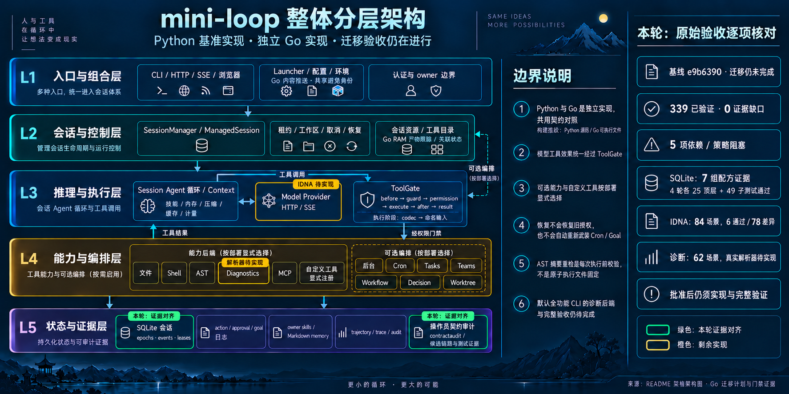

# Original acceptance criteria and remaining implementations — 2026-10-14

Baseline local main: `e9b6390a3e530fa6949f773e4ee6bbfcc4479970`.
Validated runtime: `a6bf1d5fd348158fdd21949eedce07b296844db0`.
Branch: `codex/go-final-acceptance-audit`.

This iteration reconciles the original P0/P1/G0–G7 requirements, makes the
persistence recipe ledger durable in the repository, and prepares a complete
native IDNA consumer with a measured failing baseline. Go/Python implementation,
module dependencies, feature defaults and authority are unchanged. The goal is
**not complete**. The original 344-row inventory remains **339 bounded verified,
zero evidence-incomplete and five dependency-blocked**.
Root test discovery is corrected by a new `pytest.ini`; no runtime code changes.

## Original requirements, without adding acceptance criteria

The [machine review](go-original-criteria-review-2026-10-14.json) derives all ten
requirements from `GO_PORT_PLAN.md` → `Work packages`, reads actual semantic
assertions and binds 31 selected assertions to four existing host/Linux ordinary
and race event streams: 124 passing top-level bindings. It also recomposes the
original 344 rows plus immutable 7/26/11/3-row deltas. Names and green test counts
alone are not accepted as behavioral proof.

| Original item | Current evidence and disposition |
| --- | --- |
| P0 | Inventory satisfied: documented capability/default/test mappings, 49 settings, 44 HTTP operations, three SDK producers, SQLite schema and 157 public-name bindings. Inventory does not certify all values. |
| P1 | Relocation retained; this review found and corrected the exact documented command's collection scope. A fresh bare `pytest -q` completes the 2,284 maintained cases: 2,256 passed and 28 skipped. See the correction receipt below. |
| G0 | Current named-type/JSON boundary assertions, four zero-finding type audits and host/Linux full/vet/race support the original bounded criterion. No arbitrary foreign-object or error-graph criterion is added. |
| G1 | Read semantic loop, transcript and concurrent-session isolation assertions; their actual current pass events support the original bounded recipes. |
| G2 | Read order, denial, approval/cancellation and gate-bypass controls; registration proof is kept separate from execution/authority proof. |
| G3 | Actual owned REST/SSE/default/error corpus includes the twelve team-route steps. Typed absent-team assembly is test-only, with actual handler and auth/owner controls. |
| G4 | Provider transport, stream/recovery, usage/cache and the final 34+2 SDK observations are supported. IDNA implementation and the real 84-case consumer remain blocked. Complete arbitrary-surrogate Agent/archive/progress behavior is not silently added to the original recorded-fixture criterion. |
| G5 | The seven-group persistence recipe ledger plus existing owner, trajectory and journal assertions support the original bounded recipes. Native killed-process strengthening, Source primitive composition and team typed-subset limits remain explicit. |
| G6 | Implemented opt-in slices retain explicit flags/defaults and per-feature evidence. The default Python syntax backend and its real 62-case consumer remain blocked. |
| G7 | Not complete: five required rows remain blocked, so the original no-unverified-required-rows criterion is not satisfied. |

The initial sealed review missed a P1 command gap: bare pytest also collected
retained workspace copies under `var/`, producing 809 collection errors in an
earlier actual run. The preceding successful gate added `--ignore=var` and did
not prove the exact documented command. Root `pytest.ini` now sets
`testpaths = python/tests`, containing all 278 tracked Python test files. The
[P1 correction receipt](go-pytest-entrypoint-correction-2026-10-14.json) supersedes
the initial review's P1 conclusion with the corrected command and fresh result.

Collection-only comparison finds exactly 2,284 project cases under both default
discovery and explicit root discovery. The latter additionally finds 22 cases
in Git-ignored `learn-claude-code`, an untracked reference checkout; these account
for the previous 2,278 versus current 2,256 pass count. The old 24 subtest passes
also belonged to that reference suite. No tracked project test is removed.
Explicit test selectors remain available; repository verifier tools stay separate.

After this original-scope correction, remaining implementation work is the two
families below. Approval alone will not close either family: implementation,
actual consumers and required validation still follow.

## Persistence recipes now have a repository ledger

The [durable G5 ledger](go-persistence-required-recipe-ledger-2026-10-14.json)
is a byte-for-byte copy of the independently reviewed final ledger from the
preceding iteration. Seven groups cover manager's seven restoration recipes,
cron/scheduled restoration, leases/rollback, killed-generation recovery,
compaction's three compositions, two decision replay sizes and team restart.
Each of host ordinary/race and Linux ordinary/race has the same **25 top-level
and 49 subtest pass names**, with raw event positions, fixture/producer/assertion
hashes and the final runtime receipt binding.

Killed-generation is a native process-strengthening recipe; compaction's full
compositions combine native end-to-end checks with actual Source primitives/unit
evidence. Team reconstruction compares a typed subset. These distinctions do not
establish identical end-to-end Source fixtures for every composition, power-loss
durability or fencing of arbitrary external effects. The broader original review
also reads actual default trajectory retention and owner-before-body assertions;
the small seven-group ledger is not a standalone whole-G5 certificate.

## Actual IDNA baseline: 6 pass, 78 fail

The [candidate consumer](go-provider-idna-required-consumer-2026-10-14.go.txt)
uses only current public native APIs and closed fixture types. It contains all
42 Source profiles in direct and SSE modes, with no skips. Source expectations
come from the unchanged actual SDK/HTTPX/idna
[84-case fixture](../../go/testdata/python-provider-idna.json), independently of
the native implementation. It preserves these Source phase counts:

| Source stage | Cases |
| --- | ---: |
| Constructor refusal | 34 |
| Request-stage refusal | 2 |
| Complete reply | 48 |

The actual selected Go overlay run compiles and executes every case:
**6 passing and 78 failing subtests**, one failed parent and one failed package.
All 84 native observations currently complete; the mismatch includes 34 missed
constructor refusals, two missed request refusals and 42 Unicode target-object
differences. The six passing controls are punycode, ASCII underscore and ASCII
long-label profiles in both modes. This is an explicit failing baseline for the
existing dependency-blocked surface, not a new runtime regression or a pass.

The [baseline receipt](go-provider-idna-required-baseline-2026-10-14.json) pins
the exact candidate, fixture, overlay, command, raw output and before/after
freezes. It compares actual request URL/RawPath/method, API-key/authorization
markers, dispatch count, final text and admitted-client identity. It does not
claim DNS, HTTP Host, TLS SNI or on-wire host acceptance. Source exception
class/text remain recorded; the native opaque error API compares stage, presence
and absence of dispatch. Source pre-construction provider identity has no native
public Client counterpart after constructor refusal and is not fabricated.

The first preparation attempt failed before any test ran because Go vet could
not open the new virtual overlay file. Its raw output is retained. The semantic
baseline uses explicit `-vet=off` only for that private overlay; eventual adoption
as a real Go test must run normal vet. The existing full repository vet evidence
is unchanged. The candidate stays as a documentation source artifact, outside
default test discovery, until the approved implementation can satisfy it.

## The two outstanding decisions

| Family | Required rows | Exact next work |
| --- | --- | --- |
| IDNA | `setting:base_url`, `export:build_client` | Explicit approval for `golang.org/x/net v0.43.0` and `golang.org/x/text v0.28.0`, keeping Go 1.23.3; then implement Source host admission and satisfy all 84 actual cases. Generic Lookup/Registration settings alone are insufficient for ASCII bypass, strict NFC, CONTEXTO, labelwise Bidi and Unicode-table distinctions. |
| Default syntax backend | `setting:enable_features`, `export:full_registry`, `capability:04` | Decide whether fixed CPython 3.11.3 `ast.parse` may remain an external runtime dependency, or require an actual native parser. Then implement the currently absent backend, consume all 62 actual parser cases and verify real default full-feature startup/execution. |

`AGENTS.md` requires explicit approval for added dependencies. The prior SQLite
approval authorizes neither family. Two approval questions were sent during this
iteration; neither elapsed time nor the instruction to relax test resource limits
constitutes dependency approval.

There is no existing Go CPython parser implementation. Current production code
has a named parser interface, a native scanner and explicit provider injection;
the test replay proves scanner control flow, not a Python grammar. Older prose
referring to an “existing backend” describes the proposed reuse of the existing
Source/local CPython runtime. `compile`/`py_compile` cannot substitute for
`ast.parse`: the fixed 62-case profile has 24 clean results, 36 SyntaxError
observations and two non-syntax faults. Module-level return/break/await and other
captured parser-versus-compiler distinctions remain required.

Historical blocked-row next-action strings mentioning nine non-full definitions
or the missing SDK-surrogate probe are superseded by later accepted evidence.
The immutable old rows are retained; their actual pending status is the two
families above.

## Validation and architecture

Go full/vet/race gates are reused for unchanged Go implementation. All **1,843**
current Go/Python/AGENTS inputs match the preceding
[24-gate receipt](go-remaining-contract-evidence-2026-10-14.json). That receipt's
README/architecture references describe its historical e9 baseline; the new
architecture review has its own regenerated artifact and fresh validation.
The new exact-command Python full gate freezes these inputs plus `pytest.ini`:
**1,844 unchanged inputs**, **2,256 passed / 28 skipped / 104 warnings**, 98.006
seconds including monitor teardown, with sampled tree RSS **425,664 KiB**.
Its pytest summary reports 96.68 seconds. No resource stop or observed owned
process remains. The old ignored-copy pass and 809-error failure are retained.

New execution includes the Python full gate, two collection-only comparisons,
two IDNA overlay attempts and architecture delivery. The actual IDNA baseline
takes 2.367 seconds, with
sampled task-tree RSS 191,856 KiB; very short-lived peaks may be missed. It uses
nice 10, GOMAXPROCS/package/test slots two, GOMEMLIMIT 512 MiB soft, a 1.5 GiB
sampled RSS stop and pressure enum admission 1/2. Both attempts terminate with
no observed owned processes left. No unrelated process is stopped.

The existing canonical graph, components, boundaries, authority and defaults
are unchanged. README's visible review baseline and the interactive specification
now point to e9 and the original-criteria reconciliation. HTML is regenerated by
Archify, not hand-edited; fresh showcase acceptance is **9/9**, zero errors and
warnings. Prior browser/local-server visual review remains unavailable; no new
browser acceptance is claimed. The built-in imagegen edit and exact prompt are
recorded beside this article; the base is unchanged because no component is
added or removed.

[Exact image-edit prompt](go-final-acceptance-audit-infographic-2026-10-14.prompt.txt)
and [repair prompt](go-final-acceptance-audit-infographic-2026-10-14.repair.prompt.txt).
The [final audit receipt](go-final-acceptance-audit-2026-10-14.json) binds the
current source manifest, P1 correction, original-criteria
review, durable persistence ledger, failing consumer baseline, architecture
output and image provenance. No required row status is changed by this audit.

Delivery remains small local commits followed by local-main integration.
No remote fetch, push or CI refresh is performed. The goal remains incomplete
until approved remaining implementations and their required gates are delivered.
