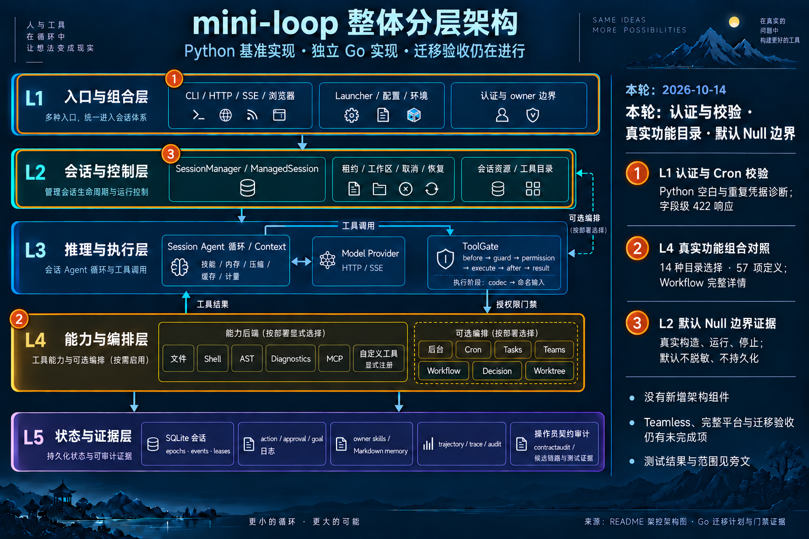

# HTTP validation, authentication and real catalogues — 2026-10-14

Baseline local main `da43c18`; branch `codex/go-http-feature-closure`.
Original P0/P1/G0–G7 acceptance remains open.

## Two runtime fixes

Public authentication environment loading now uses the existing Python-compatible
`pytext.Strip`, including U+001C–U+001F, and detects cross-owner shared tokens
during parsing before validating the completed owner mapping. Repeated bindings
for one owner remain deduplicated; diagnostics preserve Source owner ordering
without exposing tokens. Twelve actual TokenAuth constructor recipes and 24
actual environment recipes compare accepted/rejected/fault results, principals,
input detachment and Unicode/whitespace boundaries. Go's existing result seam
retains comparison faults; the bool compatibility projection remains available.
The Source mapping cannot represent duplicate keys, so native typed sequence
duplicate admission is separately retained rather than claimed as raw-pair parity.

Cron POST uses the existing closed request decoder and named validation values
to collect complete, ordered Pydantic-style field errors. Authentication remains
first; invalid body models are refused before owner lookup and scheduling.
Twenty-two actual FastAPI JSON requests cover missing/null/non-object models,
required/constrained strings, finite boolean coercions and ordered errors,
including two valid scheduling controls. Existing 29-case comparisons now also compare
422 bodies instead of returning after the status code. Numeric limits, malformed
JSON, content types, surrogate strings and all arbitrary Python values are not
inferred from this finite corpus. The legacy public request unmarshal API keeps
its separate scope.

Two workflow HTTP recipes compare complete running and cancelled details,
including node state and cancellation reason. Only random identifiers are
normalized. A controlled injected worker blocks and joins; the fixture does not
drop detail fields or claim model execution or every terminal state.

The frozen old native baseline produces 35 failed subtests across the two bug
families; these are observations, not 35 distinct production bugs. Workflow and
constructor controls already passed the baseline. The focused fixed comparisons
pass with full response, header and effect checks.

## Real feature construction and default boundaries

The feature fixture retains its original 14 registries, eight manager profiles
and 57 definitions. Additional explicit selection and binding observations let
the native consumer construct real production ManagerServices/catalogues for
every profile. It compares complete schemas, order, traits, capabilities,
execution modes, executable handler presence and service/session/manager identity.
The old name-only partial catalogue construction is removed. Diagnostics use an
explicit inventory-only provider that refuses execution. This establishes
catalogue construction and binding, not every tool's execution, a default parser
backend, or full-feature CLI acceptance.

Six actual Source recipes construct Agent, AgentSession and SessionManager with
omitted or explicit None dependencies, run once and stop managed lifecycles.
Null masking preserves text and payload; Null persistence leaves no records or
SQLite files. Source additionally installs a SQLite connection tripwire, observing
zero opens. Native consumers check absent typed secret/state dependencies,
unmasked output/history, persistence posture and actual post-stop SQLite-file
absence. They do not invent a native SQLite-call counter. Existing sandbox and
explicit SQLite evidence keeps its original bounds.

The teamless HTTP branch remains incomplete: public native manager construction
always binds a team. The registry profile that disables team tools is a separate
catalogue observation. No production export or unsafe private-state injection
was added to manufacture a teamless result.

## Validation and delivery

Final gate results, input hashes, resource observations and commits are recorded
in [the execution receipt](go-http-feature-closure-2026-10-14.json).
The [26-row delta](go-required-http-feature-delta-2026-10-14.json) preserves the
original 344-row inventory and the preceding seven-row delta. It updates only
12 partial registry rows, nine non-full definition rows, two HTTP operations,
two public authentication exports and the default Null capability after gates.
These finite proof labels are not a whole-migration completion percentage.
After the final gates, the composed inventory has **325 bounded verified,
five dependency-blocked and 14 incomplete rows**; no recorded concrete mismatch
remains in that finite inventory. Broader acceptance remains open.

| Gate | Result |
| --- | --- |
| Go ordinary with per-package coverage | 51 packages, 1476 top-level tests and 12727 subtests pass; six top-level/one subtest skip. |
| Go vet and race | vet passes; race passes the same tests, 49 passing packages/two no-test packages. |
| Python root, excluding ignored var copies | 2273 pass, 28 skip, 104 warnings, 24 subtests; 102.14s. |
| Source and type audits | 263 exports current; syntax/public/private/variable audits have zero findings. |
| Repository controls | 77 module invariants, 19 scan guards and the three relevant Python authentication mutation guards pass. |
| Architecture | regenerated HTML passes all nine showcase checks, zero errors/warnings; no browser visual acceptance is claimed. |

All 1811 Go/Python and repository-instruction inputs match their final gate
hashes after the implementation commits. The final covered Go run took 396.04s,
race 565.84s. Their maximum task-tree RSS samples were 546.61/532.41MiB;
Python full-suite sampling reached 354.48MiB. These are sampled observations,
not hard peak-memory measurements.

Application coverage is **85.34% (32595/38195 statements)**; provider coverage is
**82.57% (1521/1842)**. The same per-package instrumentation measured 85.38%
application coverage previously. The new Cron validator covers 61/62 statements;
routing no longer exercises parts of the retained legacy public unmarshal API.
The aggregate decline is recorded with the same instrumentation scope. Earlier
`-coverpkg=./...` results are not directly comparable.

The first focused and root Python runs failed because the new test expected
lowercase workflow status while actual Source returns RUNNING/CANCELLED. Only
the two test expectations were corrected; producer and fixture were unchanged.
The corrected focused tests pass. The first Go full run also records a completed
result in a 5ms background timeout recipe; its unchanged narrow recipe passes
three repetitions. Source's asyncio wait also permits completion when the future
is done after a timeout wakeup. This is an existing scheduling-sensitive test
observation, not evidence for imposing a new absolute deadline guarantee. The
initial failed full run remains separate from subsequent acceptance gates.

Heavy stages are serialized with GOMAXPROCS=2, package build parallelism one,
test parallelism two, nice 10 and GOMEMLIMIT=512MiB (soft). The task-tree RSS
budget is 1.5GiB with sampled host pressure and CPU monitoring. Samples are not
true peaks; shared pages can be counted twice and unrelated applications are
outside the task budget. No timeout, expected result or production wait policy
was relaxed to hide a failing test.

## Architecture

Built-in imagegen edited the complete layered base. Orange outlines identify
L1 admission/validation, L2 default boundary evidence and L4 catalogue evidence;
the explanatory sidebar keeps original component labels visible. The
[initial prompt](go-http-feature-closure-infographic-2026-10-14.prompt.txt) and
[layout correction prompt](go-http-feature-closure-infographic-2026-10-14.layout-fix.prompt.txt)
are retained exactly. No component was added or removed, so the base is unchanged.
README Mermaid is canonical; JSON drives generated HTML. PNG inspection and
structural HTML checks have separate acceptance scopes.

Implementation commits are `5620033` (real catalogues and Null defaults),
`5cafc23` (public authentication loading) and `c3bca02` (Cron validation).
A separate documentation commit records the evidence and architecture image.
Delivery targets local main by fast-forward. No remote push, fetch or CI refresh is claimed.
IDNA dependency approval, default parser policy, SDK surrogate details, teamless
HTTP, startup/TTL/capacity boundaries and full platform acceptance remain open.
