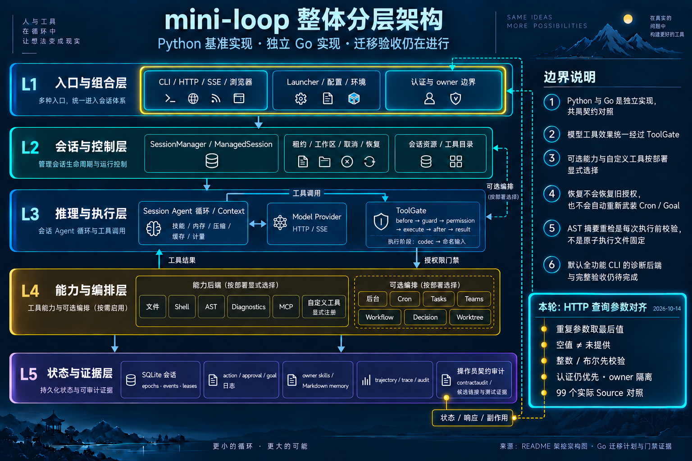

# HTTP scalar query selection — 2026-10-14

Baseline: `7a295d9`; branch: `codex/go-http-query-selection`.
This is one G3/G7 HTTP compatibility slice. Full Go migration acceptance remains
open under the original plan and parity matrix.
Validated runtime `7aa79ce089d66b0c183bfa4a5523e8c2c481df34` was fast-forwarded
into local main after the final gates. This delivery record follows that runtime
commit; no remote fetch or push was performed.

## What changed

Starlette selects the last repeated scalar query parameter. The native HTTP
entry now uses a shared named selector that also records presence: an empty
last value is distinct from an absent parameter. `access_token`, list `limit`,
SSE `envelope`, trajectory `session_id`, export `format`, and transcript `epoch`
use the same selection rule.

Named integer and boolean validators retain the captured FastAPI syntax and
complete 422 observations. Limits use an arbitrary precision integer until
clamping to 1..500. The existing epoch parser was moved into this shared helper;
its prior huge-integer and zero-padding assertions remain required.

Authentication still runs first. Header credentials retain priority, query
bearer fallback remains confined to event paths, and each request caches one
principal. Scalar validation precedes handler owner/store checks. Valid requests
still require their owner; missing and foreign sessions retain the same hidden
404 behavior. Export preserves store → format → owner order. No dependency,
feature activation or execution authority was added.

## Actual Source and native evidence

The producer runs the actual Python app, middleware, FastAPI validation,
TokenAuth, SessionManager, SQLite and TrajectoryStore. It normalizes generated
IDs, workspace paths and seed timestamps. Routes and query parsers are not
replaced. The fixture captures complete selected response headers, JSON/text/
JSONL/SSE observations, and before/after effects.

Both sides encode query values with `urlencode` / `QueryEscape`. These 99 cases
therefore establish selection for properly encoded query values, not raw
malformed-percent, bare-semicolon or invalid-UTF-8 decoding equivalence. Static
review identifies a next slice: Go can discard a malformed raw query item while
Source retains its value. Actual raw-byte route capture is still required;
ASGI scope bytes alone would not establish Uvicorn or proxy wire admission.

| Group | Cases |
| --- | ---: |
| Authentication | 15 |
| Session lists | 18 |
| Session trajectory lists | 12 |
| Trajectory lists | 11 |
| Envelope | 17 |
| Trajectory session selection | 8 |
| Export format | 9 |
| Transcript epoch | 9 |
| Total | 99 |

Seeds contain three real sessions, two SQLite transcript epochs, three finished
trajectories and six durable events. Successful SSE cases explicitly resume
`Last-Event-ID: 1` to sequence 2, then disconnect and unsubscribe. This corpus
makes no new claim about missing-cursor/live-backlog behavior; existing actual
run/default-cursor tests remain in the full gate. The initial Source-only
live-backlog experiment is retained separately in raw evidence.

The same consumer compiled against archived baseline `7a295d9`: **55 failed,
44 passed**. The initial implementation passed 94/99; five trajectory-session
404 detail observations were corrected. The final focused consumer passes
**99/99**, including no model/tool execution and no bulk trajectory read on
rejected requests. It compares captured expectations directly; expectations are
not inferred from the Go result.

Pinned installed Source versions: Python 3.11.3, FastAPI 0.136.3,
Starlette 1.2.1, Pydantic 2.13.4, HTTPX 0.28.1 and sse-starlette 3.4.4.
Exact Source hashes and fixture bytes are retained in the JSON receipt.

## Validation and resource profile

Final gates ran on identical **1784 frozen runtime/Source/canonical inputs**:

| Gate | Result |
| --- | --- |
| Full Go with all-package atomic coverage | 51 package passes; 1449 top-level passes, 6 skips; 11566 subtest passes, 1 skip |
| Go vet | Passed |
| Full Python | 2264 passed, 28 skipped; 104 warnings; 24 subtests passed |
| Focused Source / native query consumer | 5 Python tests / 99 native cases passed |
| Source export `--check` | 257 files current |
| Invariants / scanning guards | 77 modules / 19 guards passed |
| Selected Source mutation guards | SSE-only URL token, hidden ownership and trajectory export owner guard passed |
| Syntax/public/private/package-variable type audits | All four passed, zero findings |
| Consumer inventory with actual Go results | **Failed**: 256/258 passing candidate associations; IDNA/parser unreferenced |
| Diff check / gofmt / README outline | Passed |

Application statement coverage is **33848/37837 = 89.4574%**, all Go
**34214/38352 = 89.2105%**, and provider **1575/1827 = 86.2069%**. The 91,772,739
byte atomic profile was streamed; duplicate spans are merged by reached status.
This does not measure branches, Python, C or subprocess interiors. Current race
was not rerun; prior full race evidence applies only to `f913d20`.

The first full Go attempt failed the existing AST child cleanup timing assertion
(`closed-pipes`: 3.725s against 2s). That test then passed twice with the same
instrumentation, followed by a complete successful Go run. No AST code or time
assertion was changed; no root cause or general stability conclusion is claimed.
Failed baseline and intermediate stages are retained as failures.

The successful complete Go stage took **371.038s**, with sampled task-tree RSS
**432.09MiB** and CPU **199%**. Full Python took 206.068s (204.57s pytest time).

Heavy stages run serially using the explicitly relaxed profile: GOMAXPROCS=2,
`-p=1`, `-parallel=2`, `nice 10`, GOGC=75 and soft GOMEMLIMIT=512MiB. Sampled
task-tree RSS is limited to 1.5GiB; CPU above 300% for 45 seconds stops the
stage. Observed host pressure values 1/2 are allowed. Priority checks exclude
only Z-state zombies. No unrelated processes are terminated. Samples can miss
fast children, shared pages may be counted twice, and the Go target does not
bound CGO or children. Short-stage samples are not actual workload peaks.

## Architecture and delivery

README Mermaid, its boundary explanation and the JSON map describe the shared
HTTP query selection. Archify regenerated HTML and passed **9/9** structural
checks. Its declared HTML output was the only changed frozen path; the generic
read-only runner therefore recorded a failed input-stability stage. That record
is retained; Archify's successful delivery is reported separately. No browser
visual rendering was performed because the earlier approval denial remains in
effect.

The built-in imagegen edit uses the complete layered base. L1 shows the query
selection/validation change; L5 marks contract evidence. All five layers and six
boundary notes remain visible. The outer L1 highlight also surrounds Launcher,
which has no code change. No components were added or removed, so the base image
and its prompt remain the existing topology reference. The exact edit prompt is
saved beside the iteration image.

Raw stages: `var/go-http-query-selection-2026-10-14/`.
Durable machine receipt: [go-http-query-selection-2026-10-14.json](go-http-query-selection-2026-10-14.json).

The first copied baseline runner had a stale `ac4d603` freeze-scope label;
the actual archive command and frozen contents are `7a295d9`. The original raw
receipt is preserved and the metadata correction is explicit in this receipt.

Next open work includes the IDNA approval, default diagnostic backend decision,
final public/default/cross-feature inventories and full Linux acceptance. An
escaped lone-surrogate SDK caller needs actual Source ingress and next-request
probes; the current earlier Go refusal is not accepted as equivalent. Cached
remote refs were not refreshed; this iteration does not claim remote CI.
