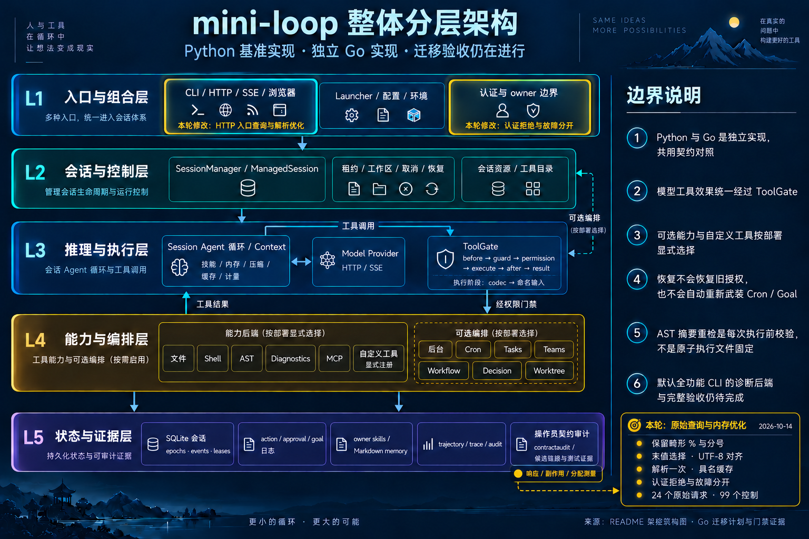

# Raw query decoding, typed authentication faults and allocation — 2026-10-14

Baseline: `51bdcc0`; branch: `codex/go-http-query-wire`.
This advances G3/G7 HTTP behavior under the unchanged full migration criteria.
Full validation and local main integration are pending at this code checkpoint.

## Actual Source observations

The producer passes **24 raw query byte sequences** directly to the actual ASGI
app: 12 authentication and 12 limit profiles. It uses real middleware, TokenAuth,
FastAPI, SessionManager, SQLite events/epochs and trajectory files. Seeds and
complete status, selected headers, body, SSE and before/after effects are retained.
Malformed `%`, `%GG` and bare semicolons remain literal Source values. Go's prior
`URL.Query` discarded those items; last-value selection could then see an earlier
value. Percent-decoded truncated UTF-8 uses maximal-subpart replacement. Literal
valid UTF-8 query bytes first become Latin-1 text in QueryParams.

The initial producer attempt failed because two non-ASCII token values raise
TypeError inside CPython `hmac.compare_digest`. The app's outer error middleware
emits **500**, body `Internal Server Error`, only the captured `content-type`
application header, then propagates the exception. The corrected producer
retains both responses and actual exception provenance. It does not convert
those profiles into ordinary 401 token rejection.

This is actual ASGI byte behavior. It does not prove Uvicorn/proxy admission.
Invalid *literal* UTF-8 bytes fault earlier during Source URL construction and
are outside this corpus; percent-decoded invalid UTF-8 is included. Source
exception class/message/propagation stage are provenance; Go TCP compares the
wire response, not an ASGI exception it cannot observe.

The old 99 properly encoded recipes recaptured **byte-identically**. The new
consumer requires all 24 names, groups and raw bytes; a real Go TCP wrapper checks
RawQuery and RequestURI without URL-encoding the fixture. It shares the existing
SQLite/trajectory/SSE assertions, owner isolation, zero model/tool effects and
disconnect cleanup. Successful streams explicitly resume cursor 1 to sequence 2.
No new missing-cursor/live-backlog claim follows.

Against archived `51bdcc0`, the same 24-case consumer produces **11 failures and
13 passes**. The new focused 24+99 consumers passed. The complete HTTP package
also passed: 103 top-level tests, one skip and 1885 subtests. Nine focused Python
tests passed. Full repository gates follow separately.

## Native design

One scan records the last values of six named fields. Only their final values
are decoded; unknown values and overwritten values are not materialized into
maps or slices. The owned `pytext.DecodeRune` preserves CPython maximal-subpart
UTF-8 replacement. Raw non-ASCII byte spans retain Source's Latin-1 handling.
Typed integer/boolean validation, header priority and owner checks keep their
previous order.

One admission context carries the caller and cached handler selections. The
fallback bearer is cleared before caching. Requests without retained handler
parameters keep the small Principal context; query-bearing admission is the
other named context value. Values are detached records, with no new authority.

`ResultAuthenticator` adds named accepted/rejected/failed observations. Server
selects exactly one method per request. `TokenAuth` faults at comparison when
either credential side is non-ASCII, including after an earlier match; token
construction remains unchanged. The legacy bool helper projects the result and
cannot expose the fault. The typed path preserves the captured plain 500 without
the middleware headers that Source's error return bypassed.

Real TCP controls require one typed call and zero bool calls, correct owned GET
behavior, and 500 even when a failed result carries a Principal. Cache controls
require cleared token text/presence and unchanged other fields. A native
configured-Unicode control prevents acceptance before a later faulty binding;
it is based on Source's algorithm and is **not** an actual Source configured-token
capture or complete public-auth fault audit.

## Allocation measurement

The benchmark compares the prior two `URL.Query` parses plus caller context with
the owned decode-once/cache path. Inputs are well-formed and produce equal
observations. Three 200ms samples per arm run serially on Darwin arm64/M2 Pro.
Store, transport, response encoding, authentication comparison and model work
are outside this component measurement.

| Sample | Prior B/op | Owned B/op | Prior allocs/op | Owned allocs/op |
| --- | ---: | ---: | ---: | ---: |
| No query / principal control | 72 | 72 | 2 | 2 |
| Short token + envelope | 936 | 224 | 10 | 2 |
| Repeated token + envelope | 9512 | 224 | 34 | 2 |
| Unrelated values | 5256 | 224 | 24 | 2 |

Final median ns/op: no-query **67.41 → 95.27**, short **647.9 → 185.0**, repeated
**10135 → 1314**, unrelated **87667 → 1679**. The no-query observation includes
the new named query/cache access and is slower in this microbenchmark; allocation
is unchanged. These data do not establish whole-application throughput, retained
memory or peak RSS savings. The first benchmark and empty-input fast-path followup
remain separate retained attempts; only the final cohort is summarized above.

## Validation and delivery

Code checkpoint `1e9fb10612e6ddbdebf049ce901468d01a433aba` was fast-forwarded
into local main after validation. Final evidence is a separate documentation
commit; remote refs, push and CI remain unrefreshed.
All following gates used the same unchanged 1,791 frozen inputs:

| Gate | Observed result |
| --- | --- |
| Complete Go / atomic statement coverage | 51 packages; 1,453 top-level passes / six skips; 11,592 subtest passes / one skip; 397.668 s |
| Go vet | Passed, 4.490 s |
| Source export | 258 fixtures current, 121.402 s |
| Full Python | 2,268 passed; 28 skipped; 104 warnings; 24 subtests passed; 106.245 s including runner |
| Python invariants / scans | 77 modules / 19 anchored scans passed |
| Selected mutation guards | SSE-only query token, hidden owner, trajectory export owner: each passing baseline and caught mutation |
| Four Go type audits | Syntax 468 files / 1,485 types; public 1,212 types; private 284 roots; 172 variables; zero findings |
| Consumer audit | **Failed (exit 1)**: 257 of 259 observed passing links; IDNA and syntax parser remain unreferenced |

Successful statement coverage is application **89.470771% (33,947/37,942)**,
all Go **89.224328% (34,313/38,457)** and provider **86.206897% (1,575/1,827)**.
The atomic profile was streamed and merged by statement span; it does not
measure branch, Python, CGO or child-process coverage. Race was not rerun for
this checkpoint; prior full race evidence belongs only to `f913d20`.

Full Go sampled task-tree RSS reached 448,496 KiB (437.98 MiB), Python
439,504 KiB (429.20 MiB); sampled CPU maxima were 198.3% and 297.7%.
The final serial cohort did not trigger a budget stop and left no observed
owned process identities. Samples can miss short-lived children, so these
values are observations rather than a hard bound or actual peak. Earlier
Source and baseline-native failures remain retained; no stopped or incomplete
stage is reported as passed. The original G0–G7 acceptance remains open.

Heavy stages are serialized under the approved relaxed profile: GOMAXPROCS=2,
`-p=1`, `-parallel=2`, nice 10, GOGC 75, soft GOMEMLIMIT=512MiB, sampled task-tree
RSS 1.5GiB and sustained CPU 300%/45s. Pressure values 1/2 are admitted; only
Z-state zombies are exempt from runnable-priority checks. Sampling misses fast
children and may count shared pages twice; the Go target does not bound CGO or
children. No unrelated processes are terminated.

Archify generated HTML and passed 9/9 structural checks; specification/artifact
hashes are retained. A dispatch while the benchmark lock was held was refused
before launch; the later serialized dispatch passed. Earlier browser-rendering
approval denial remains respected; no visual HTML review is claimed.

Built-in imagegen edits the complete layered base, highlighting HTTP entry and
authentication in L1 and measured evidence in L5. All five layers and six boundary
notes remain visible; Launcher retains normal emphasis. No topology parts were
added or removed, so the base image and prompt remain unchanged. The exact edit
prompt is saved beside the iteration image.

Raw evidence: `var/go-http-query-wire-2026-10-14/`.
Machine receipt: [go-http-query-wire-2026-10-14.json](go-http-query-wire-2026-10-14.json).
Remote refs, push and CI have not been refreshed.
