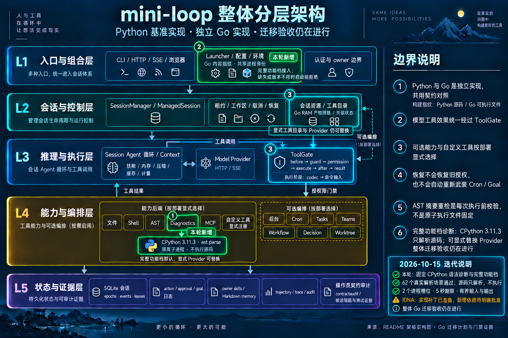

# Go IDNA 与固定 CPython 语法后端：实现与验证进展 — 2026-10-15

> **状态：CPython 主机必需门禁已通过；Linux full 因主机内存压力停止，vet/race 未开始。** IDNA 仅保留为未应用准备补丁；
> 当前生产 provider 和模块文件已还原。本文不能代替最终提交、批准状态、资源记录和 receipt。

## 当前交付边界

本轮分支为 `codex/go-provider-idna`，写稿时基线为
`30ccaffb34d1b235dc52fd106a466aa57c1f0449`。上一轮已验证的 Go 运行时为
`a6bf1d5fd348158fdd21949eedce07b296844db0`；它的测试结果不能直接作为当前修改后运行时的通过证明。

| 项目 | 写稿时状态 | 仍需完成 |
| --- | --- | --- |
| 外部 CPython 3.11.3 `ast.parse` | 用户已明确批准；实际 62-case consumer 和既有 diagnostics focused 已通过 | Linux Source 已通过；完整 full/vet/race 待获批的新资源方案和最终完整收据 |
| `golang.org/x/net v0.43.0`、`golang.org/x/text v0.28.0` | 明确依赖批准仍待回复；下载请求被自动审批拒绝，未绕过；`go.mod` 已还原 | 明确批准后安装固定版本，再编译和验证 IDNA 实现 |
| IDNA 算法、固定 Source 属性表、84-case native consumer | 已保存为六文件准备补丁，未应用；尚无通过证据 | 明确依赖批准后恢复实现并运行实际消费者和完整门禁 |
| required-row 账本 | **339 bounded verified / 0 evidence-incomplete / 5 dependency-blocked**，本轮未应用 delta | 仅在实现和必需验证完成后更新相应行 |

整体迁移仍未完成，`full_port_acceptance=false`。批准、生成属性表、编写 consumer
和静态审查均不等于运行时验收通过。本轮包内插桩覆盖率为应用代码 **85.4277%**，provider **83.0120%**；
diagnostics 包为 **84.8101%**。应用口径排除 `/tools/`，重复位置取命中并集，
没有使用 `-coverpkg`。上一轮同口径应用覆盖率为 85.4002%，本轮约增加 0.0275 个百分点。

## IDNA：按真实 HTTPX 路径保留处理顺序

属性生成器的[准确源文件归档](go-idna-properties-generator-2026-10-15.py)与准备补丁一并保存；
保留原始生成 header 和 provenance 输出位置，便于后续按字节复核。恢复运行时文件后
才可执行 `--check`；本轮未重新运行该生成器。
准备补丁使用 zero-context unified diff；恢复时应使用 `git apply --unidiff-zero`。
该格式去掉嵌套 diff 的上下文空格，保持六个候选输出文件字节不变；
`git apply --check --unidiff-zero` 和基线范围 `git diff 30ccaff --check` 已通过。

固定 Source fixture 为 [python-provider-idna.json](../../go/testdata/python-provider-idna.json)，
由 [provider_idna_contracts.py](../../python/tools/provider_idna_contracts.py)
复用真实 provider、Anthropic SDK 和 HTTPX 请求构造流程生成。其版本组合是：

- Anthropic SDK **0.107.1**、HTTPX **0.28.1**；
- Python `idna` **3.18**，其 IDNA 属性表为 Unicode **17.0.0**；
- CPython **3.11.3**，`unicodedata` 为 Unicode **14.0.0**。

这两个 Unicode 版本承担不同工作，不能用一个较新 Go Unicode 表替代全部 Source 判定。
fixture 保留相关 Source 文件 SHA；本轮也没有重新解释或放宽它的 84 个期望。

[未应用准备补丁](go-idna-prepared-2026-10-15.patch)内的 `go/provider/idna.go`
保存以下算法。它不是当前生产 provider 已采用的行为；补丁也不包含 `go.mod` 修改。

处理顺序如下：

1. 使用**原始整段 hostname** 是否为 ASCII 选择分支。纯 ASCII host 走既有
   HTTPX bypass 边界，保留 `_srv` 和纯 ASCII 长 label 的行为；先 lower 再判断
   ASCII 会错误放过 `K.-bad.invalid`。
2. 原 host 含非 ASCII 时，先通过已有 Python Unicode 14
   [完整小写规则](../../go/internal/pytext/case.go)处理整个 host，保留 `İ` 的扩展
   和跨 label 上下文中的 final sigma。随后识别 `. / U+3002 / U+FF0E / U+FF61`
   四种 label 分隔符，保留一个尾随根点并拒绝其余空 label。
3. 按 Source IDNA2008 校验 label。要求输入已经是 NFC，拒绝不符合 NFC 的文本；
   校验 rune 位置上的连字符、首字符 Mark、PVALID、CONTEXTJ、CONTEXTO 和逐 label Bidi。
   全域存在 RTL 字符不会给独立的纯数字 label 强加 Bidi 规则。
4. CONTEXTJ 使用 Source joining type 和 virama 属性；CONTEXTO 检查中点、Greek/Hebrew
   相邻 script、日文中点的同 label script，以及两套 Arabic-Indic 数字不得混用。
   Bidi 检查保留 RTL 的允许字符、结尾和 EN/AN 互斥规则，并拒绝 Python Unicode 14
   不认识方向性的码点。
5. 仅使用 `x/net/idna.Punycode` 作为原始 codec，不把 Lookup 或 Registration profile
   当作整个 Source validator。NFC 和 Bidi 的基础操作使用拟固定的 `x/text` 依赖。
   Unicode 分支还检查 Source 的字符数量和最终 ASCII 字节限制：输入不超过 254 rune，
   label 不超过 63 byte，域名不超过 253 byte，带尾随根点时不超过 254 byte。

### 构造拒绝与请求拒绝分别保留

Source 的 42 个 hostname 配方各运行 direct、SSE 两次，共 84 个 recipe。
其中原始 Source 的阶段为 **34 constructor / 2 request / 48 complete**。
例如非 NFC、非法 CONTEXT 和较新 Unicode 码点在 client 构造时拒绝；
纯 ASCII `xn--a.invalid` 通过构造，随后 HTTPX 请求准备访问 `URL.host` 才解码失败。

同一补丁中的 `go/provider/endpoint.go` 在构造阶段保存编码后的目标和延迟拒绝标记，
实际 `target.request` 才返回延迟错误。HTTPX 仅在**整个 encoded host 开头为 `xn--`**
时通过 `URL.host` 解码整域，准备实现保留这个条件。direct 和 streaming 共用此目标，
请求拒绝发生在动态凭据获取和 transport dispatch 前。

公开 identity 继续使用原 configured spelling；请求目标使用编码后的 hostname。
错误使用固定文本，不插入原 URL、API key 或 bearer token。native 错误保留阶段、
是否失败和未 dispatch 的可观察边界，不伪装成 Python 的异常类型和文本。

补丁中的 `go/provider/provider_idna_required_test.go` 是已准备的真实 native consumer，
使用实际 direct/SSE client 和受控 RoundTripper，比较 Source 的 URL、RawPath、method、凭据选择、identity、
调用数量和最终文本。它不证明 DNS、TLS/SNI、Host wire 编码或 live vendor API 行为。
Source provider 在 SDK 构造前可取得 identity，而 native `New` 拒绝后没有 client；
此公开 API 差异仍明确保留。

此前 [baseline](go-provider-idna-required-baseline-2026-10-14.json) 的真实结果是
**6 passing / 78 failing subtests**。这是旧实现的失败证据，不能列入本轮 passed gates；
当前 consumer 的新结果仍为 **pending**。

### 属性表来源和重建

补丁中的 `go/provider/idna_tables.go` 保存完整 Source 属性范围，
不包含按 42 个 hostname 名称匹配的 allowlist。范围使用具名、闭合的 rune interval
类型及二分查找：PVALID 有 1,237 个范围，Python 14 已知方向有 698 个范围，
Source joining type 有 524 个范围；还包含 CONTEXTJ、CONTEXTO、所需 scripts、virama 和 Mark。

[工作区生成器](../../var/go-idna-implementation-2026-10-14/generate-idna-tables.py)及
[provenance](../../var/go-idna-implementation-2026-10-14/idna-tables-provenance.json)
记录固定版本、输入/输出 SHA 和字节数；其输出哈希对应准备文件，并不表示这些文件仍在生产目录。
[准备清单](../../var/go-idna-implementation-2026-10-14/prepared-idna.json)另固定补丁及六个文件的 SHA。
这些 `var/` 路径是工作区准备证据。重建命令为：

```sh
.venv/bin/python var/go-idna-implementation-2026-10-14/generate-idna-tables.py
```

生成器拒绝版本或 fixture Source 哈希漂移；上游 end-exclusive 区间转成 Go inclusive
区间，并检查顺序和重叠。表文件的 SHA 为
`29155b01bd1ca01f3c5d895cc19e6a0aec34e067279b71531c7ec15ad58f639c`。
补丁内的 `go/provider/IDNA_DATA_LICENSE.txt` 保留 idna 3.18 的 BSD
通知和 CPython 3.11.3 的原始许可文本。补丁 SHA 为
`2a893caf86734bab5945bfd5598ce552133302ace3961727fde57a2fc89e2e6c`。
生成和静态审查只证明准备产物，未执行 IDNA Go 验收，也没有安装或下载两个待批模块。

## Python 语法：选择实际 `ast.parse` 后端

用户已批准外部固定 **CPython 3.11.3 `ast.parse`**。
[cpython.go](../../go/diagnostics/cpython.go) 提供 `NewCPythonParser`、
`NewDefaultPythonSyntaxDiagnostics` 和 `CPythonParser.Parse`。默认在可信宿主 PATH 中选择
`python3.11`，保存解析后的绝对路径；构造探针和每个响应都核对 `cpython / 3.11.3`。
缺失或版本不符作为错误返回，不退回近似 parser。显式 executable 由可信 embedding caller 选择。

每次操作使用独立进程。helper 以 `-I -S -B` 和空环境运行，排除当前目录/PYTHONPATH、
用户 site 与 site startup，避免写 bytecode。目标源码作为 stdin 数据传给 `ast.parse`，
不导入或执行目标程序，也不通过 `py_compile` 生成 bytecode。这种进程隔离没有建立 OS sandbox。

输入使用 base64 包装 UTF-8 surrogatepass 字节，避免 `encoding/json` 把 lone surrogate
替换成 U+FFFD 后掩盖实际解析故障。公开 `SyntaxResult` 区分 clean 和 syntax problem，
保留语法错误行号/消息；实际非 SyntaxError 通过具名 `ParserFault` 的 class/message 返回，
包括允许消息为空的 MemoryError，不能降级成 clean 或文件读取 warning。

### 资源和生命周期界限

当前已实现以下约束。focused 结果只覆盖其实际执行范围；平台效果和完整交付仍需最终门禁及 receipt：

| 约束 | 当前代码边界 |
| --- | --- |
| 全实例并发 | 共享两个子进程名额；排队等待也响应 context |
| 操作时限 | 5 秒，包含名额等待；更短调用 context 优先 |
| 原始 parser source | 最多 3,000,000 byte；取得名额后才分配 base64 副本 |
| helper stdin | 最多 4,000,000 个 base64 ASCII byte |
| 输出 | stdout 64 KiB、stderr 4 KiB；超限取消并返回故障 |
| 取消与回收 | macOS/Linux 使用独立进程组并终止该组；`Run` 等待退出和管道复制，`WaitDelay` 为 1 秒；其他平台只终止直接子进程 |
| macOS/Linux 子进程 CPU | soft 4 秒、hard 5 秒，保留更低的继承限制 |
| Linux 子进程地址空间 | `RLIMIT_AS` 512 MiB，保留更低的继承限制；不是跨平台 RSS 指标 |
| Darwin 子进程内存 | 没有等效硬 RAM cap；输入、并发和时限不能保证 AST 瞬时 RSS 上界 |

固定 helper 不 fork。显式 executable/wrapper 属于可信 operator 代码，不能自行启动独立后台工作；
这里不承诺任意 wrapper 进程树监督。Go 软内存目标、child 地址空间限制和实际 RSS 监测分别记录，
不会把一个指标当成另一个保证。

现有文件诊断仍按 Source 的文件选择和读入策略工作：排序选择最多 200 个文件，
stat 时超过 1,000,000 byte 的文件产生 skip warning，报告最多 50 项。stat-before-read
不是对并发文件增长的原子大小限制。语法 clean 只表示所选 parser 没发现语法错误，
不表示类型或逻辑正确。

### 默认 full 与显式注入

[Manager](../../go/agent/manager_features.go) 仅在启用 full、选择内建 catalogue、且没有
显式 `DiagnosticsProvider` 时选择默认 CPython 后端；caller 自定义 catalogue 保持其选择权。
[Launcher](../../go/launcher/features.go) 统一解析默认 diagnostics，启动和 deployment audit
在构造资源前探测解释器。纯 inspection 不启动进程，也不证明现场解释器可用。

显式 `DiagnosticsProvider` 完全替换默认后端，不探测 CPython；关闭 full 且没有显式
provider 时不隐式启动 parser。工作区选择、工具授权和执行 gate 保持原有归属，
parser 结果不授予访问权限。

[62-case consumer](../../go/diagnostics/cpython_test.go) 使用固定
[实际 CPython fixture](../../go/testdata/python-syntax-parser.json)：**24 clean / 36 syntax /
2 non-syntax error**。测试设计比较实际行号/消息、helper 的语法异常 subclass、具名故障及
surrogatepass 输入；[进程测试](../../go/diagnostics/cpython_process_test.go)另检查隔离、
不执行源码、版本/缺失拒绝、并发排队取消、owned PID 回收和输出预算。
这些 62 个实际 parser 子测试已在
[diagnostics-focused](../../var/go-idna-implementation-2026-10-14/diagnostics-focused/resources.json)
通过；同一 package gate 还通过既有 37 个 scanner recipe、六个 injected-provider recipe 和进程边界测试。
该次运行 exit 0、输入冻结未变、owned PID 为空，采样进程树峰值 RSS 为 199,264 KiB。
默认 Manager/full HTTP/CLI 集成的 focused 检查也已通过；完整回归和平台门禁另行记录。

### 旧拒绝场景的修正

完整功能档开始可用后，两项旧测试需要保留真实前提：

- CLI 的 session-query 配置测试第二次调用原本把 full 本身当作拒绝原因，
  因此用无截止时间的上下文进入服务。现在明确设置缺失解释器，要求 CPython 错误、
  无 stdout、未创建 workspace；额外使用一秒上下文，防止错误路径再次永久等待。
- fake benchmark 的 Source `run_arm` 构造 `SessionManager(settings, client)`，
  没有传递 `enable_features`，因此 full 环境不激活完整 catalogue。保留非法
  `MAX_TURNS` 的隐私 500 断言，并在 full 环境、空 PATH 下比较五个既有 Source
  profile 的完整规范化报告、main provider 零调用及临时目录清理。
  这是基于 Source 调用参数的回归控制，**没有宣称新增 full-env Source capture**。

修正后的 CLI 和 benchmark focused 均通过。两次停止及随后一次完整测试的真实
benchmark 断言失败均保留原始日志；它们不计为通过，也没有更改资源阈值来重试。

### 架构图

基础图新增固定 CPython 外部进程；本轮图片在完整五层架构上突出 Diagnostics、
Launcher 和 catalogue/gate 接入，橙色注明 IDNA 依赖待批准。
两张图均使用 built-in imagegen，基础图和本轮图的准确 prompt 分别随文件保存。



本轮 [prompt](../mini-loop-go-cpython-diagnostics-2026-10-15.prompt.txt)；
[维护基础图](../mini-loop-layered-architecture.png)及其
[prompt](../mini-loop-layered-architecture.prompt.txt)。

## 必需验证和最终回填

重任务串行运行，采用 `nice -n 10`、`GOMAXPROCS=2`、`GOFLAGS=-p=1`、
`go test -parallel=2` 和保守 `GOMEMLIMIT`，并记录真实进程树 RSS、系统压力、
停止原因与 owned cleanup。Go 的软内存目标不限制 CPython 子进程；预算超限或环境缺失
必须保留原始终态，不能记作通过。

| 门禁 | 本轮状态 |
| --- | --- |
| 两个固定 IDNA 依赖明确批准、固定版本安装与 `go.mod/go.sum` 复核 | pending；当前下载拒绝保留 |
| IDNA 84 个实际 direct/SSE recipe | pending；旧 6/78 失败 baseline 原样保留 |
| 固定 CPython 62 个实际解析 recipe、既有 scanner37/injected6 和 package 内进程边界 | focused passed；Linux 限制及完整平台证明 pending |
| 默认 Manager/full HTTP 与显式 provider/catalogue 替换 | focused 与主机 full/race passed |
| `go test ./...`、`go vet ./...`、`go test -race ./...` 和所需类型边界审计 | 主机三项 passed；480 production files / 1506 package types，52 packages / 1227 public roots / 290 private roots / 176 variables，均零 findings |
| 精确文档命令 `.venv/bin/python -m pytest -q`、相关 Source contract 校验及适用 verifier | 2256 passed / 28 skipped / 104 warnings；268 contracts、77 invariants、19 scans passed。Python guards/anchors 未改，本轮未重跑 mutation guards |
| 当前提交的 Linux 解释器、Source/native/full/vet/race 与资源回收证据 | Source 六组 passed；actual native 3.11.3 probe passed；full resource-blocked；vet/race not started；容器/volume 清理确认完成、无 OOM |
| README、计划矩阵、canonical/交互架构及基础图/迭代图 | 基础与迭代 PNG 已用 built-in imagegen 更新并视觉检查；交互图 showcase 9/9、零 errors/warnings；当前资源受阻状态同步 |
| 当前覆盖率、最终运行时 SHA、receipt、required-row delta | 覆盖率已采集，运行时 `b8dd27a`；交付 progress receipt；完整 17 门 receipt 和 3 行 delta 未发布，**339/0/5 不变** |

只有相应实现、实际消费者和必需门禁完成后，最终 receipt 才能说明哪些 required rows
获得新的有限证明。任何失败、手动停止、未批准依赖或未验证平台都继续保留在交付记录中。

交互图新增节点先后触发了旧线路穿过节点、线路交叉与最短 24px 的结构约束。
修正为运行时组合边界内明确标注的 external parser，并调整卡片位置/高度后，
原有 showcase 规则全部通过；失败记录原样保留。基础/本轮 PNG 已视觉检查；
交互 HTML 的浏览器视觉检查因先前浏览器访问未获批准而 **skipped**，
没有将结构检查冒充视觉通过。

## 提交、平台停止和下一步

- `c40d597`：保存未应用 IDNA 补丁、固定属性来源和准确生成器归档。
- `b8dd27af2ddecf6e2dfc881e476f97f639140a43`：固定 CPython 后端、默认 full
  组合、真实消费者、相关文档和架构。主机验证绑定 1,849 个当前输入；
  Go/Python/AGENTS/pytest.ini 字节在运行期间保持不变。
- [本轮 progress receipt](go-cpython-diagnostics-progress-2026-10-15.json)只记录已完成
  和受阻的实际检查：**14/17 门通过**（13 项主机/架构检查与 Linux Source），
  Linux full resource-blocked、vet/race 未开始。完整收据构建器仍要求全部 17 门，
  不接受缺失 Linux 门禁；progress 组装校验本身也在原资源监控下通过。

Linux 镜像为
`sha256:027571c4ab6d7570737a40290703adb9d91ecf9780aea2d2983dbf132156548b`。
现有固定 Go 1.23.3 image ID 加上固定官方 CPython 3.11.3 image digest 构建该镜像；
构建断网。Source 的六组平台夹具仍由 `/usr/bin/python3` 3.11.2 实际产生；
native 使用 `/usr/local/bin/python3.11` 3.11.3，版本、隔离参数与必需 imports
在当前容器中再次探测。两种解释器的证据不混用。

Linux full 在约 33.15 秒首次观察到主机压力 warning；原始监控允许值仍为 1/2，
root 按最新 AGENTS 要求人工向核对过身份的本任务 runner 发出 SIGTERM。
原始终态为 `resource_blocked / signal 15`；所属容器与 volume 均已移除，清理无错误，
无 OOM。记录到的 cgroup charged peak 为 994,021,376 bytes（约 948 MiB）。
此指标与主机进程树 RSS、Docker working set 不同，不能当作单一进程的物理 RAM。

[较低内存的明确方案](go-cpython-linux-memory-policy-2026-10-15.json)：容器上限
1.5 GiB → 768 MiB，Go 软目标 512 → 256 MiB，首次 warning 自动停止；保留全部包、
测试、assertions、两核、包并发一及 test parallel 二。该方案尚未获批、未执行；
原封板脚本、阈值和停止记录均未改动。低上限可能产生资源受阻，不能预先承诺通过。
该方案保持 swap 禁用；proposal 的 `swap_mib` 表示 Docker `--memory-swap`
总上限，等于容器 RAM cap，未增加额外 swap。

原始 344 行账本保持 339/0/5。三个 parser 条目已获得实现和主机证据，待当前
Linux full/vet/race 完成后才能应用三行 delta；两个 IDNA 条目仍需明确依赖批准
和真实 84-case 消费者验证。未刷新 CI，也未宣布整体迁移完成。
