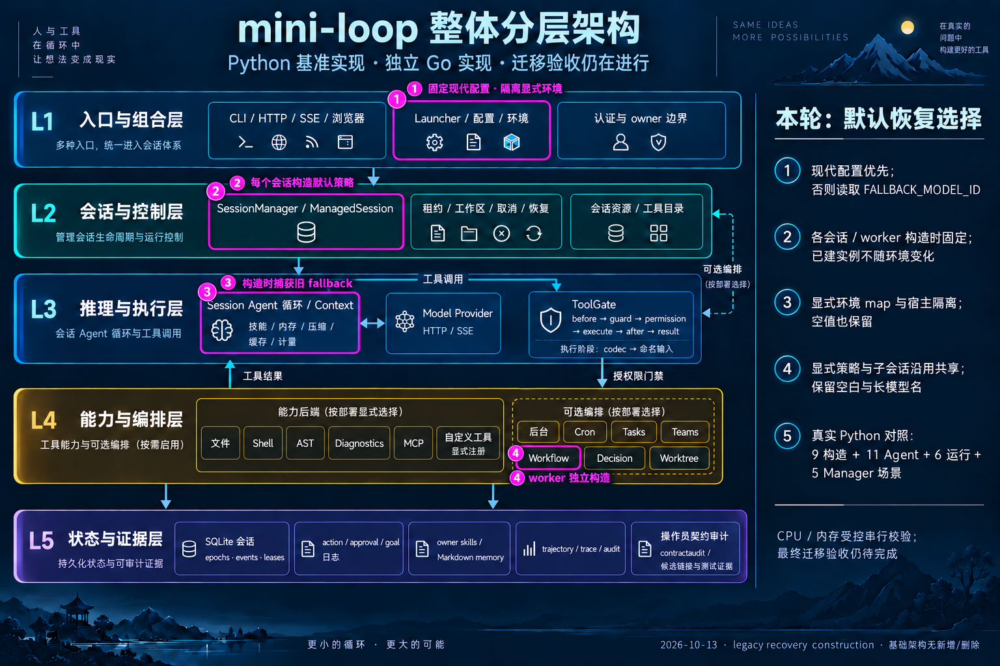

# Legacy recovery construction — committed, full validation pending

Baseline: local main `69cba43`. Working branch:
`codex/go-legacy-recovery-default`. Source contract commit: `6dc4956`.
Runtime/API/architecture commit: `a9b1bf4`, created at the user's explicit request
to commit code before optimizing memory and continuing validation. Nothing is merged.

The goal is now **active** after that user instruction. Focused checks passed;
full Go was resource-interrupted and the remaining gates still must complete
before integration. Early commitment does not establish full validation.

Previous goal state: **blocked**, confirmed by the goal tool after the third
consecutive resumed resource-blocked turn. The 13:36 UTC read-only pressure query
returned level 2. Automatic approval review rejected the recovery command before
execution; no new test/build process launched. The full migration remains incomplete.

## What changed

DefaultRecovery selects a nonempty explicit/modern model first, then captures
`FALLBACK_MODEL_ID` at construction. Empty values remain absent; whitespace and
long names are preserved. Explicit Go environment maps isolate legacy input
from the host, including an absent or empty key. Public Settings snapshots keep
only the modern fallback field.

Source Manager constructs default Recovery for each Agent. The prepared Go
change carries detached default configuration until session/worker construction;
injected policies and Task children still share their selected policy. Pointer
options are copied at manager, workflow service/runner and custom worker-factory
handoffs. Numeric retry/continuation bounds remain enforced. No dependency,
component, permission or durable state is added.

## Evidence and limits

- Actual Source capture: 9 constructor, 11 Agent, 6 run and 5 Manager scenarios.
  Each Manager scenario constructs two real Agents and records policy identity.
  The 513-byte legacy model reaches fallback and the next turn unchanged.
- Old Recovery overlay: 12 failing constructor/Agent/run subcases retained.
- Current focused Python test passed. Current Go Agent/config/Launcher/benchmark
  focused tests passed after correcting the workflow test's import from
  `go/jsonvalue` to `go/internal/jsonvalue`; the failed setup attempt is retained.
- The complete Source export check passed for 255 files. All four type audits
  reported zero findings: 465 production files / 1,475 named types; 51 packages /
  1,206 public types; 280 private root types; 172 package variables.
- Full Go testing was interrupted by host memory pressure level 2 after
  88.789 seconds. The monitor stopped the task-owned process tree (exit -15)
  and confirmed no remaining PIDs. Sampled peaks were 419,424 KiB RSS and 186.2%
  CPU. The 687 passing top-level records and one `signal: terminated` failure
  are partial output, not a complete suite result or evidence of a logic bug.
- Full Go completion, vet/race, full Python, invariants, scans, consumer inventory
  and current coverage remain pending. All 1,766 frozen input hashes are unchanged.
- Archify: 9/9, zero errors/warnings. Generated HTML has not been visually
  inspected because the earlier browser denial remains in force.

Heavy validation remains serial: nice 10, `GOMAXPROCS=2`, `GOFLAGS=-p=1`,
`go test -parallel=2`, soft `GOMEMLIMIT=512MiB`, a sampled task-tree RSS stop
budget of 1 GiB, host-pressure monitoring and a sustained CPU stop threshold.
No unrelated processes were stopped. The resumed run began only after 30 normal
pressure samples and stopped when pressure rose. No immediate heavy retry was
started after that stop. No current coverage percentage is claimed.

## Next gate

The four Source contract files were independently reviewed and committed after
their focused Python test and complete Source export check passed. This small
commit changes no Go runtime code. The user subsequently explicitly requested
committing runtime code first, overriding the usual pre-commit gate ordering.
Full Go tests, vet, race, the full Python suite and remaining applicable gates
still precede main integration.

Prepared continuation tools now accept an explicit resumed cohort directory:
`consumer_resumed.py`, `coverage_summary_resumed.py` and
`write_validated_receipt_resumed.py`, sharing `resume_evidence.py`. They preserve
real command/profile paths and identify same-named historical attempts by path.
Only static review and Python AST parsing were performed; none of these entry
points was executed. The current incomplete cohort must be rejected before any
downstream run or receipt write. Their local paths and hashes are in the JSON.

The earlier attempt at **13:17 UTC** observed pressure level 2 on its first
preflight sample. No test/build process launched. The independently checked
`resumed-cohort-1` contains five reused passing stages and zero new stages;
`required_complete` is false. All 1,766 actual input hashes still match.
That was the second resource-blocked turn since resumption; the goal was then active.

At **13:36 UTC**, automatic approval review refused the next recovery command
because repeated host-pressure blocks made another launch unsafe. A separate,
authorized read-only `sysctl` query confirmed warning level 2. The prepared runner
was not executed and `resumed-cohort-2` does not exist. Independent review of the
new resumed wrappers found no definite remaining static fix. The goal was marked
blocked after this third consecutive occurrence. No workaround was used to launch
tests. Stable normal pressure and renewed approval are needed before retrying.

After stable normal host pressure, verify unchanged frozen inputs and rerun the
complete ordinary Go suite under the same resource monitor, then run the remaining
required gates. Reuse the successful current Source/type checks only while their
inputs stay unchanged. Use new output paths and preserve every failed or blocked
attempt. Review actual results before making small Source/runtime/evidence commits
and fast-forwarding local main. No push is requested.

Default parser/IDNA approvals and consumers, Linux gates and the original
remaining P0/P1/G0–G7 criteria stay open.

### Resumption check at 12:05 UTC

All 1,766 saved input hashes remain unchanged. The new stability attempt again
observed host memory pressure level 2 at its first sample, so no test or compiler
was launched. A final static review found no definite new code defect; this
does not establish compilation or execution success.

The prepared cohort omitted its separately required consumer audit. A dedicated
`var/go-legacy-recovery-2026-10-13/consumer.py` now requires passing current
Source/full-Go reports and unchanged frozen inputs before dispatch. It preserves
the strict exit code, the legacy fixture's candidate records and the previously
known parser/IDNA gaps; candidate links remain weaker than semantic read/assertion
proof. The runner has not been executed. Run it after the passing full cohort,
under the same resource monitor, and inspect every newly missing candidate.

The [validation checkpoint image](go-legacy-recovery-validation-infographic-2026-10-13.png)
records this resource interception with its
[exact prompt](go-legacy-recovery-validation-infographic-2026-10-13.prompt.txt).
No current-slice commit, merge or push occurred.

### Blocked audit at 12:13 UTC

The third consecutive goal turn again observed host memory pressure level 2 at
the first stability sample. The retained checks are 11:58:36, 12:05:08 and
12:13:04 UTC; none launched tests or builds. All 1,766 pending inputs are still
unchanged. Independent static review found no additional definite issue that
could be resolved without the required compilation and runtime checks.

At that checkpoint the goal tool reported **blocked**, not complete. Automatic
goal continuation stopped. Historical PIDs in `state.json` described earlier completed Source
capture and are not evidence of a live validation job. All code, prompts and
raw attempts remain on the branch. Resume after the host sustains normal pressure;
the mandatory focused/full gates and independent consumer audit still precede
commits and local main integration.

[Final blocked checkpoint image](go-legacy-recovery-blocked-infographic-2026-10-13.png),
[exact prompt](go-legacy-recovery-blocked-infographic-2026-10-13.prompt.txt).

[Exact attempts, hashes and pending inputs](go-legacy-recovery-2026-10-13.json).
Raw local evidence: `var/go-legacy-recovery-2026-10-13/`.

### Resumed run beginning at 12:53 UTC

The user resumed the goal. It is **active** and incomplete; this is the first
resource-blocked turn of the fresh resumed run. Thirty consecutive normal-pressure
samples admitted validation. The focused checks, Source export and four audits
passed as listed above, before the full Go stage triggered the pressure stop.
The initial mis-import, successful rerun and interrupted full suite all remain
in the raw evidence. No test/build job remains from that suite.

`freeze.json` records the corrected import and all 1,766 current validation inputs.
The earlier `pending-freeze.json` remains historical: its workflow test import is
different. No current code commit, main integration or push has occurred.

[Resumed checkpoint image](go-legacy-recovery-resumed-infographic-2026-10-13.png),
[exact prompt](go-legacy-recovery-resumed-infographic-2026-10-13.prompt.txt).

## Architecture annotation

Magenta marks the existing configuration, Manager, Session and Workflow boxes.
The base keeps five layers, six backends, seven orchestrators and five state/
evidence blocks. Session/provider and gated-tool flows remain separate.
[Exact built-in imagegen prompt](go-legacy-recovery-infographic-2026-10-13.prompt.txt).

The resumed checkpoint keeps those four code highlights, marks the existing
contract-audit box in amber and records passing checks versus the resource
interruption. The base topology remains unchanged.

The [13:17 preflight image](go-legacy-recovery-preflight-1317-infographic-2026-10-13.png)
records the latest no-launch pressure interception and preserved prior evidence.
[Exact prompt](go-legacy-recovery-preflight-1317-infographic-2026-10-13.prompt.txt).

The [Source commit image](go-legacy-recovery-source-commit-infographic-2026-10-13.png)
records `6dc4956` separately from uncommitted Go runtime changes, retaining the
complete base topology. [Exact prompt](go-legacy-recovery-source-commit-infographic-2026-10-13.prompt.txt).

The [final resumed-block image](go-legacy-recovery-resumed-blocked-infographic-2026-10-13.png)
records the third resource block, rejected launch and preserved Source commit.
[Exact prompt](go-legacy-recovery-resumed-blocked-infographic-2026-10-13.prompt.txt).
