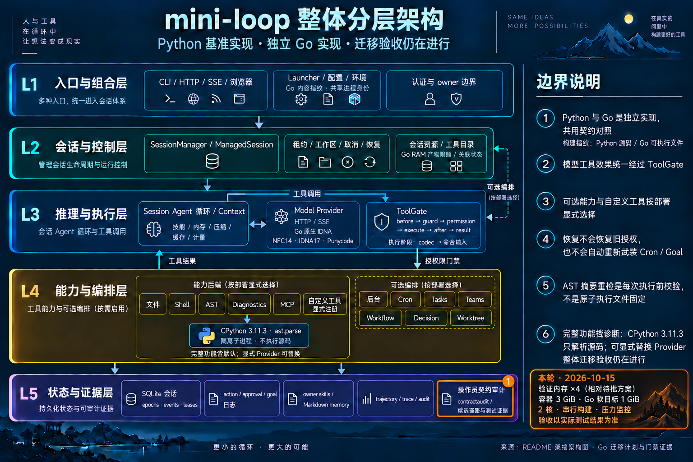

# 已批准的四倍验证内存配置

日期：2026-10-15。运行时提交仍为 `606630f`；本轮只调整验证配置和交付说明。

用户要求：“内存限制再扩大到4倍，否则任务无法进行了”。按紧接此前待批
方案的 768 MiB 容器 / 256 MiB Go 软目标为基数，已准备新配置：

| 配置 | 待批方案 | 本轮已批准 |
| --- | ---: | ---: |
| 容器硬上限 | 768 MiB | **3072 MiB / 3 GiB** |
| Go 软目标 | 256 MiB | **1024 MiB / 1 GiB** |
| 额外 swap | 0 | 0 |
| CPU 核数 | 2 | 2 |
| Go 包并发 / 测试并发 | 1 / 2 | 1 / 2 |

倍数相对于待批方案；先前实际部署的 1536 MiB / 512 MiB 配置保留为历史。
`GOMEMLIMIT` 仍是软目标，不覆盖 CGO、race、子进程或宿主虚拟机内存。
[授权与精确配置记录](go-linux-approved-memory-2026-10-15.json)包含新旧 runner
摘要和四行配置差异。新脚本是独立版本，旧脚本未被覆盖。

## 保留的执行规则

- 完整包、原始断言、六组平台 Source overlays、固定镜像和离线依赖不变。
- 两核、`-p=1`、`-parallel=2`、`nice -n 10`，重任务串行执行。
- 五次启动预检；第一个非正常压力样本触发停止，保护宿主机。
- 只清理本任务持有的容器和临时 volume；没有自动重试或预算自动升级。
- 原有 Source/消费者必须由同一 runner 生成的校验保持，因此新配置先重采
  Source，再依次执行 Linux full、vet、race。

## 本次实际执行

新 Source 阶段 `linux-native-idna-source-3g` 已进行预检，结果为
`resource_blocked / host_memory_pressure_before_launch`：宿主机在任何验证
启动前就已处于 **warning / level 2**。`launched=false`，没有创建容器
或 volume，没有运行测试，清理错误为空。后续独立两分钟就绪观察的
24 个样本也全部为 level 2。不能把该结果算为通过或测试失败。

[本轮执行记录](go-linux-approved-memory-execution-2026-10-15.json)保存原始预检
结果、压力样本和就绪记录的摘要。此前相同运行时的
[Linux Source 六组 66 场景](go-native-idna-linux-source-2026-10-15.md)
与 16 项主机门禁仍保留原有有效证据，不被本次预检抹去。

内存方案不再等待审批。下一执行条件是宿主机恢复正常压力，之后使用新配置
完成 Source/full/vet/race。原始验收账本仍为 **339/0/5**，未宣告移植验收完成。

## 本轮分层图

通过内置 imagegen 编辑完整基础图，仅在 L5 操作员契约审计处标出验证预算，
没有新增生产组件、改变拓扑或默认功能。基础图保持原样；
[精确提示词](../mini-loop-go-validation-memory-2026-10-15.prompt.txt)与图片一同保存。
README 和交互图说明同步，HTML 由 JSON 生成。

## 交付校验

新 runner 已做语法和精确差异检查，只有容器内存、Go 软目标、压力允许值
与报告文本四行变化；原脚本 SHA256 保持不变。运行时 1864 个文件仍逐字节
匹配此前主机与 Source 收据。本轮没有修改 Python 或 Go 生产代码，
也没有重跑其完整测试。

Archify `validate` / `deliver` 均通过，showcase **9/9**，零错误、零警告。
生成只是一项低开销文档检查，在原主机监控下完成并记录了 pressure 2，
不能用来替代新 Linux profile 的正常压力门禁。PNG 已目视检查；HTML 浏览器
目视检查仍因先前权限限制未执行。README outline 和 `git diff --check` 通过。
