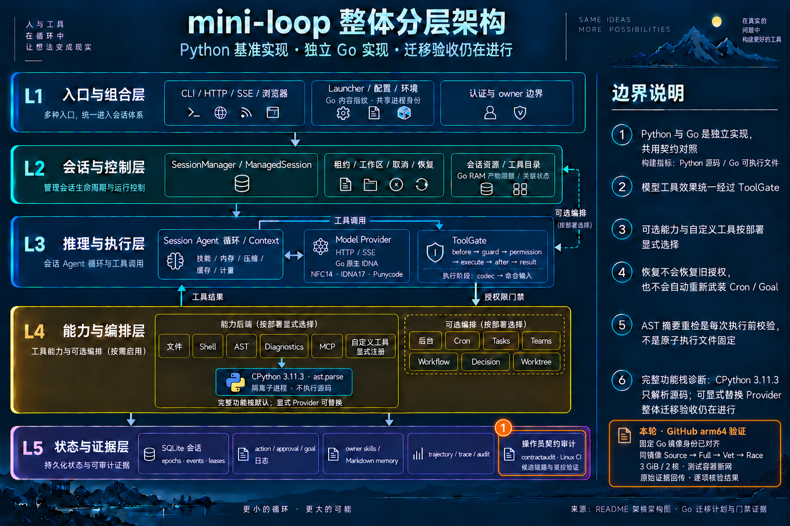

# 将当前 Linux 验证移到独立 arm64 环境

日期：2026-10-15。运行时代码基线：`606630f`。本机长期处于内存 warning，
新版 3 GiB 配置在启动预检前停止，因此新增一个明确的远端验证入口。

## 固定输入和执行边界

GitHub 官方 `ubuntu-24.04-arm` 提供独立 VM；本仓库为公开仓库，workflow
使用只读仓库权限。入口只接收公开的 commit/run 元数据，bootstrap 通过
已固定的官方镜像与现有公有依赖重建环境。
[官方 runner 规格](https://docs.github.com/en/actions/reference/runners/github-hosted-runners)
和[软件清单](https://github.com/actions/runner-images/blob/main/images/ubuntu/Ubuntu2404-Arm64-Readme.md)
是准备依据，实际运行仍需再次检查工具与资源。

官方 Registry 已解析并核对 Go arm64 manifest：
`sha256:53a9c8dafa550eb772ff742e0a8b80a5cfabd7fdb7635fe0e5e5fa413c85a848`。
其 config 为 `sha256:874a8b40ad6058f3f160636c61946394559b067562d7478cc3f9cc500794e9aa`，
与原本机 Go 基础镜像完全一致。CPython3.11.3 使用原固定官方 digest；
派生镜像在 job 内重建并记录实际 image ID，不伪称沿用旧派生 image ID。

原 Source plan、capture script、22-wheel manifest 按原字节保留。
bootstrap 按既有 SHA/大小下载公有 wheel，唯一 Go module 仍是已批准的
`mattn/go-sqlite3 v1.14.52`，由既有 `go.sum` 验证。准备与测试阶段分开：
测试容器断网、module cache 只读；Docker daemon 和镜像准备开销不在测试
容器 cgroup 的 3 GiB 上限内，driver 同时记录并监控宿主机压力。

## 完整门禁

1. 同一 CI 提交和派生镜像内，重新采集 Source3.11.2 六组 / 66 个 recipes。
2. Linux `go test ./...`，完整包集，无选择器缩减。
3. Linux `go vet ./...`。
4. Linux `go test -race ./...`。

四步串行，保留 3 GiB、无额外 swap、两核、Go 软目标 1 GiB、`-p=1`、
`-parallel=2`、`nice -n 10`。Linux 直接读取 MemAvailable 和 PSI 原文，
要求可用内存至少 max(6 GiB, 总量20%)，`full.avg10=0`、`some.avg10≤5`；
读取失败即停止，不将 Linux 观测伪装成 macOS 压力枚举。
停止只作用于本任务直接子进程及有 owner 标记的容器/volume。

校验器要求完整 53 包、62 parser、84 IDNA、NFC/Punycode 差分和原核心/
持久化配方的真实通过事件。两个无测试包和已解释的辅助/显式 audit skip
保留原状态和原因，不能改写为 pass。Source 与 native 版本、平台、archive、
fixture overlays、资源终态及清理结果均需一致。

## 证据回传

只用标准库把限定原始日志、输入摘要和收据打包，通过 Actions job log 的
带 UUID 分块回传。提取时流式验证长度、顺序和 SHA256，拒绝路径穿越、链接、
重复成员与覆盖目标。缓存、wheel、workspace 和 Git 目录不回传；它们在 CI
打包前逐字节检查，离线复核明确区分这部分历史检查与保留原始文件的再检查。

workflow、driver 与校验器都不更新原始 344 行账本。只有真实运行完成后，
才能合并既有16项主机证据、当前 CI 原始记录与最终文档，应用精确五行 delta。
本轮准备状态不代表 Linux 通过，原账本仍为 **339/0/5**。

## 分层架构与本地检查

完整基础图在 L5 契约审计中加入 Linux CI，生产层拓扑、授权和默认功能不变。
本轮通过内置 imagegen 编辑该基础图，突出新的操作员验证路径；精确提示词
和迭代图片与文档一起保存。

[基础图提示词](../mini-loop-layered-architecture.prompt.txt) ·
[本轮精确提示词](../mini-loop-go-linux-ci-2026-10-15.prompt.txt)

本机已运行18项小数据测试，覆盖 Linux 压力保护和证据传输的损坏/边界输入，
全部通过；bootstrap 固定资产检查和 CI Python 语法检查通过。
这些检查不代替上述四项真实 Linux 门禁。原1864项运行时输入保持不变。

交互图 `validate` / `deliver` 已通过 showcase 9/9，零错误、零警告；PNG
已目视检查。HTML 浏览器检查因先前权限限制未执行。文档生成在旧的轻量
主机监控下记录 pressure2，不把该文档结果计作 Linux 运行时门禁通过。
