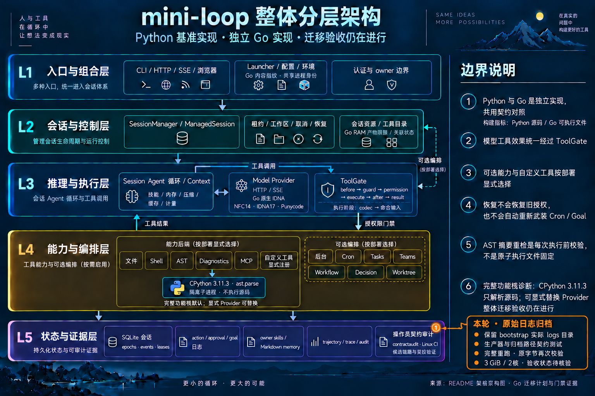

# Linux 验证中的浏览器工具与平台跳过

## 当前：补齐 bootstrap 日志归档

第二次真实运行 [38659480581](https://github.com/luoyjx/mini-loop/actions/runs/38659480581)
在提交 `960fb87` 上成功完成四阶段和最终校验器。传输包21,420,292字节，
SHA256为 `29ada5782f09796dea8875cd62e529079cad748f1edfc22bbef95d976b218101`，
已严格提取。但原校验器本地重放报缺少 `logs/`：bootstrap 写入该目录，
传输白名单却只包含 `bootstrap-logs/`。因此保留“CI成功、归档不完整”两项事实。

本轮补齐实际日志目录，并用真实日志生产器构造小数据归档测试。校验器保持
不变；完整四阶段将重新执行并验证归档后的原始字节。原344行仍为339/0/5。
本轮31项小数据测试通过，其中新增的真实生产器日志往返测试同时验证日志引用、
内容哈希与私有缓存排除。原运行时输入和校验器均未修改。

[本轮精确提示词](../mini-loop-go-linux-ci-retention-2026-10-15.prompt.txt)。

## 前一轮：浏览器与平台修正

首次真实远端任务 [38656712770](https://github.com/luoyjx/mini-loop/actions/runs/38656712770)
绑定提交 `fc53a977`，实际执行器 ID 为1000001919。Source、Go full、vet、race
命令均返回0；最终校验器因未审查的 skip 拒绝发布。因此整项 CI 保留失败状态，
原344行仍为339 verified / 0 incomplete / 5 dependency-blocked。

[首轮原始观测摘要](go-linux-ci-first-run-2026-10-15.json)保留完整失败终态和传输哈希。
Source／full／vet／race 分别耗时13.18／241.63／92.32／523.92秒；容器内核
记账峰值分别99.25／961.36／893.91／1,218.71MiB。没有 OOM，压力样本正常，
任务容器和卷已清理；此峰值不包含主机开销，采样也不是连续零压力证明。

## 实际缺口与修正

普通和 race 日志各有14个测试／子测试 skip：原有七个辅助或显式诊断场景、
六个仅在 Darwin 可用的 Seatbelt 场景，以及缺少 Node 的浏览器交互测试。
另有两个无测试文件包。六个 Seatbelt 场景在已封板的主机普通／race 日志中
实际通过；Linux 的不可用沙箱行为也实际通过。校验器只按精确包名、测试名、
Linux 平台和原始原因登记这六项，保留 skip 状态。

浏览器交互测试应实际运行。复用 [执行器固定镜像已有的 Node22.23.3](https://github.com/actions/runner-images/blob/ubuntu24-arm64/20261012.149/images/ubuntu/Ubuntu2404-Arm64-Readme.md)，
把实际二进制复制到派生验证镜像，记录版本、架构、字节哈希及容器内探测。
此测试已存在于仓库，仅使用 Node 标准库；没有新增 Go/Python 模块或 npm 包。
Node 仅供验证，生产运行时的拓扑、权限和默认能力不变。

完整四阶段按原次序重新执行，保持同镜像 Source3.11.2／native3.11.3、
容器3GiB、Go软目标1GiB、两核、断网、包并发1和测试并发2。浏览器交互以及
所有必需的 parser62、IDNA84、Unicode/codec、核心和持久化断言必须实际通过。
尚未取得修正后的完整门禁结果。

## 本轮分层图

基础图保持完整五层，本轮只标出 L5 操作员验证环境的变化。

[本轮精确提示词](../mini-loop-go-linux-ci-browser-2026-10-15.prompt.txt) ·
[完整基础图](../mini-loop-layered-architecture.png)

内置 imagegen 已编辑并目视检查完整分层图。交互图 validate／deliver 已通过
showcase 9/9，零错误、零警告；HTML 浏览器检查沿用先前权限限制，未执行。
修正后的30项小数据测试通过，覆盖精确平台／原因拒绝、必需测试跳过拒绝、
Node 字节与原始探针、遗漏二进制的传输边界。固定资产、9个 CI Python 文件
语法及 diff 检查通过；原1,864项运行时输入逐项哈希保持一致。
