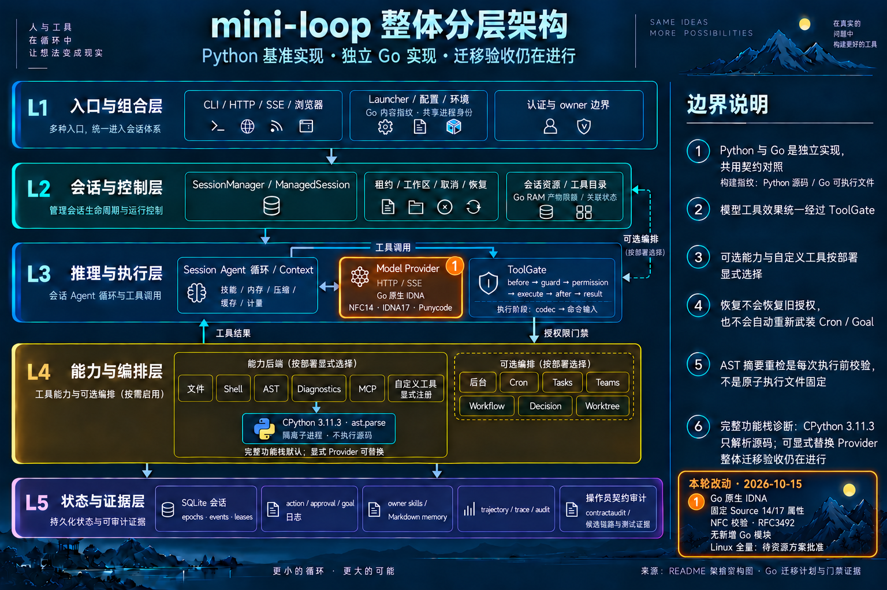

# Go 原生 IDNA：固定 Source 数据与无新增模块实现

摘要：本轮把 provider 的 IDNA 路径实现为原生 Go。使用项目自有的
RFC 3492 Punycode、完整 Unicode 14 NFC 和方向属性，配合已固定的
idna 3.18 / Unicode 17 有效性、上下文、脚本与连接属性。没有新增 Go
模块；Go 的 IDNA 运行时不调用 Python。实际验证结果和剩余平台门禁见
文末及本轮 JSON 收据，整体迁移仍未验收完成。

## 为什么采用这条实现路线

原验收要求固定 Source 行为，不指定外部 Go 库。此前提出的
`x/net v0.43.0` 和 `x/text v0.28.0` 没有获批，未下载、未引入。
本轮没有复制或内嵌这两个 Go 模块的代码或生成表。

开发期复用本机固定 CPython 3.11.3 和既有 idna 3.18 导出不可变属性，
沿用仓库已有的 Unicode 大小写数据生成方式。保留上游许可及输入、输出
和生成器摘要。准确边界是“无新增 Go 模块、内嵌固定 Source 派生数据”。
此前含外部模块的准备补丁仍作为历史证据保留，没有被应用。

## 实现和所有权

| 部分 | 所有者与约束 |
| --- | --- |
| `internal/punycode` | 项目自有 RFC 3492 原始 payload 编解码；显式溢出检查、UTF-8/标量拒绝；不承担 IDNA 策略 |
| `internal/pytext` | CPython Unicode 14 完整 canonical decomposition、稳定 CCC 重排、排除项感知 composition、Hangul 算法和全部方向类别 |
| `provider` | 整域 ASCII 分支、Python lower 顺序、逐标签 NFC/PVALID/CONTEXTJ/CONTEXTO/Bidi、A-label 与域名长度、构造/请求拒绝阶段 |
| `python/tools/export_go_*.py` | 仅开发期生成/检查；Go 运行时不依赖这些脚本或 Python 进程 |

Punycode 的工作上限为 4096 标量、32768 payload 字节，用于界定原算法
扫描/插入的工作量；provider 的入口更窄（Unicode 域名至多254字符、
编码后标签至多63字节），因此没有缩减记录的 Source IDNA 行为。
raw codec 拒绝 surrogate；原始 CPython raw codec 的此类输出作为明确的
Go 标量边界记录。合法标量使用独立编码和解码对照，不能只靠 roundtrip
把两个对称错误隐藏起来。

NFC 验证比较规范化结果与原文，不修复主机名，不进行 NFKC、UTS 46
映射或按样例放行。规范化对长 combining run 采用稳定 counting sort，
避免 insertion sort 的平方级重排。方向属性使用完整固定 Unicode 14
类别，不借用 Go 工具链的不同 Unicode 版本。

## 保留的请求语义

整域 ASCII bypass 在 lower 之前选择。只有原本包含非 ASCII 的域名
才进入完整 IDNA 路径；lower 后变成 ASCII 的文本仍须通过标签检查。
三个 Unicode 点分隔符、尾点、原始配置身份与编码后的请求目标分别保留。
ASCII 首标签为 `xn--` 时，请求准备访问解码域名的失败仍发生在请求阶段。

现有 84 个实际 Source 场景和消费者逐字保留：34个构造拒绝、2个请求
拒绝、48个成功。对照 direct/SSE 的完整 URL、RawPath、凭据、调用次数、
最终文本和可构造客户端的原始身份。Python 异常类/文字保留为 Source
证据；Go 使用明确的非空、不泄密错误适配，不伪造 Python 异常 API。
这组 MockTransport 断言不声称证明 DNS、TLS SNI 或真实网络证书行为；
已有 ASCII、HTTP wire、proxy/TLS/CONNECT 回归断言继续保留。

## 分层架构

L3 Model Provider 增加原生 IDNA 与内嵌数据路径。L4 的固定 CPython
`ast.parse` 子进程仍只服务诊断；本轮没有增加进程、权限或持久化路径。
基础图、README Mermaid、JSON 与生成 HTML 保持同一边界描述。

- [完整基础图](../mini-loop-layered-architecture.png)
- [基础图精确编辑提示词](../mini-loop-layered-architecture.prompt.txt)
- [迭代图精确编辑提示词](../mini-loop-go-native-idna-2026-10-15.prompt.txt)

两张 PNG 均由 built-in imagegen 编辑并逐张检查；HTML 自动结构门禁与
浏览器视觉验收分别记录。此前浏览器访问被拒，未绕过该限制。

## 验证和证据边界

实现提交：`606630f5c894b03cfccaafa1d2158e3bb07863cf`。
[本轮 Host 进展收据](go-native-idna-progress-2026-10-15.json)绑定16项
合格门禁、1864项输入、实际场景、采样资源、图片与所有保留尝试。
收据 SHA-256：`f19801fac73814395621a7b1995bfe4e38ed04cd32357b3b04ec035742562c13`。
组装阶段本身也在原 runner 下通过（不重复计入16项），无残留 owned 进程。

生成数据使用原封板资源 runner，预期输出修改会使
输入 freeze 不一致；这些作者阶段不是验证通过。代码稳定后单独执行
`--check`，要求实际生成字节一致、输入冻结一致。

测试沿用 nice、2核、包串行、测试并行2、512MiB Go 软内存目标和
1.5GiB owned RSS 预算；监控实际 owned 进程树与系统压力。Go 软目标
不限制 CGO、race 或子进程的全部 RSS。观察到压力 warning 后停止继续发起负载；owned 任务仍运行时，
核对 PID/starttime 后请求原 runner 清理，不终止其他应用。监控采样和
人工响应不构成瞬时硬限制。所有失败和停止尝试保留。

本轮当前 Host 验证绑定同一份1864项输入：

| 门禁 | 实际结果 |
| --- | --- |
| Go 全量 + coverage | 53个包通过，314.617秒 |
| Go vet | 通过，14.866秒 |
| Go race | 51个包通过、2个无测试包，497.199秒 |
| Python 全量 | 2256 passed / 28 skipped / 104 warnings，129.84秒测试时间 |
| Source 合同 | 268份一致；合格重试145.350秒，全程 pressure=1 |
| invariants / scans | 77模块、19个锚定扫描守卫 |
| 类型审计 | 486文件/1514类型、1228公开类型、297私有根类型、197变量，均0 findings |
| 三个生成器 `--check` | 当前输出字节一致、输入冻结一致 |
| 实际算法对照 | 6320 NFC、2614 Bidi、8非法UTF-8适配、135编码/215解码；普通/race通过 |
| 原84 IDNA消费者 | 普通/race均84通过，Source和消费者SHA未变 |

Go 应用语句覆盖率33286/38919 = **85.52635%**；provider83.82282%，
原生 NFC 实现文件97.95918%，Punycode93.89313%，诊断包84.81013%。
采用逐包插桩、相同位置 span 的命中 OR 合并，应用范围排除 `/tools/`，
不把语句覆盖率解释为迁移完成度。

首个窄验证因测试中的同值版本常量 OR 触发 vet，拆分两项断言后通过；
没有关闭 vet。首次 Source 校验进程完成且268合同一致，但31个压力采样
为 warning（78.890秒起），故不计入合格门禁。请求停止时，owned 子进程
已经退出；身份查询失败后没有猜测 PID 或发信号。确认无残留，等待压力
恢复、轻量校验持续正常后，以完全相同命令和资源策略重试成功。所有原始
状态、warning解释、作者阶段 freeze 变化和预检拒绝都保留。

Python生产模块与 mutation anchors 未改；本轮不宣称刷新完整 mutation
sweep。架构 HTML 最终结构检查9/9，0 errors/0 warnings；浏览器视觉
验收仍 skipped。最终 spec SHA-256 为
`a812406e0d15c51eead3ad510c09c349c521edb5619aa8b345ffe3637e37c6e7`，
HTML 为 `fc6e9147c24127398df7eaf0ae6ba70e8e922d1065ce3907b1ec69c502b20a8f`。

此前 CPython 收据绑定 `b8dd27a`，不能冒充本轮修订的全量验证。
Linux full 曾因主机压力 warning 停止，vet/race 未开始。降低容器上限
的方案仍待明确批准；本轮没有修改封板 runner、阈值或允许压力列表，
也没有重试 Linux 全量。原344行账本仍为339 bounded-verified / 0
evidence-incomplete / 5 blocked，必须在完整平台证据与显式 delta 后更新。

## 固定来源

- [RFC 3492](https://www.rfc-editor.org/rfc/rfc3492)：Bootstring/Punycode 算法规范。
- 本机 CPython 3.11.3 `unicodedata` / Unicode 14.0.0：NFC、CCC、Bidi。
- 已安装 idna 3.18 `idnadata.py` / Unicode 17.0.0：完整 IDNA 属性。
- 已记录 Anthropic SDK 0.107.1 / HTTPX 0.28.1：原84场景，不重新解释其预期。

具体源码、解释器、生成器、许可和输出 SHA-256 由生成记录和本轮收据绑定。
