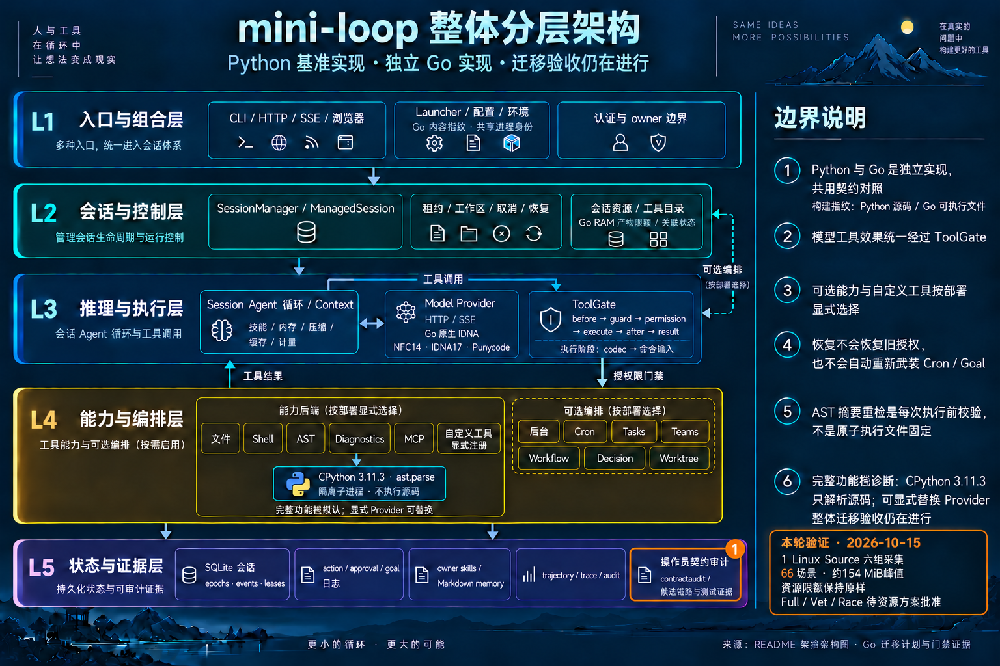

# 当前 Go 修订的 Linux Source 采集

日期：2026-10-15。运行时提交：`606630f5c894b03cfccaafa1d2158e3bb07863cf`。
文档基线：`322f925`。本轮只推进平台证据，没有修改运行时代码或资源限制。

## 本轮结果

Linux arm64 上的六组平台敏感 Source producers 全部完成，共 66 个原始
recipes。实际执行的是 `/usr/bin/python3` 的 CPython **3.11.2**；保留原始
函数、输入定义、场景名称与 fixture 字节的校验绑定。

| 组 | 场景数 |
| --- | ---: |
| benchmark | 8 |
| httpapi | 5 |
| httpapi-efficiency | 2 |
| userresources | 4 |
| workspace | 38 |
| worktrees | 9 |
| 合计 | 66 |

阶段耗时 **12.318 秒**，cgroup 峰值 **161,345,536 B / 153.87 MiB**。
全部记录的宿主机内存压力样本正常；OOM、OOM kill 等计数均为零，
阶段结束后 owned 容器和临时 volume 清理完成。cgroup 内存是内核记账范围，
不包含宿主虚拟机开销，也不等同于进程 RSS。

使用原有封板配置：容器内存 1536 MiB、禁用额外 swap、CPU 2、
Go 软目标 512 MiB、`-p=1` / `-parallel=2`、`nice -n 10`。
没有更改阈值、自动重试、锁或允许的压力等级。

## 证据范围

[独立 Source addendum](go-native-idna-linux-source-2026-10-15.json) 绑定
当前提交的 archive、526 个 Python 源文件摘要、六组实际产物和原始资源记录。
同一运行时的 1864 个输入仍与
[先前 16 项宿主门禁](go-native-idna-progress-2026-10-15.json) 完全一致。
先前 receipt 按生成时状态保留，没有覆盖其历史 Linux pending 记录。

此次不是完整 Linux Python export。它没有运行原生 CPython 3.11.3 probe、
62-case parser、84-case IDNA 或 Linux Go full/vet/race；这些结论不能从
Source 采集结果推导。先前 `b8dd27a` 的 Linux full 内存压力停止记录继续保留，
不计为当前修订通过。

## 分层架构

本轮没有新增或删除架构部件，基础图和拓扑保持原样。通过内置 imagegen
编辑[完整基础图](../mini-loop-layered-architecture.png)，在 L5 操作员契约
审计处标记本轮采集，并明确显示其余 Linux 门禁待批准。
[精确生成提示词](../mini-loop-go-linux-source-2026-10-15.prompt.txt) 与图片一同保存。
README 当前 review baseline 和交互架构说明同步更新，HTML 从 JSON 重新生成。

## 本轮交付校验

- Source addendum 组装通过；SHA256：`f13691b9bec0e9fc62c90ee3af5c3cae15a1d35d8a88649dd1515edc9d718678`。
- Archify `validate` 与 `deliver` 均通过，showcase **9/9**，零错误、零警告。
  JSON：`82e142d7d9a1893b23bbfbbd34f68291531148f17773ca1c7687ad4507a8a3e0`；
  HTML：`56652aa4c91cae4838a0eaec3e33d9105736e5bc3c821d744a5f9dd36820e2c5`。
- PNG 已目视检查；HTML 浏览器目视检查因先前权限限制未执行。
- README outline 与 `git diff --check` 校验通过。

组装首次尝试因沙箱不允许读取 `sysctl` 内存压力，在启动工作进程前停止，
不能算通过。获得系统读取权限后，在相同封板限制下以独立阶段成功完成，
两次原始记录均保留。本轮只改证据与文档，未重跑 Python/Go 全套；
此前完整测试结果只在 1864 个运行时输入逐字节一致的范围内沿用。

## 尚未完成

Linux full/vet/race 的低内存执行方案仍待明确批准；提案没有执行。
这三项门禁完成后，才可组装完整平台 receipt 并应用明确的验收行 delta。
原始 344 行仍为 **339 verified / 0 incomplete / 5 dependency-blocked**，
本轮不改变覆盖率或宣告 Go 移植全部验收完成。
