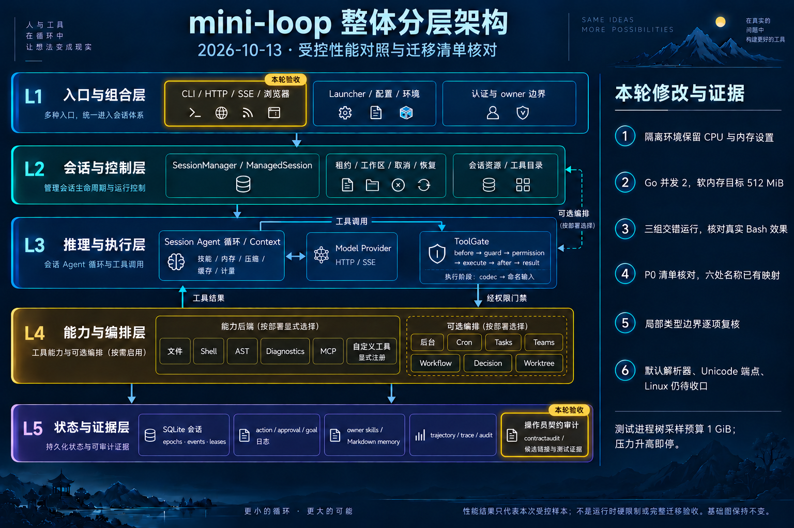

# Resource-controlled performance check — 2026-10-13

Runtime baseline: local main `82b14bf`. This iteration fixes the performance
instrument's sanitized server environment: it previously dropped inherited
CPU/memory settings. Both servers now receive a fixed conservative profile,
recorded alongside the instrument hash. No application runtime or dependency
changed.

The highlights identify entry-point measurement and operator audit evidence.
The five layers and their control flow are unchanged. The README Mermaid remains
canonical; the interactive map regenerates to the same bytes. The base image is
unchanged, and the [exact edit prompt](go-performance-resource-budget-infographic-2026-10-13.prompt.txt)
is retained.

## Resource controls and validation

Heavy stages ran serially with priority `nice 10`, `GOMAXPROCS=2`,
`GOFLAGS=-p=1`, a soft `GOMEMLIMIT=512MiB`, serial pytest and numeric-library
threads set to one. The outer monitor samples the owned process tree every
second. It stops that tree on non-normal host memory pressure, sampled RSS
reaching **1 GiB**, CPU above 250% continuously for 30 seconds, timeout, monitor
failure or residual processes. These controls are not OS hard limits.

| Check | Result |
|---|---|
| Regression on the old instrument | 1 failed: missing `GOMAXPROCS`; retained as before evidence |
| Instrument tests after the fix | 4 passed |
| Go CLI build | Passed |
| Three paired HTTP workloads | Passed, including real Bash file effects and matching final text |
| Full Python | 2253 passed, 28 skipped, 96 warnings, 24 subtests; 156.68 s |
| Invariants / scanners | 77 modules / 19 guards passed |
| Whitespace | `git diff --check` passed |

The short before probe used the earlier 3 GiB monitor default; all final stages
and the focused test used 1 GiB. Across the final six stages, sampled tree RSS
peaked at **442.6 MiB**. All 181 pressure samples, including before/focused
checks, were normal. Two isolated CPU samples reached 297.6% and 294.2%; neither
triggered the 30-second stop condition. The monitor completed its residual
checks, and a subsequent read-only check found all 82 recorded PIDs absent.
Short-lived activity between samples is outside this evidence.

All **1745** frozen program/asset and selected architecture files stayed unchanged
during validation. No Go source changed, so full Go test/vet/race and statement
coverage were not rerun. The [prior complete role-policy gates](go-role-policy-profiles-2026-10-13.json)
and [coverage profile](go-coverage-role-policy-profiles-2026-10-13.json) remain
the evidence for app **89.41%**, all Go **89.16%** and Provider **86.67%**.

## Matched samples

Each runtime has three process starts, 300 measured health requests and 60
measured fresh-session create/turn/delete sequences, plus six warmup turns.
Runs alternate order. Each turn verifies the actual Bash-created file before
deleting its session; each server joins and releases its port.

| Milliseconds | Python median / p95 | Go median / p95 |
|---|---:|---:|
| Startup | 288.117 / 393.326 | 14.458 / 498.376 |
| Health | 0.633 / 0.797 | 0.090 / 0.143 |
| Create session | 2.843 / 4.116 | 5.245 / 8.570 |
| Turn | 10.333 / 11.875 | 8.678 / 9.054 |
| Delete session | 0.728 / 0.862 | 0.291 / 0.381 |

Go creation was slower in these samples. Its startup outlier is retained;
with only three starts, nearest-rank p95 is the maximum. Median server RSS
after workload was 60,144 KiB for Python and 21,328 KiB for Go; these are single
server samples, not peak or descendant memory.

This was a shared host with another workload observed. The fixed resource
profile differs from the earlier benchmark, so these results do not establish
a regression or application optimization. No streaming, SQLite, concurrency or
paid-provider performance claim follows.

## Acceptance reconciliation

The P0 capability/default inventory is present, including all 157 namespace
lookups. Semantic parity remains tracked by the original G1–G7 requirements.
The [130 body observations](go-body-boundary-dispositions-2026-10-13.json) now
have individual source-backed dispositions. No unresolved broad dynamic
domain/service payload retention was found in that Darwin inventory; error
protocol propagation, temporary SSE wire state and generated CGO declarations
are explicitly distinguished. This establishes neither all-platform acceptance
nor total memory bounds.

Full migration remains open. The default parser backend/62 fixture consumers,
two Unicode-host direct/SSE cases and fixed-environment Linux gates remain
required work. The parity matrix retains other unverified required rows.

[Raw performance samples](../benchmarks/go-port-fake-http-resource-budget-2026-10-13.json)
and the [validation/resource receipt](go-performance-resource-budget-2026-10-13.json)
preserve exact commands, hashes, samples and limitations.
