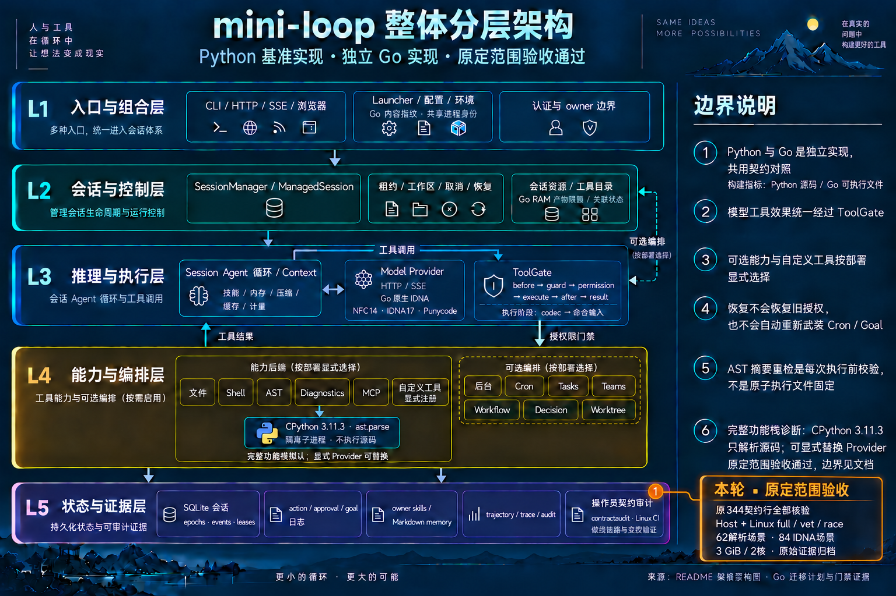

# Original Go-port acceptance — 2026-10-15

Original P0/P1/G0–G7 acceptance is complete within the recorded finite scope.
The [final receipt](go-port-completion-2026-10-15.json) and
[five-row delta](go-required-final-platform-delta-2026-10-15.json) compose the
original 344-row audit and prior 7/26/11/3 deltas, then close only the remaining
five rows: **344 verified / 0 incomplete / 0 blocked**.

Runtime baseline: `606630f`. The exact1,864-file manifest remains unchanged at
tested CI `3fccc2bec0272c1c1a0f0a8c38d812d0e3fe9917`.
[Actual run38661774873](https://github.com/luoyjx/mini-loop/actions/runs/38661774873)
uses job116184473434 and real runner1000001922. Source/full/vet/race, the on-run
verifier and the unchanged verifier's local replay of retained original bytes
all pass. The evidence receipt records precise files, hashes and raw events.

## Original work packages

| Package | Evidence and finite scope |
| --- | --- |
| P0 | Capability/default/settings/HTTP/SDK/public-export/schema inventories reconcile the original 344 IDs. Row counts describe an inventory. |
| P1 | Python remains runnable under `python/`; exact pytest gives 2,256 passed / 28 skipped. Invariants 77, scans 19 and real fake-server observations support relocation. |
| G0 | Independent Go server and named protocol/domain contracts, four zero-finding type audits and real JSON admission tests. The approved external parser is a selected grammar dependency. |
| G1 | Real fake-model loops, ordered transcript, queued cancellation and concurrent-session owner/state isolation. |
| G2 | Immutable catalogue, exact gate order, denial/cancel controls and selected-argv effects. Recorded observations confer no new authority. |
| G3 | Actual REST/SSE/default/error/owner corpus, team controls and Source-matching embedded browser bytes; real HTTP/auth and 37 browser interaction cases. |
| G4 | Direct/stream transport, interruption/recovery, usage/cache/history and the original 84 IDNA request-object recipes. Native error and constructor-identity adaptations remain explicit. |
| G5 | Seven persistence groups cover Manager restore, cron/scheduled work, leases/rollback, killed generation, compaction, decisions and team restart. SQLite NORMAL retains its recorded durability boundary. |
| G6 | Optional slices retain flags/defaults, catalogue and effect evidence. Actual62 parser recipes and default Manager/HTTP/CLI integration cover the approved CPython backend. |
| G7 | Host 16, four real Linux gates, two current documentation gates, final row composition and retained three-pair performance evidence. |

## Validation and resources

[Host evidence](go-native-idna-progress-2026-10-15.json) binds 16 passing gates and
53 Go packages. Per-package application statement coverage is 33,286/38,919
(85.53%, tools excluded); all-Go coverage is85.34%. The original31 core assertions
and persistence 25 top-level plus 49 subtest bindings pass in all four Go cohorts.
Each Linux full/race cohort passes all 6,955 required named identities.

Source capture has six groups/66 recipes on CPython3.11.2. Native full/vet/race
separately probe the approved external CPython3.11.3 interpreter. One pinned
arm64 image supplies Go1.23.3 and existing runner Node22.23.3. Containers are
offline, limited to3GiB/no extra swap/two CPU cores; Go's1GiB target is soft.
Package concurrency is1, test parallelism2, and stages run serially at nice10.
Raw Linux MemAvailable/PSI, cgroup OOM counters and owned-resource cleanup pass.
These samples and container charging retain their documented measurement limits.

| Actual Linux stage | Seconds | Cgroup peak MiB |
| --- | ---: | ---: |
| Source | 13.13 | 99.18 |
| Full | 245.14 | 941.07 |
| Vet | 95.91 | 892.38 |
| Race | 529.13 | 1215.34 |

All stages use image `sha256:cf321f481515a016ac9dc0ee8f64d6fdf95a9008546288571ac231991428d432`.
All 269 pressure observations are normal; all four stages have no OOM and no
remaining owned containers or volumes. These peaks exclude host overhead.

Each Linux cohort retains 13 named skips: seven optional/helper subcases and six
Darwin-only Seatbelt cases. The six have actual host ordinary/race passes;
Linux unavailable-sandbox behavior passes separately. `internal/fnmatch` and
`runtimeconfig` have no test files. The required browser test actually passes,
including 37 TAP cases with zero failures or skips. Skips remain explicit.

IDNA covers mock-transport request objects, configured identity, credentials,
admission phase and text. Unicode14 NFC/Bidi and IDNA17 tables are fixed;
Punycode has scalar/size bounds. Live DNS/TLS/vendor behavior, arbitrary SDK
objects and complete lone-surrogate lifecycles remain outside these fixtures.
The parser uses isolated `ast.parse` and never executes target source.
Go memory targets do not cap CGO or children; cgroup limits and pressure
observations provide separate evidence.

The retained three-pair experiment used default fake providers, serial persistent
HTTP, zero model delay and verified Bash effects. Go creation was slower in that
sample. Those historical measurements establish their original performance check
with its recorded limits; they supply no new universal speedup or SLO.

## Publication and retained history

The [first failed run and correction](go-linux-ci-browser-2026-10-15.md) remain
unchanged. Run38656712770 failed final verification after unreviewed skips.
Run38659480581 genuinely passed CI but omitted bootstrap raw logs from its
artifact, so complete offline replay failed. The final run retains the real
`logs/` directory; 31 small tests include a real producer-to-archive contract.
The acceptance verifier's bytes remain unchanged across the last two runs.

Original CI checked Node/wheel/module/cache/workspace/dependency bytes before
packing. Transport preserves raw logs and hashes while excluding caches and the
large Node binary; local replay explicitly does not re-read those omitted bytes.
Use the tested CI revision for exact replay. Publication commits preserve their
separate provenance; they do not imply tests were rerun on a new documentation HEAD.
The strict receipt includes the old Go README. A separate prose-only availability
correction will record its old/new hashes and the other 1,863 unchanged inputs.

## Architecture

The canonical README, JSON specification and generated interactive HTML are
aligned. Archify showcase validation/delivery passes 9/9 with zero errors and
warnings. PNGs are visually inspected; HTML browser visual inspection remains
skipped because the earlier browser approval was unavailable.

[Clean base](../mini-loop-layered-architecture.png) ·
[Base prompt](../mini-loop-layered-architecture.prompt.txt) ·
[Exact iteration prompt](../mini-loop-go-port-completion-2026-10-15.prompt.txt)
