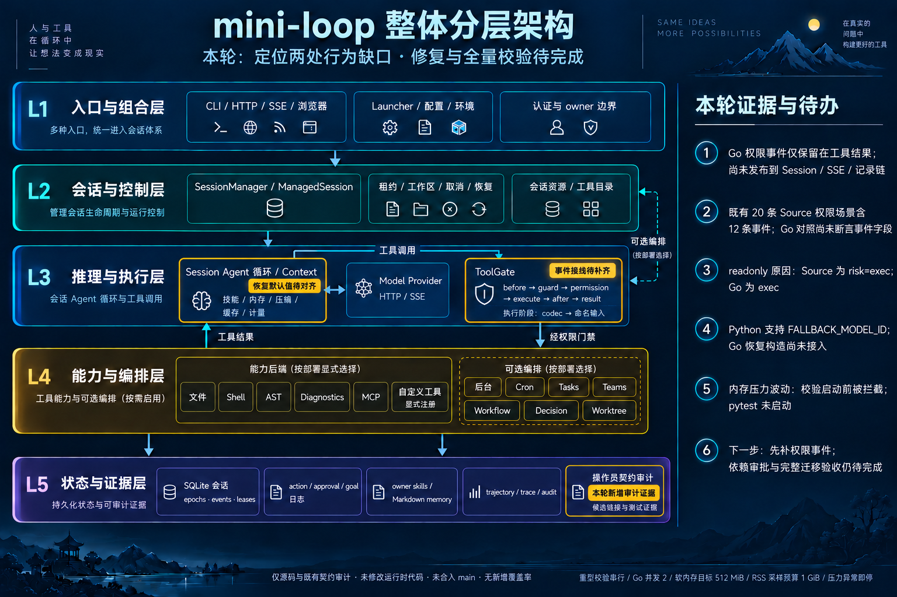

# Go migration: two concrete remaining boundaries

Reviewed 2026-10-13 at `3449dc1` on `codex/go-provider-idna-boundary`.
This is a source and existing-fixture review. No new Source capture, Go execution,
runtime implementation, dependency or permission grant is included.

## 1. Permission decisions do not reach the Go session event stream

Python's default hook chain installs `PermissionHook`. Each matching decision
calls `ToolContext.emit_event("permission", ...)`, which routes through
`Agent._send` and `Session.emit`. The session applies its normal identity,
masking, capture, publication and optional store/trajectory paths.

The current Go policy builds named `PermissionEvent` values and retains them in
`PermissionOutcome` / `ToolOutcome`. `dispatchToolAnnounced` publishes tool-use
and tool-result events, but does not publish those permission decisions.
Neither the closed `SessionEvent` union nor its JSON/stored-event codecs has a
permission variant. The observation projector and manager composition do not
install a separate publisher. This is an event-parity gap; the review found no
permission bypass and does not establish a new exploit or an execution failure.

There is also a directly inspectable payload difference. The existing actual
Source fixture `python-provider-bash-command.json` has 20 permission profiles:
12 emitted events, of which eight readonly events contain `reason="risk=exec"`
and four immutable-deny events contain their matched pattern. Go emits the
readonly reason `"exec"` in its retained outcome. Its current fixture consumer
decodes only name, mode, input and output, then asserts denial/message; it never
decodes or compares `events`. A passing candidate consumer therefore does not
prove these recorded fields match.

Evidence entry points:

- `python/mini_loop/permissions.py`: `_emit`, `before_tool`, `default_hooks`.
- `python/mini_loop/registry.py`: `ToolContext.emit_event`.
- `python/mini_loop/agent.py`: `Agent._send`.
- `python/mini_loop/session.py`: `_capture_event`, `emit` and publication.
- `python/tools/provider_bash_command_contracts.py`: existing hook capture uses
  a replacement `_send`; it is not a managed-session/SSE/restart capture.
- `go/agent/permission.go`, `gate.go`, `lifecycle.go`, `events.go`,
  `event_json.go`, `stored_event.go`, `secrets.go`, `efficiency_observation.go`.
- `go/agent/bash_command_test.go`: the 20-profile permission consumer.

Next implementation slice, under original G2/G3/G5 acceptance:

1. Make all 20 existing fixture rows' permission events required assertions.
2. Capture finite real managed Source cases for readonly, immutable deny,
   auto allow, interactive approval/refusal and interrupted execution. Compare
   decision timing, identity, masking and the live event sequence.
3. Add a named event variant, detached access, JSON/masking/stored decoding and
   a typed publisher at the actual decision point. Retain standalone policy
   outcomes. Do not replay events after tool completion: that would move allow
   events after effects and lose evidence on later cancellation or failure.
4. Verify actual SSE, trajectory and SQLite reopen projections without restoring
   authority from historical events; preserve the existing execution gate order.

## 2. Recovery construction omits the documented legacy fallback model

Python `DefaultRecovery.__init__` chooses
`fallback_model or os.getenv("FALLBACK_MODEL_ID") or None`. Default `Agent`
construction passes `Settings.fallback_model`, so a nonempty
`MINILOOP_FALLBACK_MODEL` wins; missing or empty settings fall back to the legacy
environment value. `python/.env.example` still documents `FALLBACK_MODEL_ID`.

Go `config.Load` also reads only `MINILOOP_FALLBACK_MODEL`, matching the Settings
boundary. However, Launcher passes that value to `NewDefaultRecovery`, whose
constructor never reads the legacy environment. A raw Session's default recovery
also uses an empty explicit configuration. With only the legacy variable set,
the fallback target therefore differs. Static inspection of both retry loops
shows this target is used after three consecutive overloads to select the next
request model and emit a recovery fallback event. No new paired execution has
been run to claim an observed runtime failure in this review.

Next G4/default-construction slice must cover absent, empty, whitespace,
explicit-precedence, explicit Recovery replacement and construction-time capture.
Do not fold legacy fallback into the Settings snapshot: Python's legacy-only
Settings value stays absent. Preserve Go's explicit environment-map isolation,
and avoid reading a changing ambient environment during a turn. Required paths:
`python/mini_loop/recovery.py`, `agent.py`, `config.py`, `go/config/settings.go`,
`go/launcher/app.go`, `go/agent/recovery.go`, `session.go` and `go/README.md`.

## Resource-limited validation attempt

The initial read-only pressure check returned normal (1) on the 16 GiB host.
A new, separate validation directory retained the prior frozen program inputs
and tried to resume at full Python. Its immediate prelaunch pressure check
refused the run, with zero process samples and no pytest child launched.
A later standalone normal reading was followed by a proposed 45-second stability
window; its first sample was warning (2), so it ended immediately and launched
no tests. These observations show why a single normal sample is insufficient.

No heavy retry followed. The pending full Python, invariants, scans and Archify
checks remain pending; no new Go full/vet/race or coverage result exists. The
previous passing focused tests and 253-file Source export remain historical
evidence for unchanged inputs, not substitutes for the missing full gate.
Local main remains `66f3645`; the IDNA Source commits remain on the branch.
CPython-parser and new IDNA dependency approvals remain unresolved.

The companion JSON retains exact resource reports, source/fixture hashes and
the reviewed baseline. The base architecture and canonical topology are unchanged.
This iteration image highlights the reviewed boundaries and labels both fixes as
pending; it does not depict a completed implementation.

