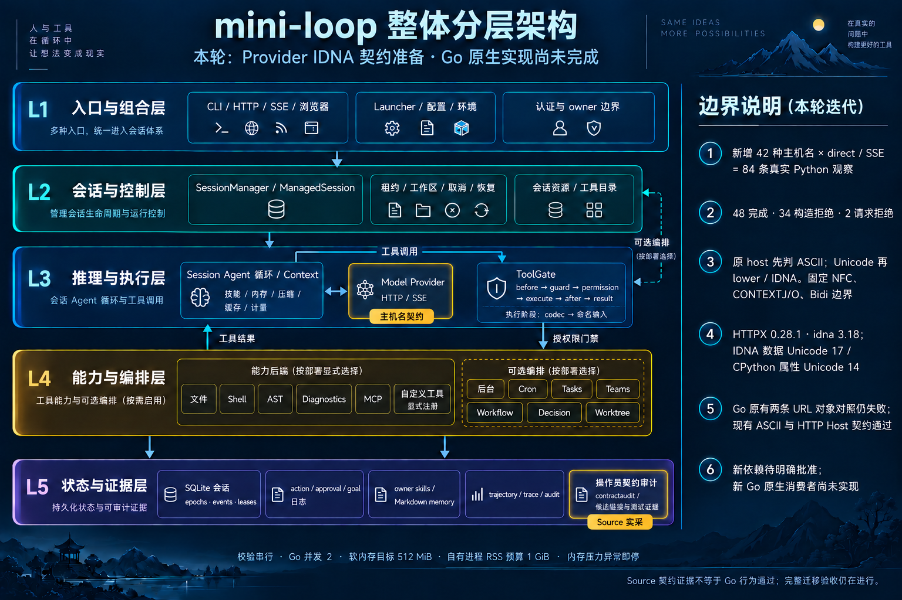

# Provider IDNA Source contracts — 2026-10-13

Outcome: captured **42 hostname profiles / 84 direct and SSE observations** from
the real Python provider, Anthropic SDK and HTTPX. This is preparation for the Go
implementation. The new fixture has no native consumer yet; the existing two
Unicode request-object assertions still fail.

## Observed behavior

The capture fixes Anthropic 0.107.1, HTTPX 0.28.1, idna 3.18, idna's Unicode
17.0.0 table and CPython 3.11.3 / Unicode 14.0.0 properties. Actual source hashes
are recorded in the fixture. The two Unicode versions have distinct roles; this
does not mean the runtime implements all Unicode 17 behavior.

| Outcome | Rows | Evidence |
|---|---:|---|
| Completed request | 48 | Exact request URL, raw path, method, headers, final text and original configured identity |
| Constructor refusal | 34 | `InvalidURL`, no transport call |
| Request-stage refusal | 2 | ASCII `xn--a.invalid` constructs, then raises `InvalidCodepoint`, no transport call |

The original hostname selects the ASCII branch before Unicode lower/IDNA.
An ASCII underscore or long label can pass this boundary, while the same label
inside a Unicode hostname fails strict IDNA validation. Kelvin-sign lowering
must not erase the original branch choice. NFC decomposition is refused instead
of normalized silently. Unicode separators, contextual joiners, middle dots,
Greek/Hebrew punctuation, numeral mixing and labelwise bidirectional rules have
explicit positive/negative observations.

The capture uses `MockTransport`. Its test refuses socket connect attempts.
It proves request-object behavior, not DNS, TCP, TLS or arbitrary HTTP wire
behavior. Original configured audit identity is preserved separately.

## Validation and resource stop

- Existing two Unicode cases: required assertions reproduced the URL difference
  using a temporary Go test overlay. No tracked Go test was changed or skipped.
- Existing 32 ASCII request-object and 40 real HTTP Host cases: passed.
- Source-focused Python tests: **3 passed in 1.24s**.
- Complete Source exporter: **253 files current**.
- Consumer inventory: exit 1, with **252 previously observed passing candidates
  and two unreferenced fixtures**, default parser and new IDNA. The native test
  results come from the prior role-policy ordinary run; all 1249 previously
  frozen Go files still match. This is not a new full Go suite.
- `git diff --check`: passed.

The initial validation wrapper mishandled the inventory tool's diagnostic text
after its JSON. The full output and initial wrapper are retained. The corrected
resume verified the exact two gaps and proceeded only to the next stage.

**Full Python did not start.** The monitor detected non-normal host memory
pressure before launch; a read-only follow-up returned warning level 2 on the
16 GiB host. This is resource-blocked, not a passing or failing Python suite.
Invariants, scans and Archify regeneration were not reached. No heavy retry was
started in this iteration, and unrelated processes were left alone.

Completed stages ran serially with `nice 10`, Go concurrency 2, package
parallelism 1, soft `GOMEMLIMIT=512MiB` and a **1 GiB** sampled owned-tree RSS
budget. Observed peak RSS was **378.9 MiB**. All 114 samples from started stages
had normal pressure; the later pre-launch block has no process samples. These
controls are not hard OS CPU/RSS limits. All **1748** frozen inputs still match.

The changes stay on `codex/go-provider-idna-boundary`. Local main remains
`66f3645`; merging waits for the remaining validation. Go full/vet/race and
coverage were not refreshed. The base architecture and interactive specification
are unchanged; the iteration image highlights the existing Provider and audit
components. Its [exact prompt](go-provider-idna-source-infographic-2026-10-13.prompt.txt)
is retained.

## Dependency decision and remaining work

`AGENTS.md` requires explicit approval for added dependencies. Approval is pending
for fixed `golang.org/x/net v0.43.0` and `golang.org/x/text v0.28.0`; neither was
added. Their module files both declare Go 1.23.0:
[net go.mod](https://raw.githubusercontent.com/golang/net/v0.43.0/go.mod),
[text go.mod](https://raw.githubusercontent.com/golang/text/v0.28.0/go.mod).
The existing local Go toolchain would remain in use.

Registration/Lookup profiles do not automatically match Python's ASCII bypass,
strict IDNA rules, Unicode tables, labelwise Bidi or error stages. The next
implementation must consume these observations and preserve endpoint guards,
original audit identity and the separate wire boundary. CPython parser approval
is a separate outstanding decision. Original P0/P1/G0–G7 acceptance remains open.

[Machine receipt](go-provider-idna-source-2026-10-13.json) ·
[Captured fixture](../../go/testdata/python-provider-idna.json)
