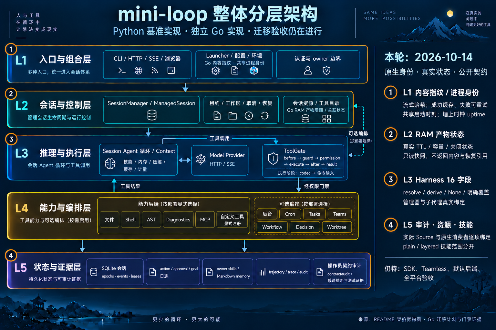

# Public identity, typed composition and runtime-store observations — 2026-10-14

Baseline local main `48fd26d`; branch `codex/go-public-contract-closure`.
The original P0/P1/G0–G7 migration objective remains open.

## Finite row reconciliation

This iteration applies eleven rows in the original 344-row audit through the
[hash-bound delta](go-required-public-contract-delta-2026-10-14.json).
All twenty required gates passed against the current frozen inputs. Starting
from 325 bounded verified, 14 evidence-incomplete and five dependency-blocked
rows, the composed result is **336 bounded verified, three evidence-incomplete
and five dependency-blocked**, with no concrete mismatch rows. These counts
describe the finite audit; complete migration and platform acceptance remain open.

| Original row | Evidence added or reconciled |
| --- | --- |
| `export:build_id` | Actual Source content/cache/failure-recovery recipes; native executable fingerprint and two real artifact probes |
| `export:runtime_identity` | Three public Source profiles, eight clock controls, shared native process identity and real launcher/HTTP composition |
| `export:audit` | Root-public alias tied to existing complete manager audit and composition consumers |
| `export:render_audit` | Six complete public renderer recipes and five invalid-severity controls |
| `export:Finding` | The same finite four-field records, exact output and explicit typed validation boundary |
| `export:Harness` | All sixteen Source fields, derive/resolve/default dispositions and real native manager/runtime/child consumers |
| `export:SkillLoader` | Actual plain catalogue producer and existing 19-case consumer |
| `export:LayeredSkillLoader` | Actual layered producer and existing 16-case consumer |
| `export:UserResourceResolver` | Correct actual owner-resource producer, four recipes and 28 ordered steps |
| `export:UserResources` | The real resolver-produced bundle consumed by the owner-resource tests |
| `capability:08` | Nine actual launcher profiles now compare effective raw-store limits, presence and shutdown closure |

The remaining three evidence-incomplete rows are the fixed SDK direct and stream
escaped lone-surrogate ingress/subsequent-request probes, plus the actual
teamless HTTP branch. The five dependency-blocked rows are `setting:base_url`,
`setting:enable_features`, `export:build_client`, `export:full_registry` and
`capability:04`. They retain the approved-dependency/default-parser decision
boundaries; five blocked rows do not mean five unrelated dependencies. IDNA
approval/adoption, the default CPython parser policy and complete Linux/runtime
acceptance are not closed by this iteration.

## Native artifact and shared process identity

The new `go/identity` package provides a named fingerprint and closed process
snapshot. SHA256 is read through a 32 KiB buffer; the executable is not loaded
as one large byte slice. Only a successful fingerprint is cached. An unavailable
artifact returns the fixed error `native executable fingerprint unavailable`,
and a later repaired read can succeed and become cached. Private filesystem
paths and OS diagnostics are not published through that error.

Source `build_id` hashes sorted Python package paths and source contents. Native
identity hashes the executable bytes. This is an explicit language adaptation:
equal Source/Go digest strings are not required or claimed. VCS revision and
modified status remain supplementary metadata, since two different dirty
artifacts can carry the same VCS fields.

The real two-artifact probe recorded these results:

| Native artifact | Complete SHA256 | Published fingerprint |
| --- | --- | --- |
| `identity-probe-a`, variant `first` | `acf3d149faa69224c724d11e26612c2f227b4a6ffc83ecdbb7123ef312c8c84e` | `acf3d149faa6` |
| `identity-probe-b`, variant `second` | `73f495352913f02ab67060b16228999041d2004e78423afc0fdc02ec67894a99` | `73f495352913` |

Both artifacts reported revision
`48fd26da6069867627776499ed53c52e89f0f6d3` and `vcs_modified=true`.
Repeating artifact A retained its fingerprint while changing the actual PID;
a byte-identical relocated copy also retained it. A separate owned copy removed
before its first identity read returned the explicit error and an empty identity
snapshot. The original probe artifacts were not removed by that test. Raw
observations and complete hashes are retained in
`var/go-public-contract-closure-2026-10-14/artifact-observations.json`.

Launcher composition reads the fingerprint before creating provider transports,
stores, workspace resources or a manager. Default HTTP construction also refuses
an unavailable fingerprint. An explicit `httpapi.Config.Build` remains an
embedding override and does not require an implicit executable read from health.
`launcher.CurrentBuild` retains Go/VCS metadata and adds a fingerprint with an
explicit optional fingerprint error.

All HTTP instances now share the identity package's PID and initialization time.
This corresponds to Source module `STARTED_AT`; it is not recovery of the OS
process creation timestamp. Uptime follows Source wall-clock subtraction and
three-decimal rounding, including backwards clock movement, negative elapsed
values, decimal ties and signed zero. The eight actual Source clock controls
are distinct from the three ordinary no-manager/default-manager/authenticated
manager profiles. `Config.Now` remains the request/rate-limiting clock and does
not set process identity.

The isolated `48fd26d` baseline retained two executed counterexamples: health
reported `build="development"`, and two servers using different injected clocks
reported different starts (`100` and `200`). Those failures establish the changed
runtime behavior rather than a test-name inventory. Successful-only caching and
wall-clock elapsed were also corrected during review; the initial sticky-error
cache and monotonic-time implementation are not the final policy.

## Sixteen-field Harness composition

The actual root-public Source `Harness` producer visits every dataclass field:
`tools`, `transport`, `hooks`, `skills`, `system_builder`, `compactor`, `recovery`,
`stuck_detector`, `cache_policy`, `secrets`, `sandbox`, `spill`, `subagents`,
`token_efficiency`, `role_tool_policy` and `injectors`. Each field has explicit
resolve, replacement, derive-to-None, unchanged-template and shared-other-field
observations. Unknown derive names and frozen assignment fail through the real
public implementation. Four actual Agent construction profiles compare every
binding: Harness only, explicit None, explicit values and a derived template.

Source `resolve(name, None)` inherits the template. Clearing a field requires
deriving a template with that field set to None, after which Agent defaults
apply. Explicit False is preserved by the value object's resolve operation;
that observation does not make False a valid implementation of every Agent seam.
For injectors, explicit None can inherit the template, whereas an explicit empty
list replaces it; runtime-facts injection remains appended by the runtime.

Go keeps these dependencies in named `RuntimeConfig` and `ManagerServices`
fields. It does not add a string-keyed derive/resolve API or treat Go zero values
as an invocation of Source None fallback. Transport is represented by Provider
and stream policy; hook responsibilities are split across gate, prompt and stop
interfaces; sandbox and spill are held inside bound executors. A child has its
own fixed system prompt. Source retains the builder attribute while selecting
that fixed string; native code selects `FixedSystem` directly.

Actual parent/default-child model runs and injector calls verify shared policy
handles, fresh history, capability selection and copied injector containers.
Manager composition is exercised through the real production composition path.
Two catalogue paths have separate evidence:

- Source built-in registry callbacks resolve `ctx.agent.toolset`. Native
  `NewBashToolCatalog(executor)` explicitly captures its caller-selected
  executor. The custom native recipe composes the same Spill Store into that
  executor before freezing the catalogue. Its child preserves that selected
  executor; equality with the parent's separate runtime executor is not required.
- A separate `Tools=nil` recipe constructs the default native catalogue and fresh
  child from the runtime-bound executor. It verifies actual child execution,
  sandbox invocation and store preservation independently of the custom recipe.

The parent config executor starts without a Spill Store, so preservation after
runtime construction proves `RuntimeConfig.Spill` was applied. Bounded 60 KB
backend probes verify actual saved output under the selected store root and the
same observed NullSandbox argv delegate. They do not infer success from a
directory's existence. The original executor remains unchanged. These are
operator backend probes; model tool permission or OS confinement is not inferred.

The complete sixteen-row adaptation table and per-symbol provenance are retained
in `var/go-public-contract-closure-2026-10-14/harness-review.json`. This finite
table does not certify arbitrary Python attributes, every future Harness field,
all workflow workers or full Launcher configuration.

## Audit, skills and owner resources

Six actual root-public Finding/renderer recipes compare all four string fields,
caller order, complete output text, severity-ordered summaries, repeated counts,
empty findings and Unicode/newline/control text. Five invalid severity controls
refuse without partial rendered text. Source validates at frozen-dataclass
construction; Go validates its named Finding values at Render. That boundary
adaptation does not claim Python object identity, slots or mutation semantics.
The public `audit` alias is tied to existing complete native manager findings and
renderer assertions: thirteen real manager profiles and sixteen composition
profiles retain their existing scopes.

The four skill/resource rows repair evidence linkage. Plain skills use
`_skill_contracts` and `python-skills.json` (19 recipes, 44 loads); layered skills
use `_layered_skill_contracts` and `python-layered-skills.json` (16 recipes,
47 loads). Owner resources use `_owner_resource_contracts` and
`python-owner-resources.json` (four recipes, 28 ordered steps), rather than the
unrelated user-skill publication fixture previously associated with that seam.
Existing consumers already compare actual descriptions, hashes, scoped loads,
owner cache identity, memory isolation, refresh behavior and local/aggregate
problem logs. No duplicate implementation or newly invented fixture replaces
those consumers.

The supplemental managed-resource frames retain their limits: their native
in-memory test store is not native SQLite restart evidence, and a constructed
inherited-bundle frame alone is not a complete teammate scheduler proof. Trusted
owner IDs select resources; a skill name or observed bundle grants no authority.

## Effective raw-store status

`ManagedSession.RawArtifactStoreStatus()` returns a detached named status with
effective limits and closure state. Its presence boolean distinguishes no store
from a retained closed store. Big-integer limit values are copied, and mutating
the returned observation does not change the live store. No raw payload, recovery
reference or store pointer is exposed.

The existing nine real launcher/HTTP profiles now compare store presence,
selected TTL and per-artifact/total capacities, and post-stop closure in addition
to their request, receipt and manager-lifecycle checks. The selected values are
seven seconds, 20,000 bytes and 40,000 bytes. This confirms startup consumption
and lifecycle reporting. It does not wait for actual seven-second expiry or
saturate the selected capacity limits; store behavior has separate tests.

## Retained attempts and corrections

Failed attempts remain under `var/go-public-contract-closure-2026-10-14/`:

- The first Source Harness capture used an invalid module import for
  `default_registry`; it was corrected to the real root-public export.
- A new native status test initially used a nonexistent `CreateSessionRequest`
  field. A Harness provider initially omitted required completed-reply metadata.
  Both test recipes were corrected without weakening production validation.
- The first custom-catalogue spill recipe assumed runtime composition rewrote
  an already bound custom executor and required parent/child executor pointer
  equality. The corrected adapter retains actual preservation and sandbox
  assertions and adds the independent default-catalogue child recipe above.
- The exporter passed a temporary-directory string to the new Path-based
  producers. Its bridge now supplies `Path(scratch)`; the failed export and
  subsequent gate remain distinct records.

These setup/recipe failures do not count as passing gates or additional runtime
defect families. The isolated identity baseline failures are retained separately
as actual counterexamples.

## Final validation and delivery

The [final gate receipt](go-public-contract-closure-2026-10-14.json) fixes runtime
commit `87df8202560a3d858a0933fc61333a972ca364df`, all twenty required stages and
1,825 canonical Go/Python/AGENTS inputs. Its SHA256 is
`848564791b917cd3fea0807bef62737775a0f00c6af8cbc592fbfe628af5abfd`.
The applied delta verifies that exact receipt hash and records the eleven
bounded dispositions. The receipt's pre-application proposal remains immutable;
the separate applied delta supplies the resulting status counts. Intermediate
review files retain their historical pending labels.

| Gate | Result |
| --- | --- |
| Go full, atomic package coverage | 52 packages; 1,488 top-level and 13,089 subtests passed; six top-level and one subtest skipped |
| Go race | Same 52-package set: 50 passed, two with no tests; same test pass/skip counts; no race diagnostics |
| Go vet | Passed |
| Python full | 2,275 passed, 28 skipped, 104 warnings, 24 subtests passed |
| Actual Source replay | 265 contract files current |
| Invariants / scanning guards | 77 modules / all 19 scanning guards passed |
| Selected failing-store mutation guard | One baseline-and-mutation guard passed |
| Type audits | Syntax: 475 production files, 1,501 types; public: 1,224 exported types; private: 288 private root types; variable audit also passed; all zero findings |
| Native and Source focused consumers | Passed, including the final two-file Python rerun after the exporter bridge fix |
| Two actual artifact builds and runtime probes | Passed; executable bytes, repetition, relocation and unavailable-artifact controls retained |
| Canonical architecture generation | Showcase 9/9, zero errors/warnings; the first commit's intermediate specification/HTML also passed 9/9 |
| Whitespace integrity | `git diff --check` and staged diff checks passed for each commit |

Application coverage is **85.3485696%** (32,639/38,242 statements), compared with
85.3383951% in the previous same-instrumentation receipt. Provider coverage stays
**82.5732899%** (1,521/1,842). Coverage uses per-package instrumentation without
`-coverpkg`; duplicate span hits are combined with OR. This is statement
coverage, separate from the 344-row finite parity audit.

Following the user's relaxed-limit instruction, heavy stages ran serially with
`GOMAXPROCS=2`, `GOFLAGS=-p=2`, test parallelism two, nice at least ten,
`GOMEMLIMIT=512MiB` as a soft target and `GOGC=75`. The task-tree RSS stop budget
was 1.5 GiB; CPU above 450% for 45 seconds or unapproved memory-pressure readings
would stop the owned stage. Full Go took 116.478 seconds with sampled RSS
552.27 MiB; race took 214.286 seconds with 669.67 MiB; full Python took
94.436 seconds with 428.16 MiB. These are sampled tree observations, not hard OS
caps or true maximum process memory. Fast probe samples can miss their children.
Different cache states and workloads prevent attributing the timing change
solely to increased concurrency.

Raw logs, failures and stage-specific fingerprints remain in
`var/go-public-contract-closure-2026-10-14/`. Full root pytest uses
`--ignore=var` to avoid collecting preserved isolated checkouts. The earlier
focused Python pass predates the exporter fix; `python-focused-final` supplies
the current gate. The earlier identity capture is likewise retained as a
superseded success, while `source-identity-retry-clock` supplies the final capture.

The code is split into three cohesive commits:

- `d2ae811acf7c5715b85b32af1d2cd4a49230c10a`: detached raw artifact store status.
- `4a835e3cdf8d97962298597f001ccf0614461d3c`: public Harness Source comparisons.
- `87df8202560a3d858a0933fc61333a972ca364df`: shared native content/process identity.

The final documentation commit contains this article, the immutable receipt,
the applied delta, plan/matrix updates and iteration image/prompt. Delivery is
to local main; its final commit identity is checked after commit creation.

There is **no fetch, push or CI refresh** in this iteration. Local validation and
local-main delivery do not imply remote or cloud-CI acceptance. Full Linux/race
and original migration completion retain their separate acceptance gates.

## Architecture evidence

The canonical README map, JSON specification and generated HTML describe the
existing typed runtime and the new identity observation package. The base image
and exact base prompt are updated for the added component; the iteration image
marks identity/HTTP, composition and store-status changes. Both PNGs were
visually inspected. Generated HTML has structural showcase acceptance only;
no browser visual acceptance is claimed.

[Exact iteration image prompt](go-public-contract-closure-infographic-2026-10-14.prompt.txt).
