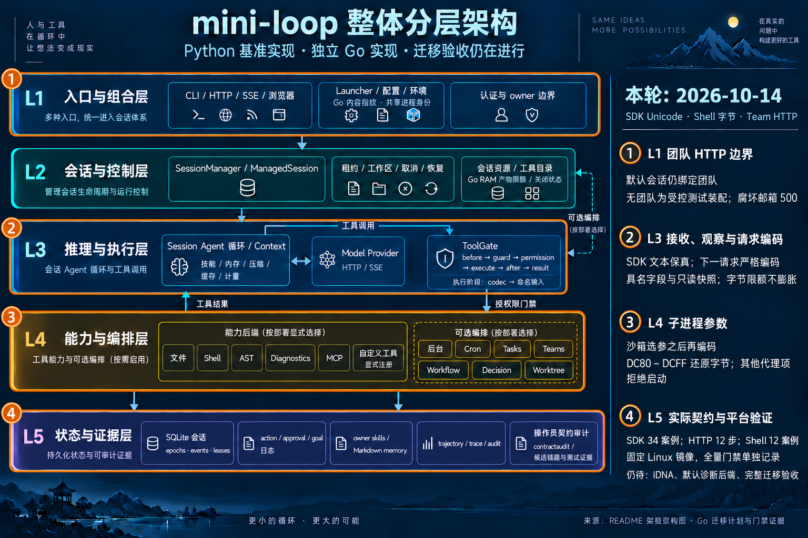

# SDK Unicode observations, shell arguments and teamless HTTP — 2026-10-14

Baseline: `a378a2b99521cdd9102e33e9a345610e6132aa0b` on
`codex/go-remaining-contract-evidence`. This article records the bounded Source
observations, retained counterexamples and implementation scope. Final validation
and the applied finite row reconciliation are recorded below.

## Original requirements and finite row reconciliation

The original P0/P1 and G0–G7 work packages remain the acceptance criteria. The
[original-criteria review](../../var/go-remaining-contract-evidence-2026-10-14/original-acceptance-review.json)
maps each of those ten requirements to existing evidence and remaining work.
P0 inventory and P1 relocation have authoritative completion evidence. Native
SQLite, restart/recovery and launcher evidence already exists; older indices
that describe those implementations as absent need reconciliation against the
delivered receipts.

The additional [bounded G5 recipe ledger](../../var/go-remaining-contract-evidence-2026-10-14/g5-required-recipe-ledger.final.json)
links seven existing groups: manager's seven restoration scenarios, cron/scheduled
restoration, leases/rollback, killed-generation recovery, three compaction cases,
two decision replay sizes and team restart. Host ordinary/race and Linux
ordinary/race each contain the same 25 passing top-level and 49 passing subtest
names. This resolves the bounded recipe-to-current-pass mapping without a new
backend. The killed process is native strengthening; compaction combines native
end-to-end tests with Source primitives/unit evidence; team comparison uses a
typed subset. Those distinctions prevent a claim that all groups share one
identical Source end-to-end fixture or certify the whole G5 criterion.
Ledger SHA256: `df1fd9ca53f60e9a6fffa92a69d2b360ad5987b020458d7a93f9c9eb0a120312`.

The preceding [public-contract receipt](go-public-contract-closure-2026-10-14.json)
leaves **336 bounded verified, three evidence-incomplete and five
dependency-blocked** rows in the original 344-row audit. This iteration supplies
new evidence for these three rows:

| Original row | New finite evidence |
| --- | --- |
| `sdk-producer:direct` | Actual fixed-SDK reply, snapshot and subsequent-request behavior for escaped lone surrogates and scalar controls |
| `sdk-producer:stream` | The corresponding actual SSE path, including partial-input and snapshot failures |
| `http:GET /sessions/{session_id}/team` | Actual owned HTTP requests through default, teamless, detached and corrupt-mailbox states |

The applied three-row delta now records **339 bounded verified, zero
evidence-incomplete and five dependency-blocked** rows. It does not complete the
original migration goal. The five blocked rows remain `setting:base_url`,
`export:build_client`, `setting:enable_features`, `export:full_registry` and
`capability:04`: they represent the IDNA dependency decision and default CPython
parser/backend policy. No dependency is added here.

Current fixed Linux full/vet/race and the refreshed matched fake HTTP performance
instrument are recorded in the final receipt. Earlier failed Linux cohorts and
Source performance failures remain historical evidence; current passes neither
erase those failures nor establish their cause or a universal latency SLO.

## Actual SDK replies and subsequent requests

The [Source producer](../../python/tools/provider_surrogate_contracts.py) uses
Anthropic SDK **0.107.1**, Pydantic **2.13.4** and HTTPX **0.28.1** with an actual
MockTransport direct/SSE exchange. Its
[34-case fixture](../../go/testdata/python-provider-surrogates.json) contains
17 profiles in both modes: text, thinking, signature, redacted data, uploaded
file identifiers, Bash input, server-tool input and caller observations. Paired
surrogates, replacement characters and ordinary Unicode are controls.

The actual Source observations are:

| Observation | Cases |
| --- | ---: |
| SDK reply obtained | 29 |
| Normalized content snapshot obtained | 28 |
| Subsequent request raises `UnicodeEncodeError` before another transport call | 22 |
| Scalar controls complete a second request | 6 |
| Reply-ingress or reply-snapshot failures | 6 |

The six negative cases have distinct timing. Four SSE tool-input cases fail
while the SDK handles partial JSON, with actual `ValueError` diagnostics. A
surrogate in a caller extension key permits a direct SDK reply but fails during
the Source `_content_payload`/Pydantic snapshot; the corresponding SSE case
fails before an SDK reply is obtained. The fixture retains the actual phase,
`sdk_reply_obtained`, error class and message. These stages must not be collapsed
into one asserted Source ingress failure.

The [native consumer](../../go/provider/surrogate_contract_test.go) exercises
real direct and stream clients, retained typed content, escaped snapshots,
cloning, progress bytes and actual subsequent HTTP request bodies. For the
22 refused subsequent requests it checks that credentials and transport counts
remain at the first request. For the six negative cases the native API uses its
existing coarse `FailureProtocol` adapter. Source diagnostic stages remain
recorded evidence; an SDK intermediate reply object is not exposed by the Go
API, and exact internal-stage/error-class equivalence is not claimed.

The implementation retains observations in existing named content fields and
closed caller/input values. The explicit
`Block.MarshalObservationASCIIJSON` snapshot represents escaped surrogate code
points without adding an arbitrary payload carrier. Ordinary UTF-8 keeps its
existing byte-budget path. When a surrogate is present, the SDK bridge escapes
only that retained code point, preserving other literal UTF-8 bytes and the
existing input bounds. Regression tests exercise actual decoding near the byte
limit with both large Unicode content and a lone surrogate.

Standard request JSON remains strict about Unicode scalar text. Existing UTF-8
observation/archive paths retain their refusal, so these new values have no
claimed archive round trip. The Source fixture captures transport behavior with
the real Source content projection; it does not prove a complete Agent run,
ManagedSession persistence or all runtime progress paths. In particular, the
native Agent streaming path still has its own UTF-8 progress guard. Caller
observations confer no execution identity, owner, permission or approval.

## Selected shell arguments and the effect boundary

Opening the SDK observation path required checking where retained Bash text
could reach an OS effect. The
[shell Source producer](../../python/tools/bash_surrogate_contracts.py) calls
actual `Toolset.run_bash_result` with safe marker/output files in a private case
workspace. The [12-case fixture](../../go/testdata/python-bash-surrogates.json)
records six `UnicodeEncodeError` exceptions before child creation and six
successful executions, including ordinary Unicode, surrogateescape bytes and
a sandbox that repairs the original command.

The captured filesystem profile is UTF-8 with `surrogateescape`. Code points
`U+DC80`–`U+DCFF` become raw bytes `80`–`FF`; other captured lone surrogates are
rejected. Conversion applies to the complete selected argv, including program
and extra arguments, **after** trusted `Sandbox.Argv` selection. Checking the
original command earlier would incorrectly reject a successful repair. The
Source exception propagates rather than becoming a successful `CommandResult`.

The native [argv codec](../../go/shell/argv_encoding.go) follows that finite
filesystem boundary before pipes or a child are created. Its named
`ArgumentEncodingError` exposes the exception class, argument index and
character range without retaining command/path text. The Bash adapter omits
process-result metadata for this pre-child exception; a zero native result
must not imply an observed process result. Existing raw native byte-string
embedding behavior is separately retained, without claiming every arbitrary
native byte string has a Source text counterpart.

The [shell consumer](../../go/shell/bash_surrogate_test.go) checks actual
selected-argv behavior and marker/output bytes. The
[nil-journal gate consumer](../../go/agent/bash_surrogate_effect_test.go) takes
real provider-decoded Bash through the native ToolGate and executor. The latter
is necessary because a journal serialization refusal cannot establish the
effect boundary for a gate with no journal. These tests cover the safe filesystem
effects in the fixture; they do not establish every environment codec, sandbox
backend or full Agent history/next-request lifecycle.

## Teamless HTTP through the actual owned handler

The [Source producer](../../python/tools/teamless_http_contracts.py) captures
12 actual FastAPI/SessionManager requests with default, missing/null team,
detached agent, owner/auth/method controls and corrupt-mailbox states. Default
Source and native managers create a team. Source teamless observations arise
from explicit mutation of the existing public Python state in this fixture.

The [native external test](../../go/agent/teamless_http_external_test.go) invokes
the real `httpapi.New` handler. A narrowly scoped
[test-only assembly helper](../../go/agent/export_test.go) temporarily clears
the typed team binding of an owned, idle, non-teammate session under the existing
locks, releases the locks for HTTP handling and restores the binding afterward.
It adds no production flag or public state mutator. This supplies actual branch
evidence while retaining the typed representation boundary accepted by the
original work packages.

The fixture compares status, body, content type and four security headers:
Content-Security-Policy, Referrer-Policy, X-Content-Type-Options and
X-Frame-Options. Teamless/detached states return a null team without a mailbox
peek, including the corrupt-mailbox control. Default/restored lead states peek
once without consuming unread messages; model calls remain zero. Existing
authentication, foreign-owner, missing-session and method refusal order is
retained.

A corrupt restored managed team exposes a concrete response difference:
Source's uncaught middleware failure sends plain `Internal Server Error` with
only its content-type header. The native route now removes the four success
security headers on its corresponding internal-error response. The change is
route-local; this fixture does not assert the behavior of every HTTP error or
broader team lifecycle.

## Retained counterexamples and focused checks

Raw logs and resource reports remain under
[`var/go-remaining-contract-evidence-2026-10-14`](../../var/go-remaining-contract-evidence-2026-10-14/).

| Check | Actual retained result |
| --- | --- |
| `sdk-native-before` | Baseline failed: 22 failing and 12 passing case subtests |
| `sdk-native-final` | Focused pass: 41 subtests, four top-level tests, two packages |
| `team-native-before` | Baseline failed: one failing and 11 passing case subtests; failure is the restored corrupt-mailbox headers |
| `team-native-fixed` | Focused pass: all 12 case subtests, one top-level test and one package |
| `bash-native-before` | Baseline failed: 20 failing subtests and two failing parent tests, or 22 failing test nodes; four subtests and the raw-native-bytes parent passed |

The shell failures occur in both direct-executor and nil-journal gate paths.
They show child/marker effects for nonencodable text and incorrect byte output
for surrogateescape values. The 22 failed nodes are not 22 independent Source
profiles. Initial Source drafts, capture attempts, diagnostic-stage corrections
and baseline logs are retained rather than replaced by successful reruns.

These focused results precede the final combined shell/SDK gates. They do not
substitute for current full Go, race, vet, Source export, full Python, invariant,
scan, guard, type, architecture or Linux acceptance results.

## Background SDK consumer assembly correction

The first complete Linux race run at `ed6daf9` failed only
`TestBackgroundSDKOptionsMatchSourceManagedAdmissionAndTasks/prefix-mismatch`:
the native transcript contained five messages against the Source fixture's four.
No race detector report or cgroup OOM occurred. The complete failed cohort and
its clean task-owned cleanup remain retained under `linux-race`.

Source inspection establishes a concrete consumer assembly mismatch. The
[Source producer](../../python/tools/provider_background_sdk_contracts.py)
installs the background tool registry but leaves `enable_features=False`;
`SessionManager` therefore installs no background/team lifecycle injector. The
native consumer had left `ManagerServices.Injectors=nil`, selecting its lifecycle
defaults. A completion notification could consequently add a message to this
native fixture. The original failure log did not retain the fifth message body;
no stronger claim about that particular message is made.

Commit `a6bf1d5fd348158fdd21949eedce07b296844db0` sets the existing explicit empty
injector list in this test and checks the empty assembly and absence of background
notification events. It preserves the exact four-message assertion and all 48
actual task, result, HTTP, action-journal and hook comparisons. Production defaults
and background execution are unchanged. The narrow race consumer passes all 48
profiles. A manual same-old-commit confirmation was stopped after this defect was
identified; its `resource_blocked`/signal-15 result is an operator stop, not a test
pass or an over-budget failure. Corrected full platform gates are recorded below.

## Final validation and delivery

The [validation receipt](go-remaining-contract-evidence-2026-10-14.json) binds runtime commit `a6bf1d5fd348158fdd21949eedce07b296844db0` to
**1,843 exact current inputs** across `go/`, `python/`
and `AGENTS.md`. Its twenty current host gates and four current Linux stages
pass. The [applied three-row delta](go-required-remaining-contract-delta-2026-10-14.json) composes the immutable original 344-row audit and earlier
7/26/11-row deltas to **339 bounded verified / zero evidence-incomplete /
five dependency-blocked**. The five blocked rows are unchanged; full port
acceptance remains false.

The initial complete Linux race failure and manually stopped old-commit
confirmation are retained separately in `retained_linux_attempts`. The current
Linux runs use the corrected committed test assembly; they do not turn the
initial failure or stopped attempt into passes.

### Exact current gates

- Source export: `.venv/bin/python python/tools/export_go_contracts.py --check`,
  268 current fixture files; producer-specific SDK, shell and team Source checks
  and focused Python consumers also pass.
- Full Python: `.venv/bin/python -m pytest -q --ignore=var`, 2,278 passed,
  28 skipped, 104 warnings and 24 subtests passed. `var` contains preserved
  private platform workspaces, excluded from test discovery.
- Host Go: unrestricted `go test -parallel=2 -json -count=1 -timeout=600s
  -coverprofile=…/coverage-corrected.out ./...`, `go vet ./...` and separate
  `go test -parallel=2 -race -json -count=1 -timeout=600s ./...`.
- Repository verifiers: 77 invariants and 19 scans. Python package behavior,
  guard anchors and scanners are unchanged; no fresh mutation-guard run is claimed.
- Four type audits: 477 production files / 1,502 package-level types;
  52 packages / 1,225 exported roots / 288 private roots / 175 package variables;
  zero findings. Existing owner-reviewed body dispositions remain historical
  evidence, not a newly rerun body inventory.
- Performance build plus the unchanged three-pair fake HTTP instrument; actual
  Bash file effects and all final outputs are verified for both runtimes.
- Architecture: regenerated interactive HTML, showcase 9/9, zero errors or
  warnings. PNG inspection is recorded; no browser visual acceptance is claimed.
- Fixed Linux: six actual same-platform Source producers / 66 cases, then
  unrestricted full Go, vet and race over all 52 expected packages. Full/race
  each has 50 passing packages and two packages without tests. Exactly six
  platform-derived fixture files are overlaid read-only in private workspaces;
  production code and assertions are unchanged. This is not a full Linux
  Source export or an arbitrary-platform certificate.

The Source/Python-only and architecture gates retain identical current hashes
and membership across the test-only correction. Nine affected Go/performance
gates were rerun under new `-corrected` stage names; original attempts remain
in place. The receipt builder parses current ordinary/race raw JSON events and
package inventories. The delta validator rechecks current freezes, package sets and
hash-bound receipt references.

### Coverage

| Scope | Covered / statements | Percent |
| --- | ---: | ---: |
| Application, excluding tools | 32,821 / 38,432 | 85.40019% |
| All Go | 33,187 / 38,947 | 85.21067% |
| Provider | 1,593 / 1,919 | 83.01199% |

This is successful host per-package statement coverage without `-coverpkg`.
Duplicate exact spans are OR-combined after statement counts agree. Application
coverage changes by +0.05162 percentage
points from the preceding receipt with the same instrumentation. Python,
branches, native C and subprocess interiors are outside this statistic.

### Matched performance

Three process pairs execute, per runtime, 60 measured turns, 300 health requests
and six warmup turns. The existing child profile intentionally retains
`GOFLAGS=-p=1` for comparison with its historical instrument; the binary build
uses the current outer `-p=2` profile. This is a shared host sample, not a global
latency or memory SLO.

| Operation | Python median / p95 ms | Go median / p95 ms |
| --- | ---: | ---: |
| startup | 300.342 / 416.707 | 24.937 / 333.643 |
| health | 0.700 / 0.836 | 0.090 / 0.132 |
| create | 2.922 / 4.161 | 5.235 / 8.567 |
| turn | 11.000 / 11.746 | 8.546 / 9.028 |
| delete | 0.795 / 0.923 | 0.303 / 0.431 |

The complete six-run ranges and post-workload RSS readings remain in the receipt.
Post-workload RSS is not a peak or an allocation profile. Faster/slower operation
comparisons apply only to these measured pairs; no historical timing failure is
erased or attributed to an unmeasured cause.

### Resource observations

Heavy stages ran serially at nice 10 with two Go/package/test slots,
`GOMEMLIMIT=512MiB` (soft), `GOGC=75` and BLAS/OMP concurrency one. Host task-tree
RSS stop is 1.5 GiB; sustained CPU stop is 450% for 45 seconds; only observed
kernel pressure enums 1/2 are admitted. Host limits are monitored stop policies,
not hard operating-system caps. Each host stage has a 1,800-second wall budget.

| Current host stage | Seconds | Sampled task-tree RSS MiB |
| --- | ---: | ---: |
| source-check | 97.960 | 396.20 |
| python-full | 93.047 | 346.66 |
| go-full | 131.702 | 547.27 |
| go-vet | 6.519 | 538.23 |
| go-race | 222.644 | 655.33 |
| performance | 5.453 | 80.34 |

Linux uses the pinned existing arm64 image
`sha256:874a8b40ad6058f3f160636c61946394559b067562d7478cc3f9cc500794e9aa`,
Go 1.23.3/CGO and the existing pinned Source wheels. Hard cgroups enforce two
CPUs, 1.5 GiB with no swap, and 256 PIDs; the root is read-only and networking
is disabled. Each stage has a 3,600-second budget. No dependencies were installed
or downloaded.

| Current Linux stage | Seconds | Kernel cgroup memory peak MiB |
| --- | ---: | ---: |
| source | 12.612 | 152.64 |
| full | 119.616 | 935.86 |
| vet | 52.034 | 1072.79 |
| race | 242.228 | 1031.47 |

All current stages terminated without recorded OOM; owned containers/volumes and
observed task processes were cleaned up. Host RSS/CPU sampling can miss fast
children and double-count shared pages. Linux kernel charged-memory peaks,
Docker working-set samples and host RSS are different measurements; none is
silently substituted for another.

### Commits and local delivery

- `fedd9c348c10a52960bf45c84b930435da58be63` — fix(httpapi): match opaque team mailbox failure responses
- `68647b2dd841e8f472c1d1bbcc01c0218ec05cf9` — fix(shell): encode selected argv before starting a child
- `ed6daf988f677165383c91732c4dc9dc8354907b` — fix(provider): retain SDK Unicode observations until wire encoding
- `a6bf1d5fd348158fdd21949eedce07b296844db0` — test(agent): match Source background injector assembly

The following documentation commit records this article, the exact receipt,
three-row delta and infographic. Delivery targets local `main`; no remote
fetch, push or CI refresh is performed. The complete migration goal remains
open for the five dependency/default-policy rows and final original-requirement
reconciliation, including recorded G5 Source/native evidence distinctions.

Receipt SHA256: `efdb8c1459b40b04de4674f96e4c94cdb9f7ef135f5e51d104c8039db5010bf5`.
Delta SHA256: `dda0cc63071e75d5e12c7673c656db5ccdfb322318e07210cb5d7d8d8dc07a2e`.

## Architecture evidence

This iteration changes behavior within the existing layers and nodes; no
component is added or removed. The layered base remains unchanged. Canonical
README/JSON/generated HTML review and acceptance are recorded with the final
delivery. The built-in image-generation edit marks the SDK observation, shell
effect and HTTP branch work without claiming full Linux or migration success.

[Exact iteration image prompt](go-remaining-contract-evidence-infographic-2026-10-14.prompt.txt).
The [image provenance](../../var/go-remaining-contract-evidence-2026-10-14/image-generation.json)
records the unchanged base, generated image and exact prompt hashes.
