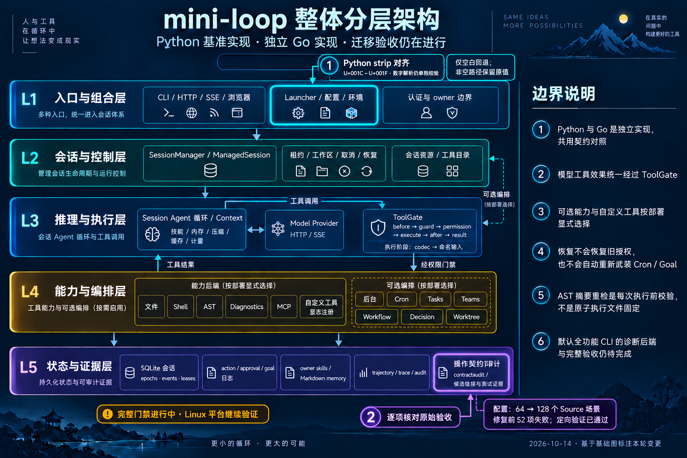

# Required-row closure and configuration whitespace — 2026-10-14

Baseline: local main `995087896e502218fe845ce1639dcb709e831231`.
Branch: `codex/go-required-row-closure`. Original P0/P1/G0–G7 scope is unchanged.

## Small runtime fix

Go `config.Load` now uses the existing `internal/pytext.Strip` where the actual
Python settings source uses `str.strip`. This includes four information
separators, U+001C–U+001F, in booleans, modes, AST fields, blank numeric defaults,
blank roots/spill selection, and decision model/key validation.

Numeric constructors retain their narrower whitespace rules: nonempty input
padded with these separators still fails. Nonempty paths retain their raw value.
The exact raw truthiness of FakeLLM/features, ordinary credentials and other
untrimmed settings is preserved. No dependency or component is added.

`python-configuration.json` now has **128 actual Source recipes**. The original
64 cases, builtin catalogue and runtime source hash are unchanged. The new 64
are four separator characters ×16 finite profiles: 44 successful snapshots and
20 rejected configurations. On the old native implementation 52 new subcases
fail; after the fix the entire config suite passes. Every accepted case compares
all 49 Snapshot fields. Rejected cases compare refusal, not Python diagnostic
class/text. This receipt does not claim universal configuration equivalence.

The original P0/P1/G0–G7 scope remains open. The reviewed inventory has 344
finite rows; this fix resolves one shared configuration family.

## CPU and memory

The user authorized relaxed limits to prioritize progress. Heavy stages remain
serial: `GOMAXPROCS=2`, one package build/test at a time, test parallelism 2,
`GOMEMLIMIT=512MiB` (soft), `GOGC=75`, nice 10. The task process tree is sampled and stopped
at 1.5 GiB RSS, sustained CPU above 300% for 45 seconds, unapproved memory-pressure levels,
or the 1800-second stage wall budget. Fast processes can escape sampling; these are not
hard process memory caps or exact peaks.

## Validation

The [execution receipt](go-required-row-closure-2026-10-14.json) retains commands,
input hashes, terminal counts, resource samples and artifact hashes.

| Gate | Result |
|---|---|
| Go full, atomic coverage | 51 packages passed; 1457 top tests and 11733 subtests passed; 6 top and 1 subtest skipped |
| Go vet | Passed |
| Go full race | 49 packages passed, 2 with no tests; same test counts; no race failures |
| Python full | 2269 passed, 28 skipped, 104 warnings, 24 subtests passed |
| Actual Source exports | All 259 current |
| Invariants / scanning guards | 77 modules / 19 scanners passed |
| Architecture / diff | 9/9 showcase structure checks; diff check passed |

All eight complete-gate stages used the same 1795 frozen inputs. No stage exceeded
its resource budget or left an observed owned process. Sampled tree RSS maxima:
Go 580 MiB, race 532 MiB, Python 372 MiB; sampled CPU maxima 199.8%, 194.3%, 298.9%.
These are sampled observations, not true peaks or hard memory limits.

Application statement coverage is **32393 / 37953 = 85.35%** for this run's
**per-package instrumentation** (no `-coverpkg` flag). All-Go coverage is 85.16%;
provider 82.38%. The 2.05 MB profile is aggregated by streaming and OR-ing duplicate
spans. The previous 89.49% application measurement used `-coverpkg=./...` and
measured cross-package test execution too; the two percentages are not directly
comparable and do not establish a regression. That broader measure was not rerun
for this small fix.

## Architecture delivery

Built-in imagegen edited the complete base image and highlighted only L1 config
and L5 contract audit. The exact prompt is the sibling `.prompt.txt`. No
components were added or removed, so the base image remains unchanged.
README Mermaid and the interactive JSON were updated together; Archify generated
HTML and passed 9/9 showcase structural checks with 0 errors / 0 warnings. Browser HTML
visual inspection remains unavailable under the prior review decision; no
browser visual pass is claimed. The generated PNG was inspected directly.

## Delivery

Commit and local-main integration identities are recorded after validation.
No remote fetch, push or CI refresh is included.
