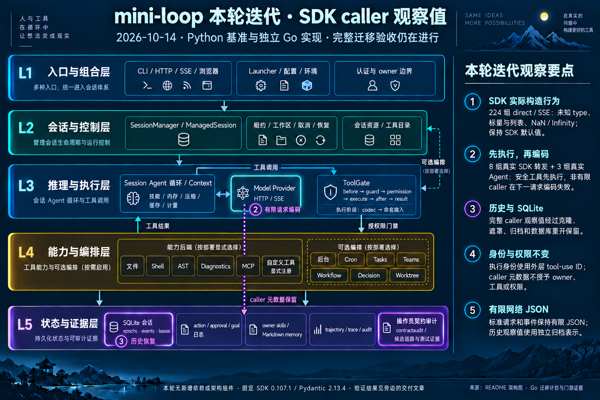

# SDK caller roots, construction defaults and nonfinite observations

Review baseline: local main `ac4d603`; branch
`codex/go-sdk-caller-observations`. This is a G4/G7 provider contract slice;
complete Python-to-Go migration acceptance remains open.

## Actual Source behavior

Fixed Anthropic SDK **0.107.1** and Pydantic **2.13.4** were exercised through
actual `messages.create` / `messages.stream` with offline HTTP MockTransport.
The producer records **224 direct/SSE cases**, **8 actual SDK next-request
forwarding cases**, and **3 actual Source Agent safe-handler runs**.
The previous 160 finite caller-ID fixtures are unchanged.

Captures cover unknown, missing/null/empty/non-text discriminators; scalar,
object and list caller roots; both code caller tags; NaN and positive/negative
Infinity in IDs, discriminator values, roots and extensions. Mapping elements
at the first list level use the SDK's first model branch. Missing `type` becomes
null there, while a code-tagged list element does not acquire a missing ID.
Nested list elements are kept raw, including sparse dictionaries. Streaming
web-fetch retains the SDK's actual ParsedTextBlock fallback and root defaults.

The committed `ac4d603` snapshot failed all 224 comparison rows before the
native change. This was an ordinary test failure with unchanged snapshot
inputs, not a budget stop. The snapshot probe and its fixture are retained
under `var/go-sdk-caller-observations-2026-10-14/before-native/`.

## Native boundaries

`SDKCallerObservation` is a named immutable closed-value representation in
`protocol.ToolCaller`. Provider admission applies captured construction defaults;
historical decode preserves stored values without reapplying SDK defaults or
network size caps. Known tags and text IDs have typed projections. Unknown
roots use a distinct observed kind; they never impersonate a Direct caller.
Strict public caller decoding and explicit construction retain their own rules.

Legacy observation/archive encoding preserves nonfinite metadata through block
clones, masking, messages and SQLite close/reopen. Ordinary request/event JSON
remains finite. Actual SDK and Agent traces establish the ordering: a safe tool
executes once, its result is paired using the outer tool-use ID, then nonfinite
caller data causes next-request encoding to fail before another transport call.
Caller metadata cannot grant owner, tool or permission authority.

The finite sanitizers use UTF-8 encoding before byte-bound checks; temporary
ASCII escaping must not expand valid Unicode and trigger the network cap.
Direct/SSE regressions verify near-limit text and caller values while retaining
oversized, unrelated nonfinite-field and nonfinite execution-ID refusals.
A former test expectation rejecting opaque/unknown callers was corrected against
the actual captured SDK behavior; public explicit admission remains separate.

The first complete Go gate exposed a finite-input regression: unconditional
input stripping substituted null before AST/MCP and other named object decoders.
The sanitizer now strips only values that fail finite encoding specifically
with a nonfinite-number error. Finite input keeps its original named decoder.
The failed gate is retained and is not counted as a pass.

## Validation and resource profile

Final gates ran on identical frozen runtime/Source/canonical inputs:

| Gate | Result |
| --- | --- |
| Full Go with all-package atomic coverage | 51 package passes; 1448 top-level passes, 6 skips |
| Go vet | Passed |
| Full Python | 2259 passed, 28 skipped; 104 warnings; 24 subtests passed |
| Source export `--check` | 256 files current |
| Invariants / scanning guards | 77 modules / 19 guards passed |
| Syntax/public/private/package-variable type audits | All four passed, zero findings |
| Consumer inventory with actual Go results | **Failed**: 255/257 candidate passing associations; IDNA/parser unreferenced |
| Diff check / README outline | Passed |

Statement coverage is application **33818/37821 = 89.4159%**, all Go
**34184/38336 = 89.1694%**, and provider **1575/1827 = 86.2069%**.
The complete atomic profile is streamed and duplicate spans merged by reached
status. This does not measure branches, Python, C or subprocess interiors.
Current race was not rerun; the prior full race pass applies only to `f913d20`.
Python guarded runtime and mutation anchors were unchanged, so mutation guard
verification was not rerun.

The successful complete Go gate took 216.69 seconds; sampled task tree RSS
peaked at **413.06 MiB**, CPU at 188.9%. The earlier code-failing complete gate
peaked at 602.20 MiB. Another attempt was **resource-blocked** after a dead
child was sampled as nice=0 with zero RSS/CPU. Monitoring now records `ps stat`
and excludes only Z-state processes from runnable-priority checks; all actual
CPU/RSS/pressure limits are unchanged. The original monitor and its stop/signals
are retained. No stopped or failed stage is counted as a pass.
Heavy validation runs serially with Go concurrency 2, `-p=1`, `-parallel=2`,
`nice 10`, GOGC 75 and a soft GOMEMLIMIT 512 MiB target. The sampled task tree
budget is 1.5 GiB; sustained CPU above 300% for 45 seconds stops the stage.
Observed system pressure values 1/2 are admitted under the user's explicit
relaxed limits. Fast children can escape sampling; short-stage samples are not
actual workload peak measurements. No unrelated processes are terminated.

## Architecture and delivery

README Mermaid remains canonical. Its review baseline and provider boundary
were updated, the interactive specification was aligned, and HTML was
regenerated with Archify (9/9 structural/composition checks, no errors/warnings).
Rendered HTML inspection remains unavailable because the earlier local browser
review was denied; structural validation is reported separately.

No component was added or removed, so the existing base image remains intact.
The iteration image is edited from that base with built-in imagegen; its exact
initial and correction prompts are retained beside the image.

[Exact image prompt](go-sdk-caller-observations-infographic-2026-10-14.prompt.txt)

IDNA dependency approval, default syntax-parser adoption and fresh fixed-image
Linux full validation remain open. The Docker daemon is unavailable; no Linux
validation is claimed. Read-only-intended OrbStack CLI inspection attempted VM
startup and timed out; it was not repeated. No remote push is included.

[Machine-readable gate, hash and resource receipt](go-sdk-caller-observations-2026-10-14.json).
Local main integration will be recorded after the implementation commit.
