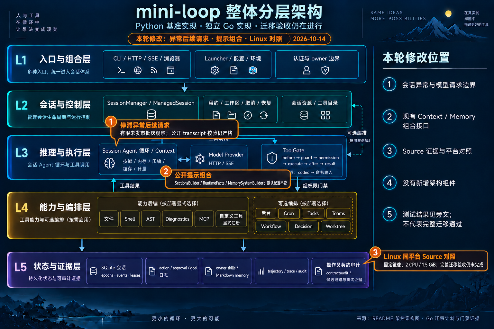

# Post-stuck follow-up, prompt composition and Linux evidence — 2026-10-14

Baseline local main `78d95bc`; iteration branch `codex/go-stuck-followup-linux`.
Full original P0/P1/G0–G7 acceptance remains open.

## Post-stuck follow-up

The previous Source inventory remains byte-for-value equal: 61 direct threshold
cases, 12 actual Agent loops and two managed loops. Two additional fixed-SDK
loops use real Anthropic 0.107.1 / HTTPX 0.28.1 with MockTransport. After the
configured slice fault, the second HTTP request really reaches the local mock,
retaining the unpublished tool batch; its explicit 400 is converted into
assistant error text and an idle terminal session. This is a local transport
observation, not live endpoint acceptance.

The old native baseline fails four direct/fake follow-up subcases and both SDK
subcases. Go now binds one unpublished batch to the complete historical prefix.
Public transcript and ModelRequest validation remain strict; only the dispatch
profile admits that exact observation. An added gap, changed prefix, partial
result batch, non-agent purpose or unrelated compactor error remains invalid.
The observation has no execution authority, is not reconstructed from JSON or
messages, and is absent from restore/child state. The named StuckInspectionError
selects this fault timing; it does not authenticate detector origin, so a custom
caller returning that same public error type also selects it. Ordinary custom
detector errors retain completed-result pairing.

Direct HTTP and SSE controls test actual transport entry, strict refusal before
registration, tampered history, escaped-credential masking and a total 500-rune
diagnostic limit. Secrets are scrubbed from closed JSON strings/keys before
Python-style error formatting. The actual SDK consumer compares both complete
request bodies and two-turn messages, events, errors and terminal state.

## Explicit prompt helpers

31 actual Source cases cover sections (11), runtime facts (13) and memory-system
composition (7). Go exposes SectionsBuilder, RuntimeFacts and MemorySystemBuilder
through the existing typed context/memory seams. It preserves callback order,
empty filtering, whitespace, owner scope, list/index order, current memory
reads and callback/store failures. Inputs and context/store lifetimes remain
caller-owned. There is no automatic Session wiring, default prompt mutation or
arbitrary Python-object stringification guarantee.

The first capture exposed two invalid Settings constructor recipes. They were
removed; the producer does not bypass the frozen public configuration contract.
The corrected Source capture and focused native comparisons pass.

## Linux evidence

The [same-platform receipt](go-linux-platform-source-2026-10-14.md) records six
original Source producers and all eight previous Go minima passing on the
unchanged frozen baseline. Actual Linux output explains the six earlier shell,
path, Git and glob disagreements without runtime/assertion/timeout changes.
These minima do not certify the newly changed runtime or full Linux/vet/race.

## Validation

Final gate counts, hashes, resource observations and delivery commits are in
[the execution receipt](go-stuck-followup-linux-2026-10-14.json).
The required-row delta updates only the seven named aliases/helpers after gates;
all other rows retain their previous evidence and status.

| Gate | Result |
| --- | --- |
| Go ordinary | 51 packages; 1470 top-level and 11789 subtests pass; six top-level/one subtest skip. |
| Go vet / race | vet passes; race has the same passing test counts, 49 passing packages/two no-test packages. |
| Python root, excluding var copies | 2270 pass, 28 skip, 104 warnings, 24 subtests; 91.47s. |
| Source / type audits | 260 exports current; syntax/public/private/variable audits all zero findings. |
| Repository controls | 77 invariants, 19 scan guards, 383 mutation guards pass. |
| Architecture | helper and final HTML deliveries each 9/9, zero errors/warnings. |

Coverage is **85.38% application (32551/38123 statements)** and **82.57%
provider**. Per-package instrumentation matches the preceding 85.35% application
measurement; earlier all-package -coverpkg measurements remain incomparable.
All 1805 gate inputs were equal across the complete runtime checks and final
root Python gate. The final 1797 Go/Python inputs still match those hashes;
only documentation/generated HTML was prepared afterward.

The seven-row delta yields 299 bounded verified, zero recorded concrete
mismatches, five dependency-blocked and 40 incomplete rows. Four updated aliases
represent one fault family; these counts are not a migration completion rate.

The initial root pytest attempt also collected ignored Linux workspace copies
under var and failed collection. Its log remains in the evidence directory;
formal tests passed in explicit project scope, then the complete root suite
passed with --ignore=var. A separate startup was stopped before tests when
the nice wrapper had not yet lowered priority; a pre-niced parent passed
with unchanged resource limits. Failed setup attempts
and baseline counterexamples are kept separately from passing gates.

Heavy stages run serially with GOMAXPROCS=2, -p=1, test parallelism 2, nice 10,
GOMEMLIMIT=512MiB (soft), and monitored task-tree RSS/host pressure. The process
budget is 1.5GiB; Linux containers additionally use a hard 1.5GiB/2CPU bound.
Sampled RSS/CPU are not true peaks and do not cap unrelated applications.

## Architecture and delivery

Built-in imagegen edited the complete layered base. Orange callouts mark the
session/provider boundary, Context helpers and L5 same-platform evidence.
The [exact prompt](go-stuck-followup-linux-infographic-2026-10-14.prompt.txt)
is saved. No architecture component was added or removed, so the base stays
unchanged. README Mermaid remains canonical; the JSON map is regenerated into
HTML with structural acceptance. Generated PNG was visually inspected; no HTML
browser visual acceptance is claimed.

Code commits: `57d563c` adds the typed helpers; `5c1e976` preserves observed
post-stuck follow-up dispatch. A separate documentation commit records the
validation/platform evidence. Delivery targets local main by fast-forward.
No remote push, fetch or CI refresh is claimed. IDNA approval/adoption, default
parser policy, SDK surrogate detail, HTTP/public/feature evidence and complete
platform acceptance remain separate work.
