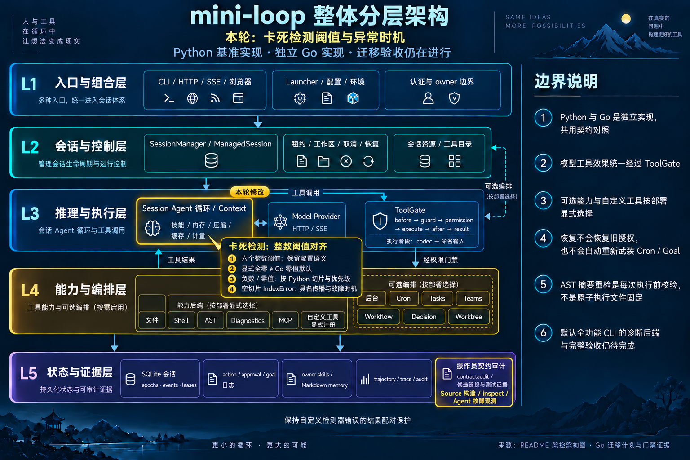

# Public stuck thresholds and fault publication — 2026-10-14

Iteration baseline: local main `6ea2fd264846697150e3bcc2691a690f9f160a7b`;
branch `codex/go-stuck-thresholds`. The previous goal turn made authoritative
progress: runtime `1e9fb10` and evidence `6ea2fd2` were committed and integrated.
This iteration extends the public integer constructor and its real caller
observations. Original P0/P1/G0–G7 acceptance remains open.

## Actual Source evidence

The new producer invokes the public `StuckThresholds` / `DefaultStuckDetector`
constructors and `inspect`, followed by real offline `Agent.run` and
`AgentSession.run` calls. No runtime method or detector is replaced. The tool
handler records a command and returns `same`; no shell or live network runs.
Credentials/environment are isolated by the existing producer boundary.

- 61 direct observations: all constructors accept; 27 no signal, 26 signals,
  eight actual `IndexError: tuple index out of range` faults.
- 12 bare Agent scenarios: defaults, negative/positive disable controls,
  negative/zero/positive nudge budgets, zero monologue, supplied all-zero
  configuration and both repeat-rule faults.
- Two additional real AgentSession fault scenarios, each followed by a second
  user turn on the same wrapper, with status/busy/run count and terminal events.
- Source observations include all six finite integer controls, signed int64
  extrema, default omission/None, zero/negative slices, empty/nonempty/mixed
  windows and rule precedence. Arbitrary Python objects or unbounded integers
  outside the host Go integer range are not certified by this finite corpus.

The initial isolated baseline diagnostic was blocked by the priority watcher;
its stdout also exposed an incorrect probe import. The corrected diagnostic
against archived `6ea2fd2` completed with **29 matches / 32 mismatches** across
61 direct cases. That is a completed diagnostic, not a passing semantic gate;
it does not establish before-implementation loop behavior. The original
`python-loops.json` remains unchanged, with sixteen detector decisions and
five actual Agent loop controls preserved.

Captured values were serialized into the exporter's sorted JSON format with
JSON equality verified; raw unsorted capture and both hashes remain retained.

## Native changes

The named six-field configuration is retained without blanket constructor
rejection. A private configured bit distinguishes an explicitly supplied all-zero
policy from the Go zero-value detector's default policy. `MaxNudges` and
`Inspect` use the same effective configuration.

Monologue is checked first. Nonpositive unproductive thresholds and alternating
thresholds below four disable those individual rules; nonpositive monologue can
fire immediately, and negative nudge budgets halt at the first signal. Repeat
counts instead preserve Python `steps[-n:]`: zero examines the whole window,
negative counts select a suffix. Empty suffixes return a named
`StuckInspectionError`, with fixed Source class/message and rule provenance.
Bounds are checked before negating a negative integer to avoid MinInt overflow.

The built-in fault happens after tool effects/events and step recording, before
result-history publication, matching the observed Source path. It returns an
error without a panic or extra invocation. Other custom-detector errors
retain their completed-result pairing protection. The timing marker is the named
error type; a custom caller deliberately returning that same marker also selects
its Source timing. Managed diagnostics render
`IndexError: tuple index out of range` for this named fault; other errors keep
their existing representation.

## Open caller boundaries

After the first built-in fault, Source retains an unanswered tool use. Its next
user turn attempts the real Fake creation entry; that validator rejects the
request before an accepted model call or new tool effect. Source catches
`InvalidTranscript`, appends error text and returns it. AgentSession therefore
reports idle/done for this second turn.

Native Session retains the first fault's observed history but its common
compactor-output transcript guard refuses the next turn before `Provider.Complete`
(`compactor transcript: ...`). The native
managed wrapper reports error. Request-entry count, returned error versus text,
retained error message and terminal status therefore remain different. The
separately named native boundary tests record that difference; they do not
certify whole-caller parity or normalize the rejected Source request away.
Source managed terminal identity omission versus native scoped headers also
remains unclaimed; only the declared terminal outcome projection is compared.

These observations require further public/default caller reconciliation under
the original goal. IDNA approval/adoption, default parser, escaped lone-surrogate
SDK caller and fixed-environment Linux gates also remain open.

## Validation and delivery

Source capture and focused Python passed (21 tests). Final focused Go passed
11 top-level tests and 98 subtests, including all 61 direct Source observations,
12 initial Agent turns, both initial managed faults and the separately named
post-fault boundary evidence. Earlier import/setup, tool-input decoder and
assumed later-refusal-stage failures remain retained.

Complete Go/atomic passed all 51 packages, with 1,457 top-level tests / six skips
and 11,669 subtests / one skip, in 366.654 seconds. Current successful statement
coverage is application **89.486997% (33,963/37,953)**, all Go **89.240408%
(34,329/38,468)** and provider **86.206897% (1,575/1,827)**. The profile was streamed
and merged by statement span; it does not measure branches, Python, C or child
interiors.

Fresh full race passed 49 packages / two no-test-package skips, with 1,457
top-level passes / six skips and 11,669 subtest passes / one skip, in 536.253
monitored seconds. Six Darwin linker `malformed LC_DYSYMTAB` warnings are
retained in the raw log; no race report was observed. Vet passed in 5.543 seconds.
Source export passed **259 current fixtures**, in 106.015 monitored seconds.
Full Python passed **2,269 tests / 28 skips**, with 104 warnings and 24 subtests
(pytest 98.07 seconds; monitored stage 99.552 seconds). All 77 invariant modules
and 19 anchored scans passed. Three selected mutation guards caught their
mutants: stuck-halt stop rule, model-visible transcript guard and Fake transcript
rejection. Four Go type audits reported zero findings: 468 production files /
1,487 package-level types; 51 packages / 1,214 exported types; 284 private roots;
172 package variables.

The consumer inventory remains **failed (exit 1)**: 258/260 associations have an
observed passing test result; only IDNA and the default parser remain
unreferenced. Candidate associations do not certify complete semantic parity.
The exact stage artifacts, hashes and open caller boundaries are retained in
[the machine receipt](go-stuck-thresholds-2026-10-14.json).

All complete gates used the same unchanged 1,795 frozen inputs. Sampled tree RSS
maxima were complete Go 611,952 KiB (597.61 MiB), race 557,152 KiB (544.09 MiB)
and Python 341,104 KiB (333.11 MiB); sampled CPU maxima were 200.0%, 178.5% and
298.8%. Final serial stages had no budget stops or observed owned-process
leftovers. Pressure values 1 and 2 were observed/admitted. These sample values
are not hard limits or actual workload peaks; earlier stopped/failed attempts
remain separately recorded.

Architecture JSON was regenerated through Archify with nine structural checks;
prior browser-rendering denial is respected and no visual HTML review is claimed.

Heavy stages are serialized with GOMAXPROCS=2, `-p=1`, test `-parallel=2`, nice10,
GOGC75, soft GOMEMLIMIT=512MiB, sampled owned-tree RSS1.5GiB and sustained
CPU300%/45s. Pressure1/2 are admitted. Sampling can miss short-lived children and
double-count shared pages; this is no hard cap on CGO/children or actual peak.
No unrelated processes are terminated.

Built-in imagegen edited the complete base, highlighting the L3 Agent loop and
L5 evidence. Five layers and six boundary notes remain present; no architecture
component was added or removed, so the base image/prompt remain unchanged.
The exact edit prompt is retained beside the iteration image.

Runtime `3a1e44c8d8b3865320bc33a17c5f39b8de3f12b8` is committed and fast-forwarded
into local main. Final evidence is a separate documentation commit. The next planned work is the original
required-row closure audit: capability/default rows, settings, HTTP operations,
SDK producers, public seams and feature profiles, with concrete Source/native
assertions instead of treating association counts as completion.

Raw evidence: `var/go-stuck-thresholds-2026-10-14/`.
Remote refs, push and CI have not been refreshed.
